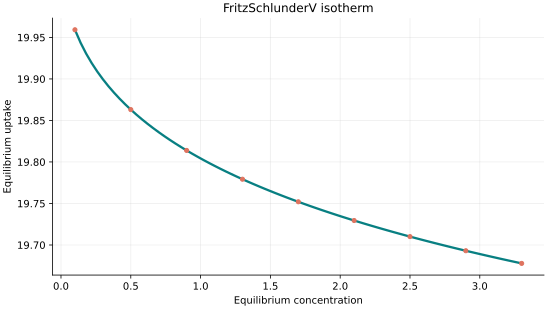
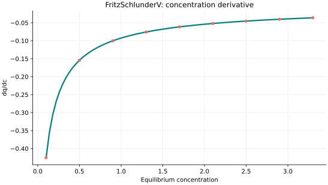
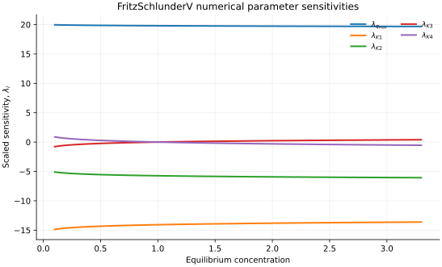

..
   ============================================================================
   Name        : FritzSchlunderV.rst
   Authors     : Joao Flavio Vasconcellos
   Version     : 2.0.0
   Description : Scientific equation, numerical domain and reproducible figures.

   Copyright   : Copyright (C) 2026 Joao Flavio Vasconcellos
   Licence     : MIT License (see LICENSE.txt)
   SPDX-License-Identifier: MIT
   ============================================================================

FritzSchlunderV isotherm
========================

Original publication and scope
------------------------------

Five-parameter Fritz–Schlunder equations extend the empirical family
associated with Fritz and Schlünder (1974). They provide independently
adjustable amplitudes and concentration powers. The five-parameter
parametrisation adopted by a particular software implementation need not
coincide term by term with every published expression bearing this name.

* Fritz, W., and Schlünder, E.-U. (1974), *Simultaneous adsorption equilibria
  of organic solutes in dilute aqueous solutions on activated carbon*,
  *Chemical Engineering Science*, **29** (5), 1279–1282. DOI:
  `10.1016/0009-2509(74)80128-4 <https://doi.org/10.1016/0009-2509(74)80128-4>`_.
* Kumar, K. V., Monteiro de Castro, M. C., Martinez-Escandell, M.,
  Molina-Sabio, M., and Rodriguez-Reinoso, F. (2010), *Adsorption on
  Heterogeneous Surfaces: Site Energy Distribution Functions from
  Fritz–Schlüender Isotherms*, *ChemPhysChem*, **11** (12), 2555–2560. DOI:
  `10.1002/cphc.201000307 <https://doi.org/10.1002/cphc.201000307>`_.

The 2010 study explicitly discusses a five-parameter Fritz–Schlüender
representation and related adsorption-site energy distributions. This does
not establish that fitted coefficients can be interpreted independently as
physical site properties. The ``FritzSchlunderV`` class implements the rational power-law equation
presented below. In contrast, the ``FrenkelHalseyHill`` class implements
a logarithmic multilayer-adsorption model. These formulations are
mathematically distinct and represent different adsorption model families.

Mathematical formulation
------------------------

.. math::

   q=\frac{q_{\max}x^{K_3}}{K_1+K_2 x^{K_4}}

The 5 adjustable parameters are: ``q_max``, ``K1``, ``K2``, ``K3``, ``K4``.
The independent variable is ``concentration``.

All five parameters strictly positive. Saturation and monotonicity depend on the relative powers; no universally bounded uptake is implied.

This equation is also implemented by the other five-parameter class; these two identifiers should not be counted as distinct mathematical families.

Parameter and concentration restrictions:

.. math::

   q_{\mathrm{max}}>0,\quad K_{1}>0,\quad K_{2}>0,\quad K_{3}>0,\quad K_{4}>0,\quad C_e\geq0.

C++20 usage
-----------

.. code-block:: cpp

   #include <isotherm/isotherm.hpp>

   const isotherm::models::FritzSchlunderV model{6.05758, 0.217337, 0.0885359, 0.0169304, 0.0746286};
   const isotherm::Real uptake = isotherm::evaluate(model, 0.5);   // 19.863038
   const isotherm::Real slope = isotherm::derivative(model, 0.5);  // -0.15436923

.. raw:: html

   

     <a class="isotherm-source-action" href="../../../source-browser/include/isotherm/models/FiveParameters/FritzSchlunderV.hpp.html">Implementation</a>
     <a class="isotherm-source-action" href="../../../source-browser/IsothermTest/FiveParameters/FritzSchlunderV/test_fritz_schlunder_v.cpp.html">Tests</a>
     <a class="isotherm-source-action" href="../../../source-browser/Examples/FiveParameters/FritzSchlunderV/main.cpp.html">Example</a>
   

Fritz–Schlunder V isotherm plot
-------------------------------

   Fritz–Schlunder V uptake for :math:`q_{\max}=6.05758`, :math:`K_1=0.217337`,
   :math:`K_2=0.0885359`, :math:`K_3=0.0169304`, :math:`K_4=0.0746286`.

Concentration derivative
------------------------

   Concentration derivative of Fritz–Schlunder V uptake for :math:`q_{\max}=6.05758`,
   :math:`K_1=0.217337`, :math:`K_2=0.0885359`, :math:`K_3=0.0169304`,
   :math:`K_4=0.0746286`.

Numerical sensitivity
---------------------

For every model parameter :math:`k_i`, the scaled sensitivity is

.. math::

   \lambda_i(C_e)=k_i\frac{\partial q_e}{\partial k_i}.

Numerical values are obtained by perturbing individual parameters and evaluating new instances of the C++ model. The accompanying C++20 example performs this procedure.

   Scaled sensitivities :math:`\lambda_{q_{\max}}`, :math:`\lambda_{K_1}`,
   :math:`\lambda_{K_2}`, :math:`\lambda_{K_3}`, :math:`\lambda_{K_4}` versus equilibrium
   concentration.

Validation and limitations
--------------------------

.. math::

   q_{\mathrm{max}}>0,\quad K_{1}>0,\quad K_{2}>0,\quad K_{3}>0,\quad K_{4}>0,\quad C_e\geq0.
