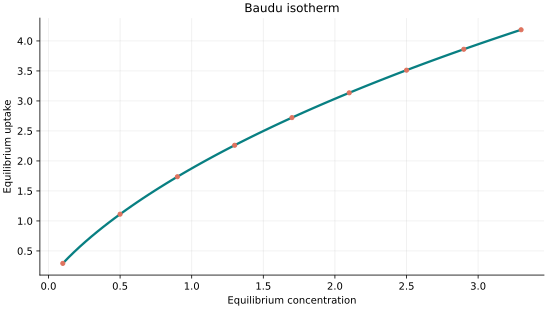
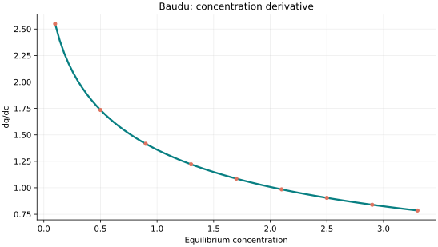
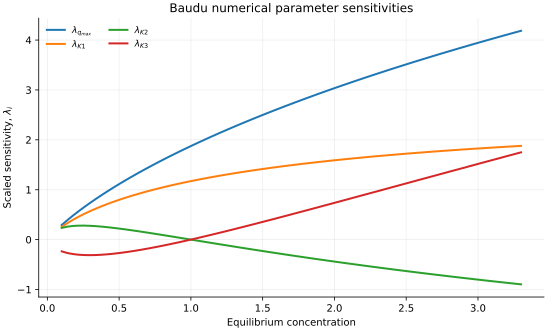

..
   ==============================================================================
   Name        : Baudu.rst
   Authors     : Joao Flavio Vasconcellos
   Version     : 2.0.0
   Description : Scientifically annotated four-parameter model equation and implementation.

   Copyright   : Copyright (C) 2026 Joao Flavio Vasconcellos
   Licence     : MIT License (see LICENSE.txt)
   SPDX-License-Identifier: MIT
   ==============================================================================

Baudu isotherm
==============

Original publication and scope
------------------------------

Baudu's four-parameter equation is an empirical modification of the
Langmuir adsorption relation, introduced to accommodate concentration-
dependent behaviour that cannot be represented adequately by a single
Langmuir affinity and capacity over an extended concentration range.
The original work concerns solute interactions with activated-carbon
fibres. The source identified below is a doctoral thesis rather than a
journal article; its original derivation has not been independently
checked against the thesis text in this documentation update.

Baudu, M. (1990), *Etude des interactions solutes-fibres de charbon actif:
applications et regeneration*, doctoral thesis, Universite de Rennes 1,
France. `Thesis record <https://www.theses.fr/1990REN10039>`_.

Foo, K. Y., and Hameed, B. H. (2010), *Insights into the modeling of
adsorption isotherm systems*, *Chemical Engineering Journal*, **156** (1),
2–10. `DOI: 10.1016/j.cej.2009.09.013
<https://doi.org/10.1016/j.cej.2009.09.013>`_. This review provides
context for multi-parameter adsorption-equilibrium correlations.

Essam, A., Eldek, S. I., and Shehata, N. (2024), *Management of caffeine
in wastewater using MOF and perovskite materials: optimization, kinetics,
and adsorption isotherm modelling*, *Journal of Environmental Health
Science and Engineering*, **22**, 345–360.
`DOI: 10.1007/s40201-024-00904-2
<https://doi.org/10.1007/s40201-024-00904-2>`_. The authors compared
Baudu with several other adsorption models for caffeine uptake on UiO-66
and a lanthanum-strontium ferrite perovskite. Their perovskite fit is
reported with :math:`R^2=0.86`; this value is specific to that dataset
and is not evidence of general superiority.

Ramadoss, R., Gunasekaran, D., and Subramanian, D. (2022), *Removal of
Divalent Nickel from Aqueous Solution Using Blue Green Marine Algae:
Adsorption Modelling and Applicability of Various Isotherm Models*, in
*Progress in Microalgae Research - A Path for Shaping Sustainable Futures*,
IntechOpen. `DOI: 10.5772/intechopen.103940
<https://doi.org/10.5772/intechopen.103940>`_. This comparison evaluates
Baudu among four-parameter models but cautions that goodness-of-fit
statistics alone do not ensure physically interpretable parameters.

Mathematical formulation
------------------------

.. math::

   q_e=\frac{q_{\max}K_1c_e^{1-K_2+K_3}}{1+K_1c_e^{1-K_2}}

The coefficient named :math:`q_{\max}` in the implementation is a
multiplicative scale. For the general fitted exponents it is **not**
necessarily a finite saturation capacity. At low concentrations, the
response has a Freundlich-type power-law asymptote; the leading power
depends on whether :math:`K_2` lies below, at, or above unity. For
:math:`K_2<1`, in particular,

.. math::

   q_e \sim q_{\max}K_1 C_e^{1-K_2+K_3}\qquad(C_e\to0^+).

For :math:`K_2>1`, the leading low-concentration power is
:math:`q_e\sim q_{\max} C_e^{K_3}`. The parameter constraints below
are those enforced by the current C++ implementation and should not
be interpreted as restrictions verified against Baudu's original thesis.

The four independently adjustable parameters are ``q_max``,
``K1``, ``K2`` and ``K3``.
No temperature parameter is required by this implementation.

All parameters are strictly positive; 0 < K3 < 1 and K2 < 1 + K3. The latter condition ensures a continuous zero-concentration limit and increasing response, a deliberate tightening of the original implementation.

Finite and non-negative concentrations are accepted. The response at zero
concentration is defined by its continuous zero limit. The derivative is
analytical and is evaluated only for strictly positive concentration.

Parameter and concentration restrictions:

.. math::

   q_{\mathrm{max}}>0,\quad K_{1}>0,\quad K_{2}>0,\quad K_{3}>0,\quad 0<K_3<1,\quad K_2<1+K_3,\quad C_e\geq0.

C++20 usage
-----------

.. code-block:: cpp

   #include <isotherm/isotherm.hpp>

   const isotherm::models::Baudu model{1.95325, 0.513664, 0.0435246, 0.00605498};
   const isotherm::Real uptake = isotherm::evaluate(model, 0.8);   // 0.57203102
   const isotherm::Real slope = isotherm::derivative(model, 0.8);  // 0.48768303

.. raw:: html

   

     <a class="isotherm-source-action" href="../../../source-browser/include/isotherm/models/FourParameters/Baudu.hpp.html">Implementation</a>
     <a class="isotherm-source-action" href="../../../source-browser/IsothermTest/FourParameters/Baudu/test_baudu.cpp.html">Tests</a>
     <a class="isotherm-source-action" href="../../../source-browser/Examples/FourParameters/Baudu/main.cpp.html">Example</a>
   

Baudu isotherm plot
-------------------

   Baudu uptake for :math:`q_{\max}=5`, :math:`K_1=0.6`, :math:`K_2=0.4`, :math:`K_3=0.35`.

Concentration derivative
------------------------

   Concentration derivative of Baudu uptake for :math:`q_{\max}=5`, :math:`K_1=0.6`,
   :math:`K_2=0.4`, :math:`K_3=0.35`.

Numerical sensitivity
---------------------

For every model parameter :math:`k_i`, the scaled sensitivity is

.. math::

   \lambda_i(C_e)=k_i\frac{\partial q_e}{\partial k_i}.

Numerical values are obtained by perturbing individual parameters and evaluating new instances of the C++ model. The accompanying C++20 example performs this procedure.

   Scaled sensitivities :math:`\lambda_{q_{\max}}`, :math:`\lambda_{K_1}`,
   :math:`\lambda_{K_2}`, :math:`\lambda_{K_3}` versus equilibrium concentration.

Validation and limitations
--------------------------

.. math::

   q_{\mathrm{max}}>0,\quad K_{1}>0,\quad K_{2}>0,\quad K_{3}>0,\quad 0<K_3<1,\quad K_2<1+K_3,\quad C_e\geq0.
