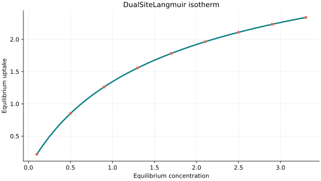
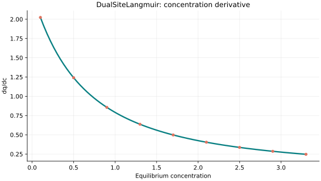
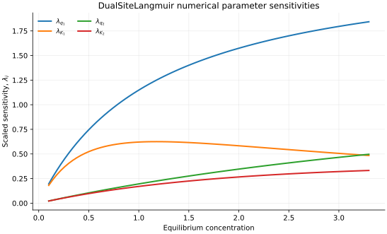

..
   ============================================================================
   Name        : DualSiteLangmuir.rst
   Authors     : Joao Flavio Vasconcellos
   Version     : 2.0.0
   Description : Scientific equation, numerical domain and reproducible figures.

   Copyright   : Copyright (C) 2026 Joao Flavio Vasconcellos
   Licence     : MIT License (see LICENSE.txt)
   SPDX-License-Identifier: MIT
   ============================================================================

DualSiteLangmuir isotherm
=========================

Original publication and scope
------------------------------

The dual-site Langmuir (DSL) model describes adsorption on two
populations of sites, each represented by a Langmuir term with its own
capacity and affinity. It extends the single-site relation established by
Langmuir (1918). The four coefficients used here describe a *single*
adsorbate at a fixed temperature. This C++ class does not implement
multicomponent competition or the additional constraints required for a
thermodynamically consistent mixture model.

Langmuir, I. (1918), *The Adsorption of Gases on Plane Surfaces of Glass,
Mica and Platinum*, *Journal of the American Chemical Society*, **40**
(9), 1361–1403. `DOI: 10.1021/ja02242a004
<https://doi.org/10.1021/ja02242a004>`_. This is the original
single-site Langmuir foundation, not a publication proposing the
four-parameter DSL model.

Mathias, P. M., Kumar, R., Moyer, J. D., Schork, J. M., Srinivasan,
S. R., Auvil, S. R., and Talu, O. (1996), *Correlation of Multicomponent
Gas Adsorption by the Dual-Site Langmuir Model. Application to
Nitrogen/Oxygen Adsorption on 5A-Zeolite*, *Industrial & Engineering
Chemistry Research*, **35** (7), 2477–2483.
`DOI: 10.1021/ie950291y <https://doi.org/10.1021/ie950291y>`_.
This study develops and examines a thermodynamically consistent
multicomponent DSL treatment and illustrates it with nitrogen/oxygen
adsorption on 5A zeolite.

Brandani, S. (2024), *On adsorption azeotropy and a classification based
on the dual site Langmuir isotherm*, *Adsorption*, **30**, 1593–1601.
`DOI: 10.1007/s10450-023-00430-x
<https://doi.org/10.1007/s10450-023-00430-x>`_. The analysis uses a
thermodynamically consistent binary DSL formulation to classify
adsorption azeotropy; its mixture-level conclusions cannot be obtained
from the present single-component function alone.

Zhao, C., Yang, Y., Sun, H., Zhong, J., Zhang, K., Wang, K., Zhang,
L., and Yao, J. (2024), *Pore-Scale Simulation of Deep Shale Gas Flow
Considering the Dual-Site Langmuir Adsorption Model Based on the Pore
Network Model*, *Langmuir*, **40** (43), 22844–22855.
`DOI: 10.1021/acs.langmuir.4c02889
<https://doi.org/10.1021/acs.langmuir.4c02889>`_. This is a recent
example of DSL use in shale-gas transport modelling.

Mathematical formulation
------------------------

.. math::

   q=\frac{q_1K_1x}{1+K_1x}+\frac{q_2K_2x}{1+K_2x}

With positive parameters, :math:`q_e(0)=0` and the limiting
uptake is :math:`q_1+q_2` as :math:`C_e\to\infty`. Swapping the two
site pairs :math:`(q_1,K_1)` and :math:`(q_2,K_2)` leaves the curve
unchanged, so the pair labels are not independently identifiable from
single-component equilibrium data. When :math:`K_1=K_2`, the expression
reduces to one Langmuir term with combined capacity :math:`q_1+q_2`.

The 4 adjustable parameters are: ``q_1``, ``K_1``, ``q_2``, ``K_2``.
The independent variable is ``concentration``.

All parameters positive. Concentration-dependent, at fixed temperature; asymptotic uptake q_1+q_2.

Parameter values are illustrative and not estimates from experimental data. The mathematical representation does not establish experimental validity.

Parameter and concentration restrictions:

.. math::

   q_{1}>0,\quad K_{1}>0,\quad q_{2}>0,\quad K_{2}>0,\quad C_e\geq0.

C++20 usage
-----------

.. code-block:: cpp

   #include <isotherm/isotherm.hpp>

   const isotherm::models::DualSiteLangmuir model{2.5, 0.85, 1.5, 0.15};
   const isotherm::Real uptake = isotherm::evaluate(model, 0.5);   // 0.8502652
   const isotherm::Real slope = isotherm::derivative(model, 0.5);  // 1.2411757

.. raw:: html

   

     <a class="isotherm-source-action" href="../../../source-browser/include/isotherm/models/FourParameters/DualSiteLangmuir.hpp.html">Implementation</a>
     <a class="isotherm-source-action" href="../../../source-browser/IsothermTest/FourParameters/DualSiteLangmuir/test_dual_site_langmuir.cpp.html">Tests</a>
     <a class="isotherm-source-action" href="../../../source-browser/Examples/FourParameters/DualSiteLangmuir/main.cpp.html">Example</a>
   

Dual-site Langmuir isotherm plot
--------------------------------

   Dual-Site Langmuir uptake for :math:`q_1=2.5`, :math:`K_1=0.85`, :math:`q_2=1.5`,
   :math:`K_2=0.15`.

Concentration derivative
------------------------

   Concentration derivative of Dual-Site Langmuir uptake for :math:`q_1=2.5`,
   :math:`K_1=0.85`, :math:`q_2=1.5`, :math:`K_2=0.15`.

Numerical sensitivity
---------------------

For every model parameter :math:`k_i`, the scaled sensitivity is

.. math::

   \lambda_i(C_e)=k_i\frac{\partial q_e}{\partial k_i}.

Numerical values are obtained by perturbing individual parameters and evaluating new instances of the C++ model. The accompanying C++20 example performs this procedure.

   Scaled sensitivities :math:`\lambda_{q_1}`, :math:`\lambda_{K_1}`, :math:`\lambda_{q_2}`,
   :math:`\lambda_{K_2}` versus equilibrium concentration.

Validation and limitations
--------------------------

.. math::

   q_{1}>0,\quad K_{1}>0,\quad q_{2}>0,\quad K_{2}>0,\quad C_e\geq0.
