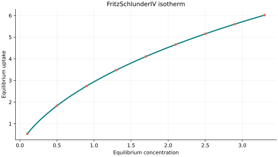
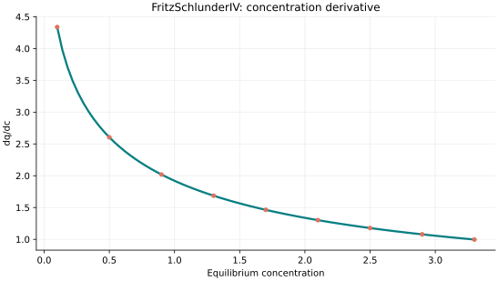
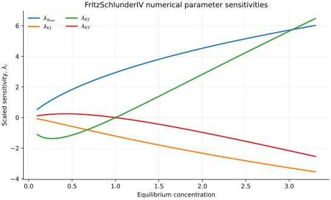

..
   ==============================================================================
   Name        : FritzSchlunderIV.rst
   Authors     : Joao Flavio Vasconcellos
   Version     : 2.0.0
   Description : Scientifically annotated four-parameter model equation and implementation.

   Copyright   : Copyright (C) 2026 Joao Flavio Vasconcellos
   Licence     : MIT License (see LICENSE)
   SPDX-License-Identifier: MIT
   ==============================================================================

Fritz–Schlunder IV isotherm
===========================

Original publication and scope
------------------------------

Fritz and Schlünder (1974) developed empirical relations for
adsorption equilibria of organic solutes on activated carbon. The
four-parameter expression implemented here is one member of the family;
different publications use distinct coefficient and exponent
conventions. The formula below, rather than the model name alone,
defines the library implementation. A strong regression fit does not by
itself identify the microscopic adsorption mechanism.

Fritz, W., and Schlünder, E.-U. (1974), *Simultaneous adsorption
equilibria of organic solutes in dilute aqueous solutions on activated
carbon*, *Chemical Engineering Science*, **29** (5), 1279–1282.
`DOI: 10.1016/0009-2509(74)80128-4
<https://doi.org/10.1016/0009-2509(74)80128-4>`_.

Kumar, K. V., Monteiro de Castro, M. C., Martinez-Escandell, M.,
Molina-Sabio, M., and Rodriguez-Reinoso, F. (2010), *Adsorption on
Heterogeneous Surfaces: Site Energy Distribution Functions from
Fritz–Schlüender Isotherms*, *ChemPhysChem*, **11** (12), 2555–2560.
`DOI: 10.1002/cphc.201000307 <https://doi.org/10.1002/cphc.201000307>`_.
This analysis examines site-energy distributions for Fritz–Schlünder
models but does not imply a unique microscopic interpretation of an
arbitrary four-parameter fit.

Kumar, M., Sujatha, S., Gokulan, R., Vijayakumar, A., Praveen, S.,
and Elayaraja, S. (2021), *Prediction of RSM and ANN in the
decolorization of Reactive Orange 16 using biochar derived from Ulva
lactuca*, *Desalination and Water Treatment*, **211**, 304–318.
`DOI: 10.5004/dwt.2021.26615 <https://doi.org/10.5004/dwt.2021.26615>`_.
Fritz–Schlünder IV and Marczewski–Jaroniec were reported as the
best-fitting models for these dye-adsorption data, with a reported
:math:`R^2=0.9999`. This paper was published in **2021**, not 2024.

Nouacer, I., Hammadi, S., Benalia, M., Djedid, M., and Bencheikh,
S. E. (2023), *Biosorption of carcinogenic metal ions using the immobilized
microalgae Auxenochlorella protothecoides on a lignocellulosic matrix:
Optimization, kinetics, isotherm and mechanism*, *South African Journal
of Botany*, **157**, 297–313.
`DOI: 10.1016/j.sajb.2023.02.023
<https://doi.org/10.1016/j.sajb.2023.02.023>`_. The authors compared
nonlinear equilibrium models for nickel biosorption and selected
Fritz–Schlünder IV using several error functions. A model ranking for
this dataset does not establish universal predictive performance.

Mathematical formulation
------------------------

.. math::

   q_e=\frac{q_{\max}c_e^{K_2}}{1+K_1c_e^{K_3}}

The denominator and numerator exponents control the asymptotic
response independently. For :math:`C_e\to\infty`,

.. math::

   q_e\sim\frac{q_{\max}}{K_1}C_e^{K_2-K_3}.

Thus the scale :math:`q_{\max}` does not in general represent a
saturation capacity. In the special case :math:`K_2=K_3=1`, the
expression becomes a Langmuir curve with affinity :math:`K_1` and
limiting uptake :math:`q_{\max}/K_1`, not :math:`q_{\max}`.

The four independently adjustable parameters are ``q_max``,
``K1``, ``K2`` and ``K3``.
No temperature parameter is required by this implementation.

All four parameters are strictly positive; 0 < K3 <= 1. Depending on the exponents the response can increase without saturation or turn over; the library does not silently enforce a monotonic subfamily.

Finite and non-negative concentrations are accepted. The response at zero
concentration is defined by its continuous zero limit. The derivative is
analytical and is evaluated only for strictly positive concentration.

Parameter and concentration restrictions:

.. math::

   q_{\mathrm{max}}>0,\quad K_{1}>0,\quad K_{2}>0,\quad K_{3}>0,\quad 0<K_3\leq1,\quad C_e\geq0.

C++20 usage
-----------

.. code-block:: cpp

   #include <isotherm/isotherm.hpp>

   const isotherm::models::FritzSchlunderIV model{71.3166, 0.357335, 0.779255, 0.669959};
   const isotherm::Real uptake = isotherm::evaluate(model, 0.8);   // 45.831032
   const isotherm::Real slope = isotherm::derivative(model, 0.8);  // 35.611192

.. raw:: html

   

     <a class="isotherm-source-action" href="../../../source-browser/include/isotherm/models/FourParameters/FritzSchlunderIV.hpp.html">Implementation</a>
     <a class="isotherm-source-action" href="../../../source-browser/IsothermTest/FourParameters/FritzSchlunderIV/test_fritz_schlunder_i_v.cpp.html">Tests</a>
     <a class="isotherm-source-action" href="../../../source-browser/Examples/FourParameters/FritzSchlunderIV/main.cpp.html">Example</a>
   

Fritz–Schlunder IV isotherm plot
--------------------------------

   Fritz–Schlunder IV uptake for :math:`q_{\max}=5`, :math:`K_1=0.7`, :math:`K_2=0.9`,
   :math:`K_3=0.6`.

Concentration derivative
------------------------

   Concentration derivative of Fritz–Schlunder IV uptake for :math:`q_{\max}=5`,
   :math:`K_1=0.7`, :math:`K_2=0.9`, :math:`K_3=0.6`.

Numerical sensitivity
---------------------

For every model parameter :math:`k_i`, the scaled sensitivity is

.. math::

   \lambda_i(C_e)=k_i\frac{\partial q_e}{\partial k_i}.

Numerical values are obtained by perturbing individual parameters and evaluating new instances of the C++ model. The accompanying C++20 example performs this procedure.

   Scaled sensitivities :math:`\lambda_{q_{\max}}`, :math:`\lambda_{K_1}`,
   :math:`\lambda_{K_2}`, :math:`\lambda_{K_3}` versus equilibrium concentration.

Validation and limitations
--------------------------

.. math::

   q_{\mathrm{max}}>0,\quad K_{1}>0,\quad K_{2}>0,\quad K_{3}>0,\quad 0<K_3\leq1,\quad C_e\geq0.
