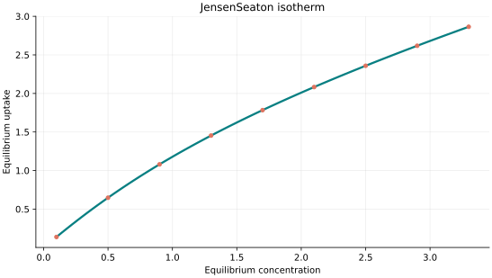
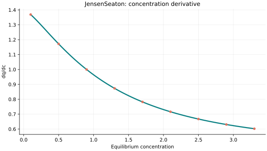
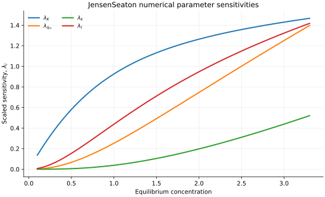

..
   ============================================================================
   Name        : JensenSeaton.rst
   Authors     : Joao Flavio Vasconcellos
   Version     : 2.0.0
   Description : Scientific equation, numerical domain and reproducible figures.

   Copyright   : Copyright (C) 2026 Joao Flavio Vasconcellos
   Licence     : MIT License (see LICENSE.txt)
   SPDX-License-Identifier: MIT
   ============================================================================

JensenSeaton isotherm
=====================

Original publication and scope
------------------------------

Jensen, C. R. C., and Seaton, N. A. (1996), *An Isotherm Equation for
Adsorption to High Pressures in Microporous Adsorbents*, *Langmuir*,
**12** (11), 2866–2867. `DOI: 10.1021/la9509460
<https://doi.org/10.1021/la9509460>`_. This is the original source for
the Jensen–Seaton relation. The equation interpolates between a Henry-law
limit at low pressure and a high-pressure response that continues to rise,
instead of enforcing a horizontal saturation plateau. The latter behaviour
accounts empirically for compression of adsorbate within micropores.

The equation below is the four-parameter form also described in the
`pyGAPS Jensen–Seaton model documentation
<https://pygaps.readthedocs.io/en/master/_modules/pygaps/modelling/jensenseaton.html>`_.
The Isotherm++ interface names its independent argument equilibrium
``concentration``. For comparison with gas-pressure measurements, the
independent variable, its numerical value and the fitted coefficients must
use mutually consistent units; the class does not calculate an equation
of state or convert concentration into pressure automatically.

Rivera-Torrente, M., Kroon, D., Coulet, M.-V., et al. (2022),
*Understanding the Effects of Binders in Gas Sorption and Acidity of
Aluminium Fumarate Extrudates*, *Chemistry – A European Journal*,
**28** (5), e202103420. `DOI: 10.1002/chem.202103420
<https://doi.org/10.1002/chem.202103420>`_. This application fitted
single-component CO2 and CH4 measurements on aluminium fumarate
materials using three-site Jensen–Seaton expressions and then estimated
mixture selectivity using IAST. Its three-site construction and IAST
calculation are additional operations, not features of the present
four-parameter C++ class. The journal issue is dated **2022**, not 2023.

The cited papers do not establish that one fitted curve is preferable for
all microporous materials. Model selection remains dependent on the
pressure range, sorbent, temperature and observational uncertainty.

Mathematical formulation
------------------------

.. math::

   q=Kx\left[1+\left(\frac{Kx}{q_m(1+kx)}\right)^t\right]^{-1/t}

The 4 adjustable parameters are: ``K``, ``q_m``, ``k``, ``t``.
The independent variable is ``concentration``.

All four parameters strictly positive; q increases without a hard horizontal high-pressure plateau.

Parameter values are illustrative and not estimates from experimental data. The mathematical representation does not establish experimental validity.

Parameter and concentration restrictions:

.. math::

   K>0,\quad q_{\mathrm{m}}>0,\quad k>0,\quad t>0,\quad C_e\geq0.

C++20 usage
-----------

.. code-block:: cpp

   #include <isotherm/isotherm.hpp>

   const isotherm::models::JensenSeaton model{1.4, 3, 0.18, 1.4};
   const isotherm::Real uptake = isotherm::evaluate(model, 0.5);   // 0.64740681
   const isotherm::Real slope = isotherm::derivative(model, 0.5);  // 1.1717692

.. raw:: html

   

     <a class="isotherm-source-action" href="../../../source-browser/src/isotherm/models/FourParameters/JensenSeaton.hpp.html">Implementation</a>
     <a class="isotherm-source-action" href="../../../source-browser/IsothermTest/FourParameters/JensenSeaton/test_jensen_seaton.cpp.html">Tests</a>
     <a class="isotherm-source-action" href="../../../source-browser/Examples/FourParameters/JensenSeaton/main.cpp.html">Example</a>
   

Jensen–Seaton isotherm plot
---------------------------

   Jensen–Seaton uptake for :math:`K=1.4`, :math:`q_m=3`, :math:`k=0.18`, :math:`t=1.4`.

Concentration derivative
------------------------

   Concentration derivative of Jensen–Seaton uptake for :math:`K=1.4`, :math:`q_m=3`,
   :math:`k=0.18`, :math:`t=1.4`.

Numerical sensitivity
---------------------

For every model parameter :math:`k_i`, the scaled sensitivity is

.. math::

   \lambda_i(C_e)=k_i\frac{\partial q_e}{\partial k_i}.

Numerical values are obtained by perturbing individual parameters and evaluating new instances of the C++ model. The accompanying C++20 example performs this procedure.

   Scaled sensitivities :math:`\lambda_{K}`, :math:`\lambda_{q_m}`, :math:`\lambda_{k}`,
   :math:`\lambda_{t}` versus equilibrium concentration.

Validation and limitations
--------------------------

.. math::

   K>0,\quad q_{\mathrm{m}}>0,\quad k>0,\quad t>0,\quad C_e\geq0.
