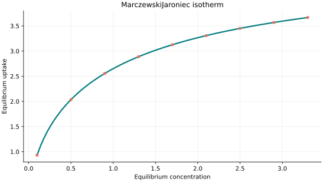
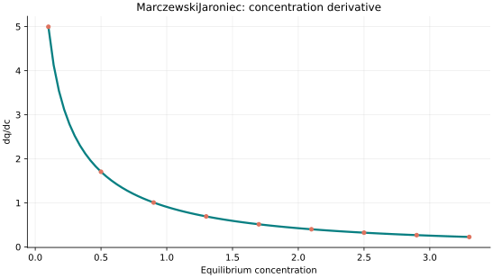
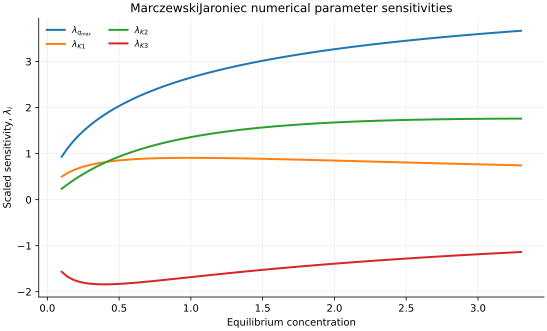

..
   ==============================================================================
   Name        : MarczewskiJaroniec.rst
   Authors     : Joao Flavio Vasconcellos
   Version     : 2.0.0
   Description : Scientifically annotated four-parameter model equation and implementation.

   Copyright   : Copyright (C) 2026 Joao Flavio Vasconcellos
   Licence     : MIT License (see LICENSE.txt)
   SPDX-License-Identifier: MIT
   ==============================================================================

Marczewski–Jaroniec isotherm
============================

Original publication and scope
------------------------------

Marczewski, A. W., and Jaroniec, M. (1983), *A New Isotherm Equation
for Single-Solute Adsorption from Dilute Solutions on Energetically
Heterogeneous Solids*, *Monatshefte für Chemie*, **114** (6), 711–715.
`DOI: 10.1007/BF01134184
<https://doi.org/10.1007/BF01134184>`_. This is a primary source for
generalised adsorption-isotherm relations based on local adsorption and
distributions of adsorption energies over heterogeneous solids.

Marczewski, A. W., Derylo-Marczewska, A., and Jaroniec, M. (1986),
*Energetic heterogeneity and molecular size effects in physical
adsorption on solid surfaces*, *Journal of Colloid and Interface
Science*, **109** (2), 310–324. `DOI: 10.1016/0021-9797(86)90309-7
<https://doi.org/10.1016/0021-9797(86)90309-7>`_. The later study
examines the effects of site-energy heterogeneity and adsorbate size.
Its correct volume and pages are **109**, 310–324, not 114, 319–327.

Dan-Iya, B. I., and Shukor, M. Y. (2023), *Isothermal Modelling of the
Adsorption of Crystal Violet onto Modified Charred Rice Husk*, *Journal
of Environmental Microbiology and Toxicology*, **11** (1), 1–9.
`DOI: 10.54987/jemat.v11i1.837
<https://doi.org/10.54987/jemat.v11i1.837>`_. This nonlinear regression
study assessed Marczewski–Jaroniec amongst a range of candidate models.
For these data it identified **Jovanovic**, rather than Marczewski–Jaroniec,
as the preferred model according to its reported statistical selection.

The four-parameter expression below defines the particular
Marczewski–Jaroniec parametrisation used by Isotherm++. It should not be
assumed to be numerically interchangeable with every equation labelled
``Marczewski–Jaroniec`` in the literature; the exponents, affinity
convention and admissible parameter ranges must be compared first.

Mathematical formulation
------------------------

.. math::

   q_e=q_{\max}\left[\frac{(K_1c_e)^{K_2}}{1+(K_1c_e)^{K_2}}\right]^{K_3/K_2}

The four independently adjustable parameters are ``q_max``,
``K1``, ``K2`` and ``K3``.
No temperature parameter is required by this implementation.

All parameters are strictly positive and 0 < K3 < 1. The model is saturating and approaches q_max as concentration tends to infinity.

Finite and non-negative concentrations are accepted. The response at zero
concentration is defined by its continuous zero limit. The derivative is
analytical and is evaluated only for strictly positive concentration.

Parameter and concentration restrictions:

.. math::

   q_{\mathrm{max}}>0,\quad K_{1}>0,\quad K_{2}>0,\quad K_{3}>0,\quad 0<K_3<1,\quad C_e\geq0.

C++20 usage
-----------

.. code-block:: cpp

   #include <isotherm/isotherm.hpp>

   const isotherm::models::MarczewskiJaroniec model{4.99159, 0.240965, 0.0686414, 0.0818727};
   const isotherm::Real uptake = isotherm::evaluate(model, 0.8);   // 2.0374566
   const isotherm::Real slope = isotherm::derivative(model, 0.8);  // 0.11014187

.. raw:: html

   

     <a class="isotherm-source-action" href="../../../source-browser/src/isotherm/models/FourParameters/MarczewskiJaroniec.hpp.html">Implementation</a>
     <a class="isotherm-source-action" href="../../../source-browser/IsothermTest/FourParameters/MarczewskiJaroniec/test_marczewski_jaroniec.cpp.html">Tests</a>
     <a class="isotherm-source-action" href="../../../source-browser/Examples/FourParameters/MarczewskiJaroniec/main.cpp.html">Example</a>
   

Marczewski–Jaroniec isotherm plot
---------------------------------

   Marczewski–Jaroniec uptake for :math:`q_{\max}=5`, :math:`K_1=0.7`, :math:`K_2=0.8`,
   :math:`K_3=0.6`.

Concentration derivative
------------------------

   Concentration derivative of Marczewski–Jaroniec uptake for :math:`q_{\max}=5`,
   :math:`K_1=0.7`, :math:`K_2=0.8`, :math:`K_3=0.6`.

Numerical sensitivity
---------------------

For every model parameter :math:`k_i`, the scaled sensitivity is

.. math::

   \lambda_i(C_e)=k_i\frac{\partial q_e}{\partial k_i}.

Numerical values are obtained by perturbing individual parameters and evaluating new instances of the C++ model. The accompanying C++20 example performs this procedure.

   Scaled sensitivities :math:`\lambda_{q_{\max}}`, :math:`\lambda_{K_1}`,
   :math:`\lambda_{K_2}`, :math:`\lambda_{K_3}` versus equilibrium concentration.

Validation and limitations
--------------------------

.. math::

   q_{\mathrm{max}}>0,\quad K_{1}>0,\quad K_{2}>0,\quad K_{3}>0,\quad 0<K_3<1,\quad C_e\geq0.
