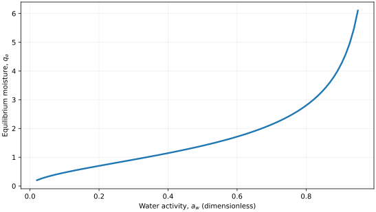
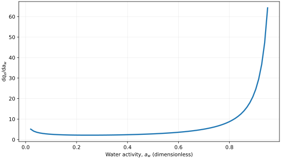
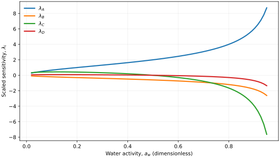

..
   ==============================================================================
   Name        : Oswin.rst
   Authors     : Joao Flavio Vasconcellos
   Version     : 2.0.0
   Description : Four-parameter temperature-dependent extension of the Oswin isotherm.

   Copyright   : Copyright (C) 2026 Joao Flavio Vasconcellos
   Licence     : MIT License (see LICENSE.txt)
   SPDX-License-Identifier: MIT
   ==============================================================================

Oswin isotherm
==============

Original publication and scope
------------------------------

The original empirical **two-parameter** moisture-sorption equation
was introduced by Oswin, C. R. (1946), *The kinetics of package life.
III. The isotherm*, *Journal of the Society of Chemical Industry*,
**65** (12), 419–421. `DOI: 10.1002/jctb.5000651216
<https://doi.org/10.1002/jctb.5000651216>`_. The original work was
concerned with sorption by hygroscopic materials and the shelf life of
packaged products.

The established **modified Oswin** equation introduces a linear
variation of its amplitude with temperature, while retaining a
constant exponent, :math:`(A+BT)[a_w/(1-a_w)]^{1/C}`. This
three-coefficient form is described in `Mathematical Modeling and
Hysteresis of Sorption Isotherms for Paddy Rice Grains (2019)
<https://doi.org/10.1590/1809-4430-Eng.Agric.v39n4p524-532/2019>`_
and was applied in `Desorption Isotherms of Grain Sorghum Flour (2024)
<https://doi.org/10.1590/1809-4430-Eng.Agric.v44e20230063/2024>`_.

Kimani, P. K., Gitau, A. N., Mbuge, D. O., Agullo, J. O., and Yang,
L. (2023), *Modelling Moisture Sorption Isotherms of Superabsorbent
Polymer Fabric for Desiccant Drying of Crops*.
`DOI: 10.1155/2023/9992832
<https://doi.org/10.1155/2023/9992832>`_. The authors compared
several sorption models for a superabsorbent fabric and reported the
modified Oswin, modified Freundlich and modified Henderson equations
amongst the better-performing correlations over the investigated
temperature range.

Tryding, J., Askfelt, H., Alexandersson, M., and Ristinmaa, M. (2023),
*A full-range moisture sorption model for cellulose-based materials
yielding consistent net isosteric heat of sorption*, *Drying Technology*,
**41** (1), 61–76. `DOI: 10.1080/07373937.2022.2084104
<https://doi.org/10.1080/07373937.2022.2084104>`_. This paper
develops a different generalisation of classical Oswin and Henderson
relations that explicitly incorporates the fibre saturation point and
thermodynamic constraints. Its equation is not identical to the one
implemented here.

The **four-coefficient** Isotherm++ expression below additionally permits
the exponent denominator to depend linearly on temperature through
:math:`C+DT`. This is a library-specific extension and must not be
attributed to Oswin (1946) or to either 2023 application as their
published formulation. When :math:`D=0`, it reduces to the reported
three-coefficient modified Oswin form; :math:`B=D=0` recovers the
original-type power law. At a single temperature, only :math:`A+BT`
and :math:`C+DT` are identifiable, so data at several temperatures are
required to estimate all four coefficients independently.

Mathematical formulation
------------------------

.. math::

   q_e(a_w,T)=(A+BT)\left(\frac{a_w}{1-a_w}\right)^{1/(C+DT)}.

The admissible parameter and input domain is

.. math::

   A>0,\quad B,D\in\mathbb{R},\quad C>0,\quad
   T>0\;\mathrm{K},\quad A+BT>0,\quad C+DT>0,\quad
   0\leq a_w<1.

The implemented activity derivative requires :math:`a_w>0`:

.. math::

   \frac{\partial q_e}{\partial a_w}
   =\frac{q_e}{(C+DT)\,a_w(1-a_w)}.

Here :math:`a_w` is water activity, a dimensionless ratio of water vapour
partial pressure to saturation vapour pressure at the same temperature.
The independent temperature :math:`T` must be supplied in kelvin. The four
fitted coefficients are :math:`A`, :math:`B`, :math:`C`, and :math:`D`.
:math:`A` has the units of :math:`q_e`, :math:`B` has the units of
:math:`q_e\,\mathrm{K}^{-1}`, :math:`C` is dimensionless, and :math:`D`
has units of :math:`\mathrm{K}^{-1}`. The sums :math:`A+BT` and
:math:`C+DT` must remain positive at each evaluated temperature.

Coefficients fitted with temperature :math:`t` in degrees Celsius cannot
be used unchanged. Because :math:`t=T-273.15`, their kelvin intercepts
satisfy :math:`A_K=A_{\circ C}-273.15B` and
:math:`C_K=C_{\circ C}-273.15D`.

C++20 usage
-----------

.. code-block:: cpp

   #include <isotherm/isotherm.hpp>

   const isotherm::models::Oswin model{2.0, -0.002, 1.7, 0.001};
   constexpr isotherm::Real temperature_k = 300.0;             // K
   const isotherm::Real uptake = isotherm::evaluate(
       model, 0.5, temperature_k);                              // 1.4
   const isotherm::Real slope = isotherm::derivative(
       model, 0.5, temperature_k);                              // 2.8

.. raw:: html

   

     <a class="isotherm-source-action" href="../../../source-browser/src/isotherm/models/FourParameters/Oswin.hpp.html">Implementation</a>
     <a class="isotherm-source-action" href="../../../source-browser/IsothermTest/FourParameters/Oswin/test_oswin.cpp.html">Tests</a>
     <a class="isotherm-source-action" href="../../../source-browser/Examples/FourParameters/Oswin/main.cpp.html">Example</a>
   

Oswin isotherm plot
-------------------

   Oswin equilibrium moisture for :math:`A=2.0`, :math:`B=-0.002`,
   :math:`C=1.7`, :math:`D=0.001` at :math:`T=300\,\mathrm{K}`.

Activity derivative
-------------------

   Activity derivative of Oswin moisture for :math:`A=2.0`,
   :math:`B=-0.002`, :math:`C=1.7`, :math:`D=0.001` at
   :math:`T=300\,\mathrm{K}`.

Numerical sensitivity
---------------------

For each model parameter :math:`k_i`, the scaled sensitivity is

.. math::

   \lambda_i(a_w)=k_i\frac{\partial q_e(a_w,T)}{\partial k_i},\qquad T=300\,\mathrm{K}.

Numerical values are obtained by perturbing individual parameters and evaluating new instances of the C++ model. The accompanying C++20 example performs this procedure.

   Scaled sensitivities to :math:`A`, :math:`B`, :math:`C`, and :math:`D`
   versus water activity at :math:`T=300\,\mathrm{K}`.

Validation and limitations
--------------------------

.. math::

   A>0,\quad B,D\in\mathbb{R},\quad C>0,\quad
   T>0\;\mathrm{K},\quad A+BT>0,\quad C+DT>0,\quad
   0\leq a_w<1.

The implemented activity derivative requires :math:`a_w>0`.
