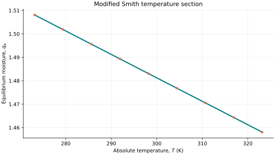
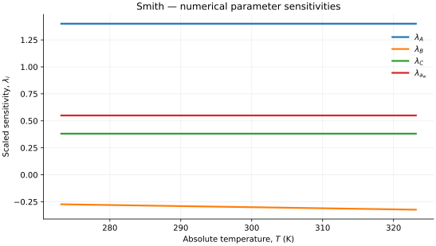

..
   ==============================================================================
   Name        : Smith.rst
   Authors     : Joao Flavio Vasconcellos
   Version     : 2.0.0
   Description : Modified Smith fixed-water-activity temperature section.

   Copyright   : Copyright (C) 2026 Joao Flavio Vasconcellos
   Licence     : MIT License (see LICENSE.txt)
   SPDX-License-Identifier: MIT
   ==============================================================================

Smith isotherm
==============

Original publication and scope
------------------------------

Smith, S. E. (1947), *The Sorption of Water Vapor by High Polymers*,
*Journal of the American Chemical Society*, **69** (3), 646–651.
`DOI: 10.1021/ja01195a053 <https://doi.org/10.1021/ja01195a053>`_.

Smith's original equation (6) describes a two-coefficient moisture-sorption
relation at a fixed temperature. The modified three-coefficient expression
below allows its intercept to depend linearly on absolute temperature.
A temperature-dependent Smith relationship has been reported, for example,
in the `study of moisture sorption in soybean grains
<https://www.scielo.br/j/asagr/a/W4Gf9X4FzG7LTmSYQwZVFCv/?lang=en>`_.
The temperature term is not part of Smith's 1947 equation.

The C++ class stores three empirical coefficients and a *fixed water activity*
for its temperature section. Its four stored parameters do not represent four
independently fitted material coefficients.

Mathematical formulation
------------------------

.. math::

   q_e(T;A,B,C,a_w)=(A+BT)-C\ln(1-a_w).

The admissible parameter and input domain is

.. math::

   A>0,\quad B\in\mathbb{R},\quad C>0,\quad
   0\leq a_w<1,\quad T>0\;\mathrm{K},\quad A+BT>0.

Here :math:`a_w=p_w/p_w^{\mathrm{sat}}` is dimensionless water activity,
where the vapour pressure and saturation pressure refer to the same
temperature. :math:`T` is the **absolute temperature in kelvin**.
:math:`A` and :math:`C` have units of equilibrium moisture content, while
:math:`B` has units of equilibrium moisture content per kelvin. Literature
expressions written as :math:`q_e=a-bt_{\mathrm{C}}-c\ln(1-a_w)`, with
:math:`t_{\mathrm{C}}` in degrees Celsius, correspond to the kelvin-based
form through :math:`A=a+273.15b`, :math:`B=-b`, :math:`C=c`.

The temperature derivative at fixed stored parameters is

.. math::

   \frac{\partial q_e}{\partial T}=B.

The derivative with respect to stored water activity is distinct:

.. math::

   \frac{\partial q_e}{\partial a_w}=\frac{C}{1-a_w}.

The C++ ``derivative(model, T)`` function returns :math:`B`, not the
water-activity derivative. The latter can be calculated by comparing new
instances constructed at different activities.

C++20 usage
-----------

.. code-block:: cpp

   #include <isotherm/isotherm.hpp>

   const isotherm::models::Smith model{1.4, -0.001, 0.55, 0.5}; // A, B, C, a_w
   constexpr isotherm::Real temperature_k = 300.0;              // K
   const isotherm::Real uptake = isotherm::evaluate(model, temperature_k);   // 1.4812309
   const isotherm::Real slope = isotherm::derivative(model, temperature_k);  // -0.001

.. raw:: html

   

     <a class="isotherm-source-action" href="../../../source-browser/src/isotherm/models/FourParameters/Smith.hpp.html">Implementation</a>
     <a class="isotherm-source-action" href="../../../source-browser/IsothermTest/FourParameters/Smith/test_smith.cpp.html">Tests</a>
     <a class="isotherm-source-action" href="../../../source-browser/Examples/FourParameters/Smith/main.cpp.html">Example</a>
   

Smith isotherm plot
-------------------

   Smith equilibrium moisture for :math:`A=1.4`, :math:`B=-0.001`,
   :math:`C=0.55` and fixed :math:`a_w=0.5`.

Temperature derivative
----------------------

   Temperature derivative of Smith equilibrium moisture with
   :math:`A=1.4`, :math:`B=-0.001`, :math:`C=0.55`, :math:`a_w=0.5`.

Numerical sensitivity
---------------------

For each model parameter :math:`k_i`, the scaled sensitivity is

.. math::

   \lambda_i(T)=k_i\frac{\partial q_e(T)}{\partial k_i}.

Numerical values are obtained by perturbing individual parameters and evaluating new instances of the C++ model. The accompanying C++20 example performs this procedure.

   Scaled sensitivities :math:`\lambda_A`, :math:`\lambda_B`,
   :math:`\lambda_C` and :math:`\lambda_{a_w}`
   versus absolute temperature at fixed :math:`a_w=0.5`.

Validation and limitations
--------------------------

.. math::

   A>0,\quad B\in\mathbb{R},\quad C>0,\quad
   0\leq a_w<1,\quad T>0\;\mathrm{K},\quad A+BT>0.

At a single fixed water activity, varying temperature identifies the slope
:math:`B` and only the combined intercept :math:`A-C\ln(1-a_w)`.
Determining :math:`A` and :math:`C` separately therefore requires additional
activity conditions or independent information. The original Smith relation
was developed for a restricted moisture-sorption regime; mathematical
validity at :math:`a_w=0` is not evidence of physical applicability there.
