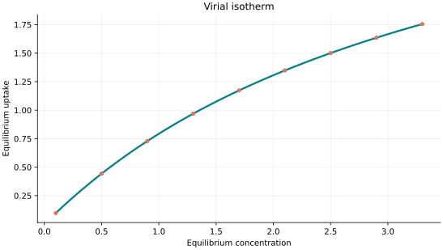
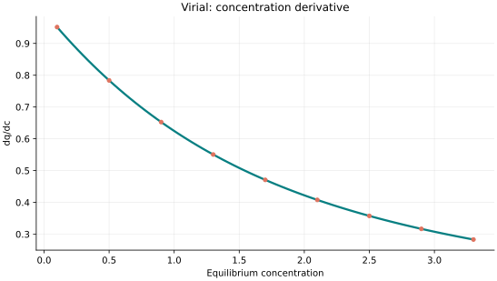
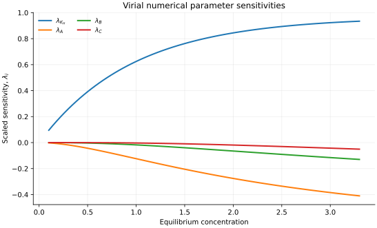

..
   ============================================================================
   Name        : Virial.rst
   Authors     : Joao Flavio Vasconcellos
   Version     : 2.0.0
   Description : Scientific equation, numerical domain and reproducible figures.

   Copyright   : Copyright (C) 2026 Joao Flavio Vasconcellos
   Licence     : MIT License (see LICENSE.txt)
   SPDX-License-Identifier: MIT
   ============================================================================

Virial isotherm
===============

Original publication and scope
------------------------------

Virial adsorption equations form a family of expansions, rather than a
single universal isotherm. A standard treatment is Ruthven, D. M.
(1984), *Principles of Adsorption and Adsorption Processes*, Wiley,
New York. `Publisher record
<https://www.wiley.com/en-us/principles-of-adsorption-and-adsorption-processes-p-9780471866060>`_.
This book is a reference for adsorption-equilibrium theory and does
not establish that the present four-parameter truncated expression
was originally proposed by Ruthven.

The Isotherm++ class uses an *implicit* cubic virial expansion in
adsorbed loading, where the independent input is equilibrium
concentration and the numerical root provides equilibrium uptake.
Its enforced strictly positive virial coefficients select a monotonic,
uniquely invertible branch; they are restrictions of this implementation,
not universal physical constraints on virial coefficients.

Chu, K. H., Hashim, M. A., Mudhoo, A., and Debord, J. (2023), *Beyond
Freundlich and Langmuir: the Ruthven–virial equilibrium isotherm for
aqueous-solid adsorption systems*, *Chemical Papers*, **77** (3),
1593–1600. `DOI: 10.1007/s11696-022-02576-4
<https://doi.org/10.1007/s11696-022-02576-4>`_. This study tests a
**two-parameter** Ruthven–virial variant for aqueous-solid equilibrium;
its exponential-integral formulation is not the same mathematical
expression as the cubic four-parameter series implemented below.

*High Pressure Excess Isotherms for Adsorption of Oxygen and Nitrogen
in Zeolites* (2011), *Langmuir*, **27** (17), 10648–10656.
`DOI: 10.1021/la201690x
<https://doi.org/10.1021/la201690x>`_. This work reported that a
virial correlation described high-pressure oxygen and nitrogen excess
adsorption data on NaX and NaY zeolites better than a Toth correlation
with the same number of parameters. It was published in **2011**, not
2023; its temperature-dependent and excess-adsorption context differs
from the present concentration-based, fixed-coefficient model.

Mathematical formulation
------------------------

.. math::

   x=\frac{q}{K_H}\exp(Aq+Bq^2+Cq^3)

The 4 adjustable parameters are: ``K_H``, ``A``, ``B``, ``C``.
The independent variable is ``concentration``.

K_H positive, A,B,C strictly positive in this release (restricted monotonic region). High-pressure inversion has a unique positive root.

Unlike the pressure-explicit literature equation, the public evaluate(x) returns uptake, so an inverse solution is necessary.

Parameter and concentration restrictions:

.. math::

   K_{\mathrm{H}}>0,\quad A>0,\quad B>0,\quad C>0,\quad C_e\geq0.

C++20 usage
-----------

.. code-block:: cpp

   #include <isotherm/isotherm.hpp>

   const isotherm::models::Virial model{1, 0.25, 0.045, 0.01};
   const isotherm::Real uptake = isotherm::evaluate(model, 0.5);   // 0.44323026
   const isotherm::Real slope = isotherm::derivative(model, 0.5);  // 0.78371504

.. raw:: html

   

     <a class="isotherm-source-action" href="../../../source-browser/src/isotherm/models/FourParameters/Virial.hpp.html">Implementation</a>
     <a class="isotherm-source-action" href="../../../source-browser/IsothermTest/FourParameters/Virial/test_virial.cpp.html">Tests</a>
     <a class="isotherm-source-action" href="../../../source-browser/Examples/FourParameters/Virial/main.cpp.html">Example</a>
   

Virial isotherm plot
--------------------

   Virial uptake for :math:`K_H=1`, :math:`A=0.25`, :math:`B=0.045`, :math:`C=0.01`.

Concentration derivative
------------------------

   Concentration derivative of Virial uptake for :math:`K_H=1`, :math:`A=0.25`,
   :math:`B=0.045`, :math:`C=0.01`.

Numerical sensitivity
---------------------

For every model parameter :math:`k_i`, the scaled sensitivity is

.. math::

   \lambda_i(C_e)=k_i\frac{\partial q_e}{\partial k_i}.

Numerical values are obtained by perturbing individual parameters and evaluating new instances of the C++ model. The accompanying C++20 example performs this procedure.

   Scaled sensitivities :math:`\lambda_{K_H}`, :math:`\lambda_{A}`, :math:`\lambda_{B}`,
   :math:`\lambda_{C}` versus equilibrium concentration.

Validation and limitations
--------------------------

.. math::

   K_{\mathrm{H}}>0,\quad A>0,\quad B>0,\quad C>0,\quad C_e\geq0.
