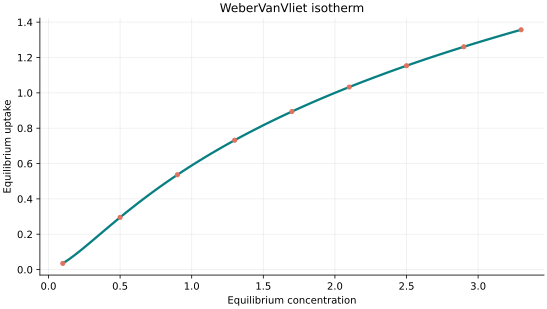
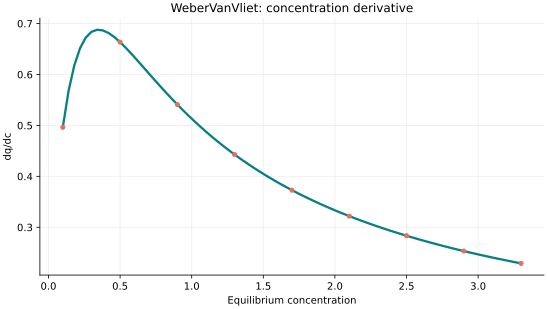
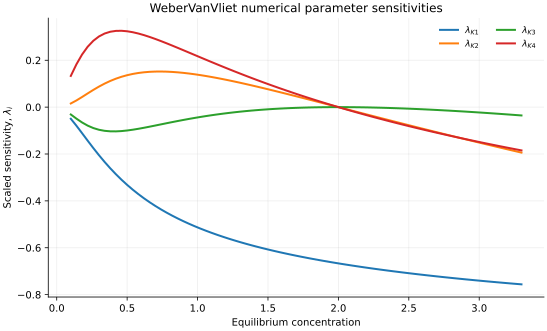

..
   ==============================================================================
   Name        : WeberVanVliet.rst
   Authors     : Joao Flavio Vasconcellos
   Version     : 2.0.0
   Description : Scientifically annotated four-parameter model equation and implementation.

   Copyright   : Copyright (C) 2026 Joao Flavio Vasconcellos
   Licence     : MIT License (see LICENSE)
   SPDX-License-Identifier: MIT
   ==============================================================================

Weber–Van Vliet isotherm
========================

Original publication and scope
------------------------------

Van Vliet, B. M., Weber, W. J., Jr., and Hozumi, H. (1980),
*Modeling and prediction of specific compound adsorption by activated
carbon and synthetic adsorbents*, *Water Research*, **14** (12),
1719–1728. `DOI: 10.1016/0043-1354(80)90107-4
<https://doi.org/10.1016/0043-1354(80)90107-4>`_. The original study
compared activated carbons and synthetic adsorbents, using an empirical
isotherm alongside a model for adsorption-bed performance. It is the
historical reference for the Weber–Van Vliet family of correlations.

The four-parameter Isotherm++ expression below is written with
**equilibrium concentration on the left-hand side** and loading as the
unknown. Unlike explicit uptake equations, the C++ function
``evaluate(C_e)`` computes the positive inverse numerically. Its
additional monotonicity condition :math:`K_4>K_2\exp(-2)` selects a
unique positive solution over the supported domain; this is a
numerical admissibility condition specific to the implementation.

Dan-Iya, B. I., and Shukor, M. Y. (2023), *Isothermal Modelling of the
Adsorption of Crystal Violet onto Modified Charred Rice Husk*,
*Journal of Environmental Microbiology and Toxicology*, **11** (1),
1–9. `DOI: 10.54987/jemat.v11i1.837
<https://doi.org/10.54987/jemat.v11i1.837>`_. Weber–Van Vliet was
among the models included in the nonlinear reanalysis. The authors
reported **Jovanovic** as the preferred model for those data. Thus the
study supports the *application* of Weber–Van Vliet, but not a claim
that it was universally or specifically the best-fitting model.

The present formulation and admissible domain must be checked when
transferring fitted parameters from other published conventions. Good
statistical agreement does not alone establish mechanistic validity.

Mathematical formulation
------------------------

.. math::

   c_e=K_1 q_e^{K_2q_e^{K_3}+K_4}

.. math::

   \ln(c_e/K_1)=(K_2\exp(K_3 t)+K_4)t,\qquad t=\ln(q_e)

The positive root is found by bisection in ``t``. For positive ``K2`` and
``K3``, the derivative of the right-hand side with respect to ``t`` has
lower bound ``K4 - K2 exp(-2)``. Requiring this bound to be strictly
positive guarantees uniqueness of the positive equilibrium uptake. The
parameter bound above establishes this property.

The four independently adjustable parameters are ``K1``,
``K2``, ``K3`` and ``K4``.
No temperature parameter is required by this implementation.

All parameters are strictly positive and K4 > K2 exp(-2). This is a sufficient condition for uniqueness for every positive concentration; outside this region the equation can have multiple positive solutions and this implementation rejects it rather than returning an arbitrary root.

Finite and non-negative concentrations are accepted. The response at zero
concentration is defined by its continuous zero limit. The derivative is
analytical and is evaluated only for strictly positive concentration.

Parameter and concentration restrictions:

.. math::

   K_{1}>0,\quad K_{2}>0,\quad K_{3}>0,\quad K_{4}>0,\quad K_4>K_2\exp(-2),\quad C_e\geq0.

C++20 usage
-----------

.. code-block:: cpp

   #include <isotherm/isotherm.hpp>

   const isotherm::models::WeberVanVliet model{0.087093, 3.19814, 0.0647897, 0.769393};
   const isotherm::Real uptake = isotherm::evaluate(model, 0.8);   // 1.7216065
   const isotherm::Real slope = isotherm::derivative(model, 0.8);  // 0.51254114

.. raw:: html

   

     <a class="isotherm-source-action" href="../../../source-browser/include/isotherm/models/FourParameters/WeberVanVliet.hpp.html">Implementation</a>
     <a class="isotherm-source-action" href="../../../source-browser/IsothermTest/FourParameters/WeberVanVliet/test_weber_van_vliet.cpp.html">Tests</a>
     <a class="isotherm-source-action" href="../../../source-browser/Examples/FourParameters/WeberVanVliet/main.cpp.html">Example</a>
   

Weber–Van Vliet isotherm plot
-----------------------------

   Weber–Van Vliet uptake for :math:`K_1=2`, :math:`K_2=0.7`, :math:`K_3=0.6`,
   :math:`K_4=0.8`.

Concentration derivative
------------------------

   Concentration derivative of Weber–Van Vliet uptake for :math:`K_1=2`, :math:`K_2=0.7`,
   :math:`K_3=0.6`, :math:`K_4=0.8`.

Numerical sensitivity
---------------------

For every model parameter :math:`k_i`, the scaled sensitivity is

.. math::

   \lambda_i(C_e)=k_i\frac{\partial q_e}{\partial k_i}.

Numerical values are obtained by perturbing individual parameters and evaluating new instances of the C++ model. The accompanying C++20 example performs this procedure.

   Scaled sensitivities :math:`\lambda_{K_1}`, :math:`\lambda_{K_2}`, :math:`\lambda_{K_3}`,
   :math:`\lambda_{K_4}` versus equilibrium concentration.

Validation and limitations
--------------------------

.. math::

   K_{1}>0,\quad K_{2}>0,\quad K_{3}>0,\quad K_{4}>0,\quad K_4>K_2\exp(-2),\quad C_e\geq0.
