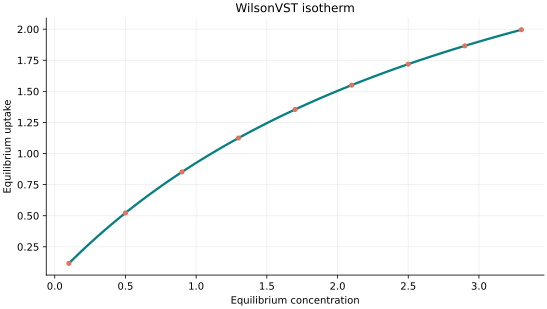
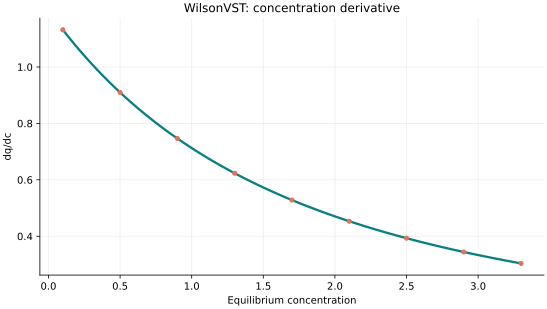
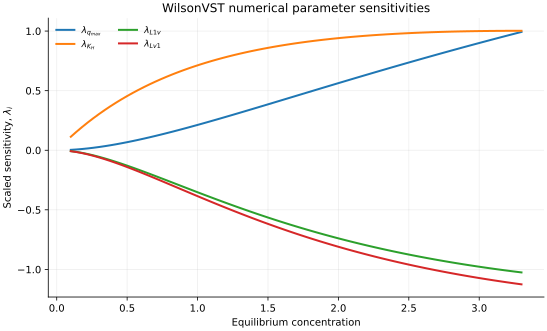

..
   ============================================================================
   Name        : WilsonVST.rst
   Authors     : Joao Flavio Vasconcellos
   Version     : 2.0.0
   Description : Scientific equation, numerical domain and reproducible figures.

   Copyright   : Copyright (C) 2026 Joao Flavio Vasconcellos
   Licence     : MIT License (see LICENSE.txt)
   SPDX-License-Identifier: MIT
   ============================================================================

WilsonVST isotherm
==================

Original publication and scope
------------------------------

Suwanayuen, S., and Danner, R. P. (1980), *A gas adsorption isotherm
equation based on vacancy solution theory*, *AIChE Journal*, **26** (1),
68–76. `DOI: 10.1002/aic.690260112
<https://doi.org/10.1002/aic.690260112>`_. This is the primary paper
for the pure-component vacancy solution theory (VST) isotherm. It treats
adsorbate molecules and hypothetical vacancies as solution components
and represents non-ideality using Wilson activity coefficients.

Suwanayuen, S., and Danner, R. P. (1980), *Vacancy solution theory
of adsorption from gas mixtures*, *AIChE Journal*, **26** (1), 76–83.
`DOI: 10.1002/aic.690260113
<https://doi.org/10.1002/aic.690260113>`_. The companion paper
extends the treatment to adsorption from gas mixtures. A single
component's C++ isotherm is not by itself a full multicomponent
thermodynamic calculation.

Cochran, T. W., Kabel, R. L., and Danner, R. P. (1985), *Vacancy solution
theory of adsorption using Flory–Huggins activity coefficient
equations*, *AIChE Journal*, **31** (2), 268–277.
`DOI: 10.1002/aic.690310214
<https://doi.org/10.1002/aic.690310214>`_. This is a related
**Flory–Huggins VST** variant, not the primary source for the
Wilson-activity formulation.

*Understanding the vacancy solution theory* (2026), *Adsorption*.
`DOI: 10.1007/s10450-026-00678-z
<https://doi.org/10.1007/s10450-026-00678-z>`_. This later analysis
reviews the reference states and thermodynamic-consistency conditions
in VST. Those mixture-level considerations must not be assumed to
follow automatically from evaluation of the present single-component
class.

The explicit pressure–coverage relation below follows the Wilson VST
form also documented by `pyGAPS
<https://pygaps.readthedocs.io/en/latest/_modules/pygaps/modelling/wvst.html>`_.
Isotherm++ inverts that relation for uptake by bisection. Its
:math:`0.8\leq L_{1v},L_{v1}\leq1.2` restriction is a conservative
numerical monotonicity condition imposed by this implementation, not
a general thermodynamic range required by Wilson's activity model.

Mathematical formulation
------------------------

.. math::

   x=\frac{q_{\max}}{K_H}\frac{\theta}{1-\theta}\,f_W(\theta)

The Wilson activity correction is defined by

.. math::

   \ln f_W=\ln L_{1v}+\ln u-\ln v-\frac{L_{v1}(1-L_{v1})\theta}{u}-\frac{(1-L_{1v})\theta}{v}

where

.. math::

   u=1-(1-L_{v1})\theta,\quad v=L_{1v}+(1-L_{1v})\theta

The 4 adjustable parameters are: ``q_max``, ``K_H``, ``L1v``, ``Lv1``.
The independent variable is ``concentration``.

q_max,K_H strictly positive. To guarantee a single root, both Wilson interaction factors L1v and Lv1 are restricted to [0.8,1.2], a conservative sufficient region; other literature states are not claimed to be covered.

f_W(theta) is the Wilson vacancy activity correction. The derivative is obtained from the explicit log-pressure relation, and bisection in surface coverage selects its unique root in the restricted parameter domain.

Parameter and concentration restrictions:

.. math::

   q_{\mathrm{max}}>0,\quad K_{\mathrm{H}}>0,\quad L_{1v}>0,\quad L_{v1}>0,\quad 0.8\leq L_{1v}\leq1.2,\quad 0.8\leq L_{v1}\leq1.2,\quad C_e\geq0.

C++20 usage
-----------

.. code-block:: cpp

   #include <isotherm/isotherm.hpp>

   const isotherm::models::WilsonVST model{4, 1.2, 0.9, 1.1};
   const isotherm::Real uptake = isotherm::evaluate(model, 0.5);   // 0.52244468
   const isotherm::Real slope = isotherm::derivative(model, 0.5);  // 0.90961164

.. raw:: html

   

     <a class="isotherm-source-action" href="../../../source-browser/include/isotherm/models/FourParameters/WilsonVST.hpp.html">Implementation</a>
     <a class="isotherm-source-action" href="../../../source-browser/IsothermTest/FourParameters/WilsonVST/test_wilson_v_s_t.cpp.html">Tests</a>
     <a class="isotherm-source-action" href="../../../source-browser/Examples/FourParameters/WilsonVST/main.cpp.html">Example</a>
   

Wilson VST isotherm plot
------------------------

   Wilson VST uptake for :math:`q_{\max}=4`, :math:`K_H=1.2`, :math:`L_{1v}=0.9`,
   :math:`L_{v1}=1.1`.

Concentration derivative
------------------------

   Concentration derivative of Wilson VST uptake for :math:`q_{\max}=4`, :math:`K_H=1.2`,
   :math:`L_{1v}=0.9`, :math:`L_{v1}=1.1`.

Numerical sensitivity
---------------------

For every model parameter :math:`k_i`, the scaled sensitivity is

.. math::

   \lambda_i(C_e)=k_i\frac{\partial q_e}{\partial k_i}.

Numerical values are obtained by perturbing individual parameters and evaluating new instances of the C++ model. The accompanying C++20 example performs this procedure.

   Scaled sensitivities :math:`\lambda_{q_{\max}}`, :math:`\lambda_{K_H}`,
   :math:`\lambda_{L_{1v}}`, :math:`\lambda_{L_{v1}}` versus equilibrium concentration.

Validation and limitations
--------------------------

.. math::

   q_{\mathrm{max}}>0,\quad K_{\mathrm{H}}>0,\quad L_{1v}>0,\quad L_{v1}>0,\quad 0.8\leq L_{1v}\leq1.2,\quad 0.8\leq L_{v1}\leq1.2,\quad C_e\geq0.
