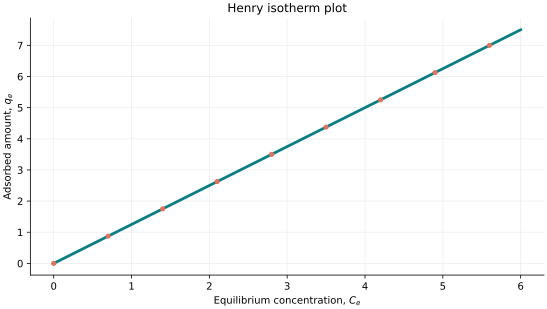
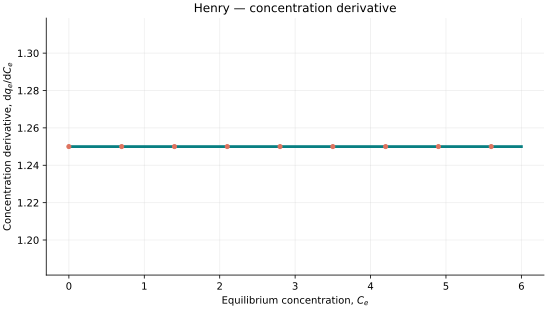
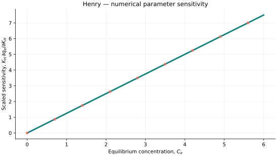

..
   ==============================================================================
   Name        : Henry.rst
   Authors     : Joao Flavio Vasconcellos
   Version     : 2.0.0
   Description : Scientific background, validation and example for Henry adsorption.

   Copyright   : Copyright (C) 2026 Joao Flavio Vasconcellos
   Licence     : MIT License (see LICENSE.txt)
   SPDX-License-Identifier: MIT
   ==============================================================================

Henry isotherm
===============

Original publication and scope
------------------------------

William Henry, *Experiments on the Quantity of Gases Absorbed by Water, at
Different Temperatures, and under Different Pressures*, *Philosophical
Transactions of the Royal Society of London*, **93** (1803), 29–42 and
274–276. DOI: `10.1098/rstl.1803.0004 <https://doi.org/10.1098/rstl.1803.0004>`_.

Henry's 1803 paper deals with gases dissolved in water. For adsorption onto
solids, the same proportional relation describes uptake at low surface
coverage. Use the model where uptake is approximately proportional to
equilibrium concentration.

For a review of sorption models, see Limousin *et al.* (2007), *Sorption
isotherms: A review on physical bases, modeling and measurement*, *Applied
Geochemistry*, **22**, 249–275. DOI: `10.1016/j.apgeochem.2006.09.010
<https://doi.org/10.1016/j.apgeochem.2006.09.010>`_.

Mathematical formulation
------------------------

.. math::

   q_e(C_e) = K_H C_e, \qquad K_H>0, \quad C_e\geq 0.

Here :math:`q_e` is uptake (for example, mg g⁻¹), :math:`C_e` is aqueous
equilibrium concentration (for example, mg L⁻¹), and :math:`K_H` is the
proportionality coefficient (for example, L g⁻¹). These units are
illustrative; applications must supply consistent units. The implementation
requires a finite positive coefficient and non-negative finite concentration.

The concentration derivative and low-concentration limit are

.. math::

   \frac{\mathrm{d}q_e}{\mathrm{d}C_e}=K_H,
   \qquad \lim_{C_e\to 0^+} \frac{q_e}{C_e}=K_H.

Henry's law has no saturation limit. Do not use it at concentrations
where the measured uptake is no longer approximately linear.

C++20 usage
-----------

.. code-block:: cpp

   #include <isotherm/isotherm.hpp>

   const isotherm::models::Henry model{1.25};
   const isotherm::Real uptake = isotherm::evaluate(model, 2.0);   // 2.5
   const isotherm::Real slope = isotherm::derivative(model, 2.0);  // 1.25

.. raw:: html

   

     <a class="isotherm-source-action" href="../../../source-browser/include/isotherm/models/OneParameter/Henry.hpp.html">Implementation</a>
     <a class="isotherm-source-action" href="../../../source-browser/IsothermTest/OneParameter/Henry/test_henry.cpp.html">Tests</a>
     <a class="isotherm-source-action" href="../../../source-browser/Examples/OneParameter/Henry/main.cpp.html">Example</a>
   

The source browser shows the C++ files with links to their original source.

Henry isotherm plot
-------------------

   Henry uptake for :math:`K_H=1.25`.

Concentration derivative
------------------------

The independent variable of the implemented Henry model is equilibrium
concentration rather than thermodynamic activity. Consequently, the plot
shows :math:`\mathrm{d}q_e/\mathrm{d}C_e=K_H=1.25`, evaluated by the
compiled C++20 model. An activity derivative would require an explicitly
specified relation between activity and concentration.

   Concentration derivative of Henry uptake for :math:`K_H=1.25`.

Numerical sensitivity
---------------------

For the Henry coefficient :math:`K_H`, the scaled sensitivity is

.. math::

   \lambda_{K_H}(C_e)=K_H\frac{\partial q_e}{\partial K_H}.

Numerical values are obtained by perturbing individual parameters and evaluating new instances of the C++ model. The accompanying C++20 example performs this procedure.

   Scaled sensitivity to :math:`K_H` versus equilibrium concentration.

Validation and limitations
--------------------------

The model requires:

.. math::

   K_H > 0, \qquad C_e \geq 0.
