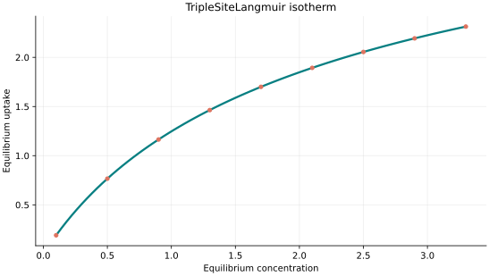
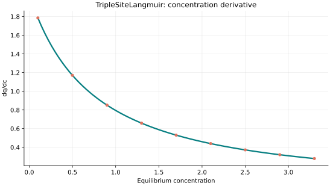
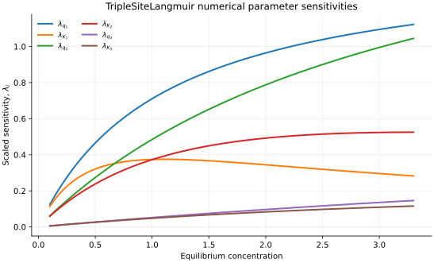

..
   ============================================================================
   Name        : TripleSiteLangmuir.rst
   Authors     : Joao Flavio Vasconcellos
   Version     : 2.0.0
   Description : Scientific equation, numerical domain and reproducible figures.

   Copyright   : Copyright (C) 2026 Joao Flavio Vasconcellos
   Licence     : MIT License (see LICENSE)
   SPDX-License-Identifier: MIT
   ============================================================================

TripleSiteLangmuir isotherm
===========================

Original publication and scope
------------------------------

Triple-site Langmuir as specified by https://pygaps.readthedocs.io/en/develop/reference/fitting.html , with six independent adjustable parameters.

Mathematical formulation
------------------------

.. math::

   q=\sum_{i=1}^{3}\frac{q_i K_i x}{1+K_i x}

The 6 adjustable parameters are: ``q_1``, ``K_1``, ``q_2``, ``K_2``, ``q_3``, ``K_3``.
The independent variable is ``concentration``.

All six coefficients strictly positive. Requires a SIX-parameter category, not a forced five-parameter approximation.

The model assumes three distinct, non-interacting populations of adsorption
sites, each characterised by its own saturation capacity :math:`q_i` and
affinity constant :math:`K_i`. The equilibrium uptake is the sum of the three
independent contributions. As :math:`C_e \to \infty`, each contribution
approaches its respective :math:`q_i`, so the total saturation capacity is

.. math::

   q_{\mathrm{sat}} = q_1 + q_2 + q_3.

This is an asymptotic limit, not necessarily attained at any finite
concentration. The total saturation capacity is determined by the three
:math:`q_i` values and is not a seventh independently adjustable parameter.

Parameter and concentration restrictions:

.. math::

   q_{1}>0,\quad K_{1}>0,\quad q_{2}>0,\quad K_{2}>0,\quad q_{3}>0,\quad K_{3}>0,\quad C_e\geq0.

C++20 usage
-----------

.. code-block:: cpp

   #include <isotherm/isotherm.hpp>

   const isotherm::models::TripleSiteLangmuir model{1.5, 0.9, 2.1, 0.3, 0.7, 0.08};
   const isotherm::Real uptake = isotherm::evaluate(model, 0.5);   // 0.76635336
   const isotherm::Real slope = isotherm::derivative(model, 0.5);  // 1.1702384

.. raw:: html

   

     <a class="isotherm-source-action" href="../../../source-browser/include/isotherm/models/SixParameters/TripleSiteLangmuir.hpp.html">Implementation</a>
     <a class="isotherm-source-action" href="../../../source-browser/IsothermTest/SixParameters/TripleSiteLangmuir/test_triple_site_langmuir.cpp.html">Tests</a>
     <a class="isotherm-source-action" href="../../../source-browser/Examples/SixParameters/TripleSiteLangmuir/main.cpp.html">Example</a>
   

Triple-site Langmuir isotherm plot
----------------------------------

   Triple-Site Langmuir uptake for :math:`q_1=1.5`, :math:`K_1=0.9`, :math:`q_2=2.1`,
   :math:`K_2=0.3`, :math:`q_3=0.7`, :math:`K_3=0.08`.

Concentration derivative
------------------------

   Concentration derivative of Triple-Site Langmuir uptake for :math:`q_1=1.5`,
   :math:`K_1=0.9`, :math:`q_2=2.1`, :math:`K_2=0.3`, :math:`q_3=0.7`, :math:`K_3=0.08`.

Numerical sensitivity
---------------------

For every model parameter :math:`k_i`, the scaled sensitivity is

.. math::

   \lambda_i(C_e)=k_i\frac{\partial q_e}{\partial k_i}.

Numerical values are obtained by perturbing individual parameters and evaluating new instances of the C++ model. The accompanying C++20 example performs this procedure.

   Scaled sensitivities :math:`\lambda_{q_1}`, :math:`\lambda_{K_1}`, :math:`\lambda_{q_2}`,
   :math:`\lambda_{K_2}`, :math:`\lambda_{q_3}`, :math:`\lambda_{K_3}` versus equilibrium
   concentration.

Validation and limitations
--------------------------

.. math::

   q_{1}>0,\quad K_{1}>0,\quad q_{2}>0,\quad K_{2}>0,\quad q_{3}>0,\quad K_{3}>0,\quad C_e\geq0.
