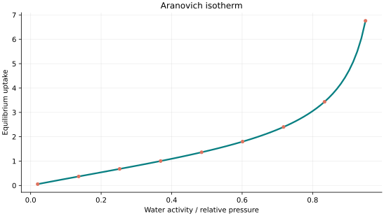
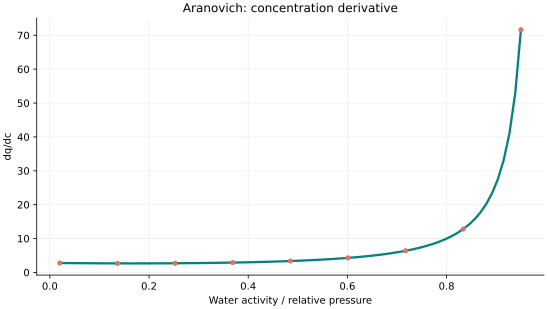
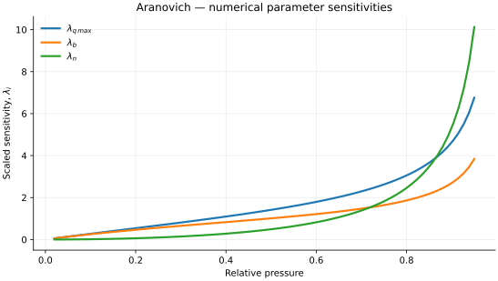

..
   ============================================================================
   Name        : Aranovich.rst
   Authors     : Joao Flavio Vasconcellos
   Version     : 2.0.0
   Description : Scientific equation, numerical domain and reproducible figures.

   Copyright   : Copyright (C) 2026 Joao Flavio Vasconcellos
   Licence     : MIT License (see LICENSE.txt)
   SPDX-License-Identifier: MIT
   ============================================================================

Aranovich isotherm
==================

Original publication and scope
------------------------------

Aranovich, G. L. (1992), *The theory of polymolecular
adsorption*, *Langmuir*, **8** (2), 736–739. DOI:
`10.1021/la00038a071 <https://doi.org/10.1021/la00038a071>`_. This is the
primary reference for the modified multilayer-adsorption treatment. The
original Aranovich-type correction is commonly associated with a square-root
factor in reduced pressure, whereas the model documented here permits the
multilayer exponent :math:`n` to be adjusted.

The subsequent Aranovich–Donohue research develops related, but not
necessarily algebraically identical, models:

* Aranovich, G. L., and Donohue, M. D. (1996), *Multilayer adsorption of
  slightly soluble organic compounds from aqueous solutions*, *Journal of
  Colloid and Interface Science*, **178** (2), 764–769. DOI:
  `10.1006/jcis.1996.0175 <https://doi.org/10.1006/jcis.1996.0175>`_.
  This study formulates multilayer adsorption using a reduced concentration
  and an adjustable divergence exponent.
* Aranovich, G. L., and Donohue, M. D. (1996), *Adsorption of supercritical
  fluids*, *Journal of Colloid and Interface Science*, **180** (2), 537–541.
  DOI: `10.1006/jcis.1996.0334
  <https://doi.org/10.1006/jcis.1996.0334>`_. This is a related application
  of lattice-based adsorption theory, not an experimental validation of this
  particular three-parameter equation.
* Donohue, M. D., and Aranovich, G. L. (1998), *Classification of Gibbs
  adsorption isotherms*, *Advances in Colloid and Interface Science*,
  **76–77**, 137–152. DOI: `10.1016/S0001-8686(98)00044-X
  <https://doi.org/10.1016/S0001-8686(98)00044-X>`_. This addresses the
  classification of adsorption behaviours, including non-monotonic Gibbs
  excess adsorption.
* Aranovich, G. L., and Donohue, M. D. (2003), *Adsorption compression:
  An important new aspect of adsorption behavior and capillarity*,
  *Langmuir*, **19** (7), 2722–2735. DOI: `10.1021/la020739h
  <https://doi.org/10.1021/la020739h>`_. This extends the broader physical
  analysis of adsorbed phases.
* Yılmaz, M., Hashim, M. A., and Chu, K. H. (2022), *Description of sigmoid
  adsorption isotherms of water pollutants by the Aranovich–Donohue
  equation*, *Separation Science and Technology*, **57** (18), 2908–2915.
  DOI: `10.1080/01496395.2022.2097093
  <https://doi.org/10.1080/01496395.2022.2097093>`_. This reports
  applications of an Aranovich–Donohue formulation to atypical liquid-phase
  adsorption curves; it is not a direct validation of every Aranovich variant.

The implemented three-parameter expression combines a Langmuir-type
low-coverage term with the multilayer factor :math:`(1-x)^{-n}`. For gas
adsorption, :math:`x=p/p_{\mathrm{sat}}` is a dimensionless relative pressure;
for solution applications, a reduced concentration requires an explicitly
defined reference, such as :math:`x=C_e/C_{\mathrm{sat}}`, with
:math:`C_{\mathrm{sat}}` the relevant saturation or solubility concentration.
The C++ class receives :math:`x` directly and does not calculate this
normalisation.

Mathematical formulation
------------------------

.. math::

   q=\frac{q_{\max} b x}{(1+b x)(1-x)^n}

The 3 adjustable parameters are: ``q_max``, ``b``, ``n``.
The independent variable is ``water activity or relative pressure``.

0 <= relative pressure x < 1; n>0 is the multilayer divergence exponent. This selected A-D-Langmuir convention is not a universal definition of Aranovich models.

At x near saturation the mathematical model diverges; the derivative and uptake do not extend continuously to x=1.

The implementation requires the following admissible parameter and input domain:

.. math::

   q_{\mathrm{max}}>0,\quad b>0,\quad n>0,\quad 0\leq x<1.

C++20 usage
-----------

.. code-block:: cpp

   #include <isotherm/isotherm.hpp>

   const isotherm::models::Aranovich model{3.5, 0.8, 0.5};
   const isotherm::Real uptake = isotherm::evaluate(model, 0.5);   // 1.4142136
   const isotherm::Real slope = isotherm::derivative(model, 0.5);  // 3.4345187

.. raw:: html

   

     <a class="isotherm-source-action" href="../../../source-browser/src/isotherm/models/ThreeParameters/Aranovich.hpp.html">Implementation</a>
     <a class="isotherm-source-action" href="../../../source-browser/IsothermTest/ThreeParameters/Aranovich/test_aranovich.cpp.html">Tests</a>
     <a class="isotherm-source-action" href="../../../source-browser/Examples/ThreeParameters/Aranovich/main.cpp.html">Example</a>
   

Aranovich isotherm plot
-----------------------

   Aranovich uptake for :math:`q_{\max}=3.5`, :math:`b=0.8`, :math:`n=0.5`.

Concentration derivative
------------------------

   Relative-pressure derivative of Aranovich uptake for :math:`q_{\max}=3.5`, :math:`b=0.8`,
   :math:`n=0.5`.

Numerical sensitivity
---------------------

For each coefficient :math:`k_i`, the numerical scaled sensitivity is

.. math::

   \lambda_i(x)=k_i\frac{\partial q_e}{\partial k_i}.

Numerical values are obtained by perturbing individual parameters and evaluating new instances of the C++ model. The accompanying C++20 example performs this procedure.

   Scaled sensitivities :math:`\lambda_{q_{\max}}`, :math:`\lambda_{b}`, :math:`\lambda_{n}`
   versus relative pressure.

Validation and limitations
--------------------------

.. math::

   q_{\mathrm{max}}>0,\quad b>0,\quad n>0,\quad 0\leq x<1.
