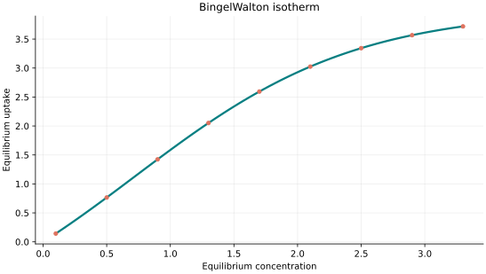
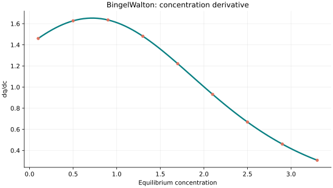
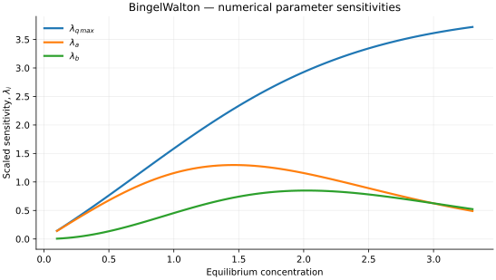

..
   ============================================================================
   Name        : BingelWalton.rst
   Authors     : Joao Flavio Vasconcellos
   Version     : 2.0.0
   Description : Scientific equation, numerical domain and reproducible figures.

   Copyright   : Copyright (C) 2026 Joao Flavio Vasconcellos
   Licence     : MIT License (see LICENSE)
   SPDX-License-Identifier: MIT
   ============================================================================

Bingel–Walton isotherm
======================

Original publication and scope
------------------------------

Bingel and Walton (2023) introduced an empirical adsorption isotherm based on
Bass's innovation-diffusion model. Their original formulation uses gas
pressure and was designed to describe adsorption curves of IUPAC types I,
III and V. The authors assessed the model using 31 literature data sets,
including stepped isotherms of flexible metal-organic frameworks.

Bingel, L. W., and Walton, K. S. (2023), *Surprising Use of the Business
Innovation Bass Diffusion Model To Accurately Describe Adsorption Isotherm
Types I, III, and V*, *Langmuir*, **39** (12), 4475–4482.
`DOI: 10.1021/acs.langmuir.3c00147 <https://doi.org/10.1021/acs.langmuir.3c00147>`_.

The published model has two fitted coefficients, :math:`a` and :math:`b`;
:math:`q_{\max}` is obtained from the observed saturation loading (or the
largest measured loading when saturation is not reached), rather than fitted
as a third coefficient. The C++ class nevertheless accepts all three
quantities as constructor arguments. Its concentration-based expression
retains the functional form of the original pressure-based equation, but
this substitution does not itself demonstrate experimental validity for
liquid-phase adsorption.

For methodological background, see Bingel, L. W., Walton, K. S., and
Sholl, D. S. (2022), *Experimentally Verified Alkane Adsorption Isotherms
in Nanoporous Materials from Literature Meta-Analysis*, *Journal of Chemical
& Engineering Data*, **67** (7), 1757–1764.
`DOI: 10.1021/acs.jced.1c00967 <https://doi.org/10.1021/acs.jced.1c00967>`_.
This earlier work concerns adsorption-data reproducibility, not the
derivation of the Bingel–Walton equation.

Mathematical formulation
------------------------

.. math::

   q_e=q_{\max}\frac{1-\exp[-(a+b)C_e]}{1+(b/a)\exp[-(a+b)C_e]}

The C++ class is constructed with three positive values, :math:`q_{\max}`,
:math:`a` and :math:`b`. In the original publication only :math:`a` and
:math:`b` are fitted: :math:`q_{\max}` is supplied independently. The
model gives :math:`q_e(0)=0` and approaches :math:`q_{\max}` as
:math:`C_e\rightarrow\infty`. The initial slope is :math:`a q_{\max}`.

Here :math:`C_e` denotes equilibrium concentration. When supplied in physical
concentration units, both :math:`a` and :math:`b` must have the reciprocal
units so that :math:`(a+b)C_e` is dimensionless. The published gas-phase
formulation instead uses pressure and coefficients with inverse-pressure
units; for relative pressure the independent variable is dimensionless.
The class requires :math:`a>0` and :math:`b>0`, which is more restrictive
than the original monotonicity condition :math:`a+b>0` (with :math:`a>0`).

The implementation requires the following admissible parameter and input domain:

.. math::

   q_{\mathrm{max}}>0,\quad a>0,\quad b>0,\quad C_e\geq0.

C++20 usage
-----------

.. code-block:: cpp

   #include <isotherm/isotherm.hpp>

   const isotherm::models::BingelWalton model{4, 0.35, 0.8};
   const isotherm::Real uptake = isotherm::evaluate(model, 0.5);   // 0.76510973
   const isotherm::Real slope = isotherm::derivative(model, 0.5);  // 1.6272208

.. raw:: html

   

     <a class="isotherm-source-action" href="../../../source-browser/include/isotherm/models/ThreeParameters/BingelWalton.hpp.html">Implementation</a>
     <a class="isotherm-source-action" href="../../../source-browser/IsothermTest/ThreeParameters/BingelWalton/test_bingel_walton.cpp.html">Tests</a>
     <a class="isotherm-source-action" href="../../../source-browser/Examples/ThreeParameters/BingelWalton/main.cpp.html">Example</a>
   

Bingel–Walton isotherm plot
---------------------------

   Bingel–Walton uptake for :math:`q_{\max}=4`, :math:`a=0.35`, :math:`b=0.8`.

Concentration derivative
------------------------

   Concentration derivative of Bingel–Walton uptake for :math:`q_{\max}=4`, :math:`a=0.35`,
   :math:`b=0.8`.

Numerical sensitivity
---------------------

For each coefficient :math:`k_i`, the numerical scaled sensitivity is

.. math::

   \lambda_i(C_e)=k_i\frac{\partial q_e}{\partial k_i}.

Numerical values are obtained by perturbing individual parameters and evaluating new instances of the C++ model. The accompanying C++20 example performs this procedure.

   Scaled sensitivities :math:`\lambda_{q_{\max}}`, :math:`\lambda_{a}`, :math:`\lambda_{b}`
   versus equilibrium concentration.

Validation and limitations
--------------------------

.. math::

   q_{\mathrm{max}}>0,\quad a>0,\quad b>0,\quad C_e\geq0.
