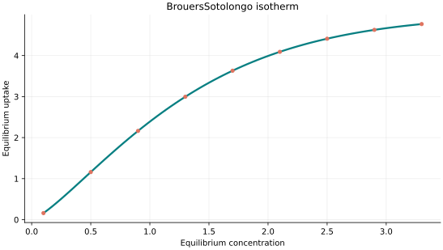
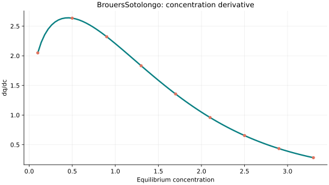
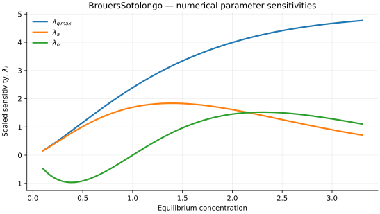

..
   ==============================================================================
   Name        : BrouersSotolongo.rst
   Authors     : Joao Flavio Vasconcellos
   Version     : 2.0.0
   Description : Model equation, validity, code example and reproducible figures.

   Copyright   : Copyright (C) 2026 Joao Flavio Vasconcellos
   Licence     : MIT License (see LICENSE)
   SPDX-License-Identifier: MIT
   ==============================================================================

Brouers–Sotolongo isotherm
==========================

Original publication and scope
------------------------------

Brouers, Sotolongo, Marquez and Pirard (2005) developed a statistical
approach to adsorption on heterogeneous and microporous surfaces, linking
power-law behaviour to heavy-tailed Lévy distributions. The
Brouers–Sotolongo isotherm is commonly expressed as a saturating
Weibull-type function, as used by the present class.

Brouers, F., Sotolongo, O., Marquez, F., and Pirard, J.-P. (2005),
*Microporous and heterogeneous surface adsorption isotherms arising from
Levy distributions*, *Physica A*, **349** (1–2), 271–282.
`DOI: 10.1016/j.physa.2004.10.032 <https://doi.org/10.1016/j.physa.2004.10.032>`_.

Ncibi, M. C., Altenor, S., Seffen, M., Brouers, F., and Gaspard, S.
(2008), *Modelling single compound adsorption onto porous and non-porous
sorbents using a deformed Weibull exponential isotherm*, *Chemical
Engineering Journal*, **145** (2), 196–202.
`DOI: 10.1016/j.cej.2008.04.001 <https://doi.org/10.1016/j.cej.2008.04.001>`_.
This study applies the model to phenol and methylene blue adsorption.

Brouers, F. (2014), *Statistical Foundation of Empirical Isotherms*,
*Open Journal of Statistics*, **4** (9), 687–701.
`DOI: 10.4236/ojs.2014.49064 <https://doi.org/10.4236/ojs.2014.49064>`_.
This paper relates the Brouers–Sotolongo and generalised forms to
statistical distribution families and adsorption-energy distributions.

Brouers, F., and Marquez-Montesino, F. (2016), *Dubinin isotherms versus
the Brouers–Sotolongo family isotherms: A case study*, *Adsorption Science
& Technology*.
`DOI: 10.1177/0263617416670909 <https://doi.org/10.1177/0263617416670909>`_.
The comparison discusses connections between Dubinin-type models and the
generalised Brouers–Sotolongo family; it does not make every family member
identical to the three-parameter expression implemented here.

Selmi, T., Seffen, M., Celzard, A., and Fierro, V. (2020), *Effect of the
adsorption pH and temperature on the parameters of the Brouers–Sotolongo
models*, *Environmental Science and Pollution Research*, **27** (19),
23437–23446.
`DOI: 10.1007/s11356-018-3835-8 <https://doi.org/10.1007/s11356-018-3835-8>`_.
The study examines the dependence of parameters in related equilibrium
and kinetic models on experimental conditions.

Mathematical formulation
------------------------

.. math::

   q_e=q_{\max}\left[1-\exp(-a C_e^n)\right]

The coefficients :math:`q_{\max}`, :math:`a` and :math:`n` are positive.
:math:`q_{\max}` is the limiting saturation loading and :math:`n` is a
dimensionless shape exponent. If :math:`C_e` is a dimensional equilibrium
concentration, :math:`a` has units of :math:`[C_e]^{-n}`, making
:math:`a C_e^n` dimensionless. If dimensionless concentration is used
instead, it must be specified as :math:`c^*=C_e/C_{\mathrm{ref}}`, with a
stated positive reference concentration in the same units as :math:`C_e`;
the numerical value of :math:`a` then depends on that choice.
The C++ class receives the independent-variable value directly and does not
perform concentration normalisation. Its ``evaluate`` method includes
:math:`C_e=0`; ``derivative`` requires :math:`C_e>0`.

The implementation requires the following admissible parameter and input domain:

.. math::

   q_{\mathrm{max}}>0,\quad a>0,\quad n>0,\quad C_e\geq0.

C++20 usage
-----------

.. code-block:: cpp

   #include <isotherm/isotherm.hpp>

   const isotherm::models::BrouersSotolongo model{5, 0.65, 1.3};
   const isotherm::Real uptake = isotherm::evaluate(model, 0.8);   // 1.9256032
   const isotherm::Real slope = isotherm::derivative(model, 0.8);  // 2.4296495

.. raw:: html

   

     <a class="isotherm-source-action" href="../../../source-browser/include/isotherm/models/ThreeParameters/BrouersSotolongo.hpp.html">Implementation</a>
     <a class="isotherm-source-action" href="../../../source-browser/IsothermTest/ThreeParameters/BrouersSotolongo/test_brouers_sotolongo.cpp.html">Tests</a>
     <a class="isotherm-source-action" href="../../../source-browser/Examples/ThreeParameters/BrouersSotolongo/main.cpp.html">Example</a>
   

Brouers–Sotolongo isotherm plot
-------------------------------

   Brouers–Sotolongo uptake for :math:`q_{\max}=5`, :math:`a=0.65`, :math:`n=1.3`.

Concentration derivative
------------------------

   Concentration derivative of Brouers–Sotolongo uptake for :math:`q_{\max}=5`,
   :math:`a=0.65`, :math:`n=1.3`.

Numerical sensitivity
---------------------

For each coefficient :math:`k_i`, the numerical scaled sensitivity is

.. math::

   \lambda_i(C_e)=k_i\frac{\partial q_e}{\partial k_i}.

Numerical values are obtained by perturbing individual parameters and evaluating new instances of the C++ model. The accompanying C++20 example performs this procedure.

   Scaled sensitivities :math:`\lambda_{q_{\max}}`, :math:`\lambda_{a}`, :math:`\lambda_{n}`
   versus equilibrium concentration.

Validation and limitations
--------------------------

.. math::

   q_{\mathrm{max}}>0,\quad a>0,\quad n>0,\quad C_e\geq0.
