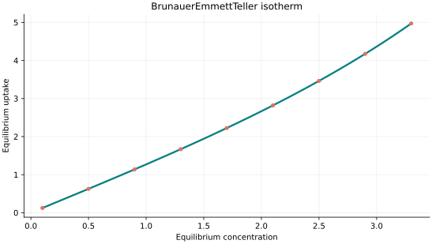
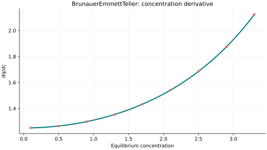
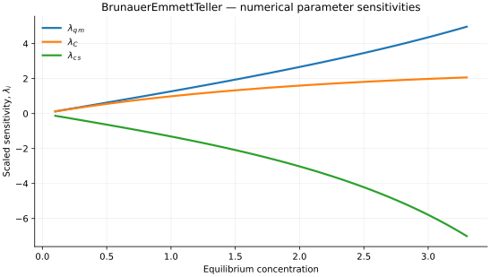

..
   ==============================================================================
   Name        : BrunauerEmmettTeller.rst
   Authors     : Joao Flavio Vasconcellos
   Version     : 2.0.0
   Description : Model equation, validity, code example and reproducible figures.

   Copyright   : Copyright (C) 2026 Joao Flavio Vasconcellos
   Licence     : MIT License (see LICENSE.txt)
   SPDX-License-Identifier: MIT
   ==============================================================================

Brunauer–Emmett–Teller isotherm
===============================

Original publication and scope
------------------------------

Brunauer, S., Emmett, P. H. and Teller, E. (1938), *Adsorption of Gases in
Multimolecular Layers*, *Journal of the American Chemical Society*, **60**
(2), 309–319. DOI: `10.1021/ja01269a023
<https://doi.org/10.1021/ja01269a023>`_. This is the original BET treatment
of gas adsorption in successive molecular layers.

Anderson, R. B. (1946), *Modifications of the Brunauer, Emmett and Teller
Equation*, *Journal of the American Chemical Society*, **68** (4), 686–691.
DOI: `10.1021/ja01208a049 <https://doi.org/10.1021/ja01208a049>`_.
This paper develops an early extension of the BET treatment.

Vyawahare, P., Tun, H., Vaughn, M. W. and Chen, C.-C. (2022), *From Langmuir
isotherm to Brunauer–Emmett–Teller isotherm*, *AIChE Journal*, **68** (3),
e17523. DOI: `10.1002/aic.17523 <https://doi.org/10.1002/aic.17523>`_.
The authors develop a thermodynamic, activity-based treatment of multilayer
adsorption.

Hu, Q., Lan, R., He, L., Liu, H. and Pei, X. (2023), *A critical review of
adsorption isotherm models for aqueous contaminants: Curve characteristics,
site energy distribution and common controversies*, *Journal of
Environmental Management*, **329**, 117104. DOI:
`10.1016/j.jenvman.2022.117104
<https://doi.org/10.1016/j.jenvman.2022.117104>`_. This review places
adsorption models in the context of their assumptions and appropriate use.

Tu, J., Chien, S.-C. and Lin, L.-C. (2026), *Surface area determination of
porous materials: the BET approach, its limitations, and alternatives*,
*Chemical Society Reviews*, online publication, 12 October 2026.
DOI: `10.1039/D6CS00693K <https://doi.org/10.1039/D6CS00693K>`_. The review
examines limitations of BET-based surface-area determination in porous
materials.

The implemented three-parameter equation uses :math:`q_m`, :math:`C` and
:math:`c_s`, with the reduced variable :math:`x=C_e/c_s`. Here :math:`C_e`
and :math:`c_s` must have the same concentration units, whereas :math:`x` and
:math:`C` are dimensionless. The original gas-phase BET equation is
conventionally expressed using relative pressure :math:`p/p_0`. A
concentration-based application must therefore specify the meaning of
:math:`c_s`; correspondence with a gas-phase saturation pressure or an
aqueous activity is not automatic.

Mathematical formulation
------------------------

.. math::

   q_e=\frac{q_m C c_e}{(c_s-c_e)[1+(C-1)c_e/c_s]}

The three adjustable parameters are ``q_m``, ``C`` and ``c_s``.
All must be strictly positive and finite. The model accepts finite,
non-negative equilibrium concentrations, while the derivative requires
strictly positive concentration.

An analytical concentration derivative is implemented and checked against an
independently calculated centred difference.

The concentration must remain strictly below the saturation concentration
:math:`c_s`; the model diverges as that boundary is approached.

The implementation requires the following admissible parameter and input domain:

.. math::

   q_{\mathrm{m}}>0,\quad C>0,\quad c_{\mathrm{s}}>0,\quad 0\leq C_e<c_s.

C++20 usage
-----------

.. code-block:: cpp

   #include <isotherm/isotherm.hpp>

   const isotherm::models::BrunauerEmmettTeller model{5, 2, 8};
   const isotherm::Real uptake = isotherm::evaluate(model, 0.8);   // 1.010101
   const isotherm::Real slope = isotherm::derivative(model, 0.8);  // 1.2881339

.. raw:: html

   

     <a class="isotherm-source-action" href="../../../source-browser/src/isotherm/models/ThreeParameters/BrunauerEmmettTeller.hpp.html">Implementation</a>
     <a class="isotherm-source-action" href="../../../source-browser/IsothermTest/ThreeParameters/BrunauerEmmettTeller/test_brunauer_emmett_teller.cpp.html">Tests</a>
     <a class="isotherm-source-action" href="../../../source-browser/Examples/ThreeParameters/BrunauerEmmettTeller/main.cpp.html">Example</a>
   

Brunauer–Emmett–Teller isotherm plot
------------------------------------

   Brunauer–Emmett–Teller uptake for :math:`q_m=5`, :math:`C=2`, :math:`c_s=8`.

Concentration derivative
------------------------

   Concentration derivative of Brunauer–Emmett–Teller uptake for :math:`q_m=5`, :math:`C=2`,
   :math:`c_s=8`.

Numerical sensitivity
---------------------

For each coefficient :math:`k_i`, the numerical scaled sensitivity is

.. math::

   \lambda_i(C_e)=k_i\frac{\partial q_e}{\partial k_i}.

Numerical values are obtained by perturbing individual parameters and evaluating new instances of the C++ model. The accompanying C++20 example performs this procedure.

   Scaled sensitivities :math:`\lambda_{q_m}`, :math:`\lambda_{C}`, :math:`\lambda_{c_s}`
   versus equilibrium concentration.

Validation and limitations
--------------------------

.. math::

   q_{\mathrm{m}}>0,\quad C>0,\quad c_{\mathrm{s}}>0,\quad 0\leq C_e<c_s.
