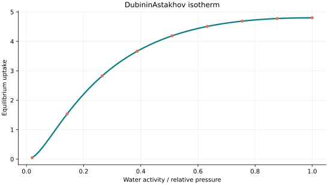
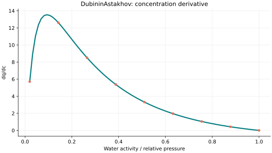
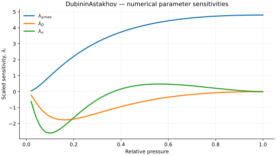

..
   ============================================================================
   Name        : DubininAstakhov.rst
   Authors     : Joao Flavio Vasconcellos
   Version     : 2.0.0
   Description : Scientific equation, numerical domain and reproducible figures.

   Copyright   : Copyright (C) 2026 Joao Flavio Vasconcellos
   Licence     : MIT License (see LICENSE.txt)
   SPDX-License-Identifier: MIT
   ============================================================================

DubininAstakhov isotherm
========================

Original publication and scope
------------------------------

Dubinin, M. M. and Astakhov, V. A. (1971), *Development of the concepts
of volume filling of micropores in the adsorption of gases and vapors by
microporous adsorbents*, *Bulletin of the Academy of Sciences of the USSR,
Division of Chemical Science*, **20** (1), 3–7. DOI:
`10.1007/BF00849307 <https://doi.org/10.1007/BF00849307>`_. This work
establishes the Dubinin–Astakhov extension of micropore volume-filling
theory, generalising the exponent of the Dubinin–Radushkevich model.

Ozawa, S., Kusumi, S. and Ogino, Y. (1976), *Physical adsorption of gases at
high pressure. IV. An improvement of the Dubinin–Astakhov adsorption
equation*, *Journal of Colloid and Interface Science*, **56** (1), 83–91.
DOI: `10.1016/0021-9797(76)90149-1
<https://doi.org/10.1016/0021-9797(76)90149-1>`_. The study discusses an
extension for high-pressure gas adsorption.

Stoeckli, F., Jakubov, T. and Lavanchy, A. (1994), *Water adsorption in
active carbons described by the Dubinin–Astakhov equation*, *Journal of the
Chemical Society, Faraday Transactions*, **90**, 783–786. DOI:
`10.1039/FT9949000783 <https://doi.org/10.1039/FT9949000783>`_. This work
applies the model to water vapour uptake and type-V adsorption behaviour.

Stoeckli, F., López-Ramón, M. V. and Moreno-Castilla, C. (2001), *Adsorption
of Phenolic Compounds from Aqueous Solutions, by Activated Carbons,
Described by the Dubinin–Astakhov Equation*, *Langmuir*, **17** (11),
3301–3306. DOI: `10.1021/la0014407
<https://doi.org/10.1021/la0014407>`_. This study applies a related
potential-based treatment to aqueous adsorption, with its own definition of
the adsorption potential.

Brouers, F. and Marquez-Montesino, F. (2016), *Dubinin isotherms versus the
Brouers–Sotolongo family isotherms: A case study*, *Adsorption Science &
Technology*, **34** (9–10), 552–564. DOI:
`10.1177/0263617416670909
<https://doi.org/10.1177/0263617416670909>`_. The authors compare the
relationships and limitations of these model families.

The C++ class uses the reduced form :math:`q_e=q_{\max}\exp[-D(-\ln x)^n]`,
where the dimensionless input :math:`x=p/p_0` is relative vapour pressure
(:math:`p_0` is the saturation vapour pressure at the measurement
temperature). For water-vapour sorption, :math:`x` may be interpreted as water
activity under the corresponding vapour–liquid equilibrium convention.
The coefficient :math:`D` is dimensionless and incorporates the adsorption
energy and absolute temperature for a fixed-temperature fit, conventionally
:math:`D=(RT/E)^n` when :math:`E` denotes the characteristic adsorption
energy. The class does not take :math:`T` or :math:`E` as separate inputs.
A liquid-phase concentration must not be passed as :math:`x` without first
defining and justifying its transformation to a dimensionless quantity.

Mathematical formulation
------------------------

.. math::

   q=q_{\max}\exp\left[-D\left(-\ln x\right)^n\right]

The 3 adjustable parameters are: ``q_max``, ``D``, ``n``.
The independent variable is ``water activity or relative pressure``.

0 < x <= 1, with q(0) defined by limit 0. Exponent n >= 1 to keep the derivative finite at x=1.

D is an effective temperature-specific coefficient, not an independently specified adsorption energy.

The implementation requires the following admissible parameter and input domain:

.. math::

   q_{\mathrm{max}}>0,\quad D>0,\quad n>0,\quad n\geq 1,\quad 0\leq x\leq 1.

C++20 usage
-----------

.. code-block:: cpp

   #include <isotherm/isotherm.hpp>

   const isotherm::models::DubininAstakhov model{4.8, 0.3, 2};
   const isotherm::Real uptake = isotherm::evaluate(model, 0.5);   // 4.1556964
   const isotherm::Real slope = isotherm::derivative(model, 0.5);  // 3.4566111

.. raw:: html

   

     <a class="isotherm-source-action" href="../../../source-browser/src/isotherm/models/ThreeParameters/DubininAstakhov.hpp.html">Implementation</a>
     <a class="isotherm-source-action" href="../../../source-browser/IsothermTest/ThreeParameters/DubininAstakhov/test_dubinin_astakhov.cpp.html">Tests</a>
     <a class="isotherm-source-action" href="../../../source-browser/Examples/ThreeParameters/DubininAstakhov/main.cpp.html">Example</a>
   

Dubinin–Astakhov isotherm plot
------------------------------

   Dubinin–Astakhov uptake for :math:`q_{\max}=4.8`, :math:`D=0.3`, :math:`n=2`.

Concentration derivative
------------------------

   Relative-pressure derivative of Dubinin–Astakhov uptake for :math:`q_{\max}=4.8`,
   :math:`D=0.3`, :math:`n=2`.

Numerical sensitivity
---------------------

For each coefficient :math:`k_i`, the numerical scaled sensitivity is

.. math::

   \lambda_i(x)=k_i\frac{\partial q_e}{\partial k_i}.

Numerical values are obtained by perturbing individual parameters and evaluating new instances of the C++ model. The accompanying C++20 example performs this procedure.

   Scaled sensitivities :math:`\lambda_{q_{\max}}`, :math:`\lambda_{D}`, :math:`\lambda_{n}`
   versus relative pressure.

Validation and limitations
--------------------------

.. math::

   q_{\mathrm{max}}>0,\quad D>0,\quad n>0,\quad n\geq 1,\quad 0\leq x\leq 1.
