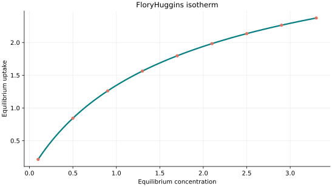
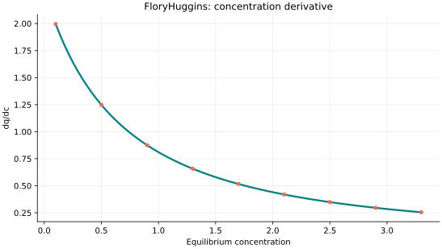
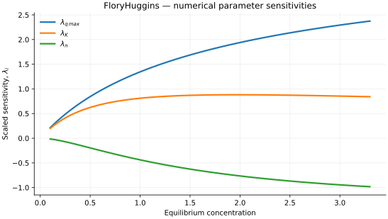

..
   ============================================================================
   Name        : FloryHuggins.rst
   Authors     : Joao Flavio Vasconcellos
   Version     : 2.0.0
   Description : Scientific equation, numerical domain and reproducible figures.

   Copyright   : Copyright (C) 2026 Joao Flavio Vasconcellos
   Licence     : MIT License (see LICENSE.txt)
   SPDX-License-Identifier: MIT
   ============================================================================

FloryHuggins isotherm
=====================

Original publication and scope
------------------------------

The Flory–Huggins framework originated in the independent statistical-thermodynamic treatments of polymer solutions developed by Huggins and Flory. These papers establish the theoretical background; they should not be presented as original derivations of the particular aqueous-adsorption coverage equation used by this model.

The principal early references are:

* Huggins, M. L. (1941), *Solutions of Long Chain Compounds*, *The Journal of Chemical Physics*, **9** (5), 440. DOI: `10.1063/1.1750930 <https://doi.org/10.1063/1.1750930>`_.
* Flory, P. J. (1941), *Thermodynamics of High Polymer Solutions*, *The Journal of Chemical Physics*, **9** (8), 660. DOI: `10.1063/1.1750971 <https://doi.org/10.1063/1.1750971>`_.
* Flory, P. J. (1942), *Thermodynamics of High Polymer Solutions*, *The Journal of Chemical Physics*, **10** (1), 51–61. DOI: `10.1063/1.1723621 <https://doi.org/10.1063/1.1723621>`_.
* Huggins, M. L. (1942), *Some Properties of Solutions of Long-chain Compounds*, *The Journal of Physical Chemistry*, **46** (1), 151–158. DOI: `10.1021/j150415a018 <https://doi.org/10.1021/j150415a018>`_.

The implemented adsorption relation expresses the surface coverage as an implicit function of equilibrium concentration, with three fitted parameters: saturation loading, an equilibrium coefficient and a coverage exponent. It is not the Flory–Huggins form of vacancy solution theory, which is documented separately.

Chu, Hashim, Bashiri, Debord, Harel and Bollinger (2023), *The Flory–Huggins Isotherm and Water Contaminant Adsorption: Debunking Some Modeling Fallacies*, *Industrial & Engineering Chemistry Research*, **62** (2), 1121–1131, DOI: `10.1021/acs.iecr.2c03799 <https://doi.org/10.1021/acs.iecr.2c03799>`_, analyse the aqueous-adsorption form and demonstrate that a commonly used linearisation is inconsistent with its nonlinear equation. The C++ model evaluates the implicit nonlinear equation rather than that linearisation.

Mathematical formulation
------------------------

.. math::

   \theta=Kx(1-\theta)^n,\quad q=q_{\max}\theta

The 3 adjustable parameters are: ``q_max``, ``K``, ``n``.
The independent variable is ``concentration``.

Positive q_max,K,n. Root theta in [0,1) is unique and found by bisection. Assumes x is the driving concentration (cf. some sources use initial concentration C_i).

This coverage equation should not be confused with Flory–Huggins vacancy solution theory.

The implementation requires the following admissible parameter and input domain:

.. math::

   q_{\mathrm{max}}>0,\quad K>0,\quad n>0,\quad C_e\geq0.

C++20 usage
-----------

.. code-block:: cpp

   #include <isotherm/isotherm.hpp>

   const isotherm::models::FloryHuggins model{4.2, 0.55, 1.4};
   const isotherm::Real uptake = isotherm::evaluate(model, 0.5);   // 0.84377187
   const isotherm::Real slope = isotherm::derivative(model, 0.5);  // 1.248214

.. raw:: html

   

     <a class="isotherm-source-action" href="../../../source-browser/include/isotherm/models/ThreeParameters/FloryHuggins.hpp.html">Implementation</a>
     <a class="isotherm-source-action" href="../../../source-browser/IsothermTest/ThreeParameters/FloryHuggins/test_flory_huggins.cpp.html">Tests</a>
     <a class="isotherm-source-action" href="../../../source-browser/Examples/ThreeParameters/FloryHuggins/main.cpp.html">Example</a>
   

Flory–Huggins isotherm plot
---------------------------

   Flory–Huggins uptake for :math:`q_{\max}=4.2`, :math:`K=0.55`, :math:`n=1.4`.

Concentration derivative
------------------------

   Concentration derivative of Flory–Huggins uptake for :math:`q_{\max}=4.2`,
   :math:`K=0.55`, :math:`n=1.4`.

Numerical sensitivity
---------------------

For each coefficient :math:`k_i`, the numerical scaled sensitivity is

.. math::

   \lambda_i(C_e)=k_i\frac{\partial q_e}{\partial k_i}.

Numerical values are obtained by perturbing individual parameters and evaluating new instances of the C++ model. The accompanying C++20 example performs this procedure.

   Scaled sensitivities :math:`\lambda_{q_{\max}}`, :math:`\lambda_{K}`, :math:`\lambda_{n}`
   versus equilibrium concentration.

Validation and limitations
--------------------------

.. math::

   q_{\mathrm{max}}>0,\quad K>0,\quad n>0,\quad C_e\geq0.
