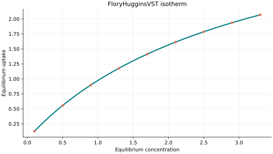
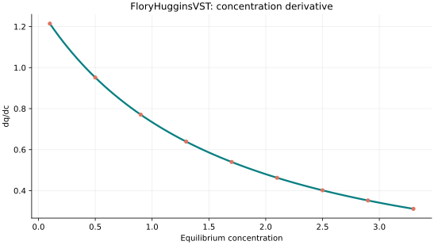
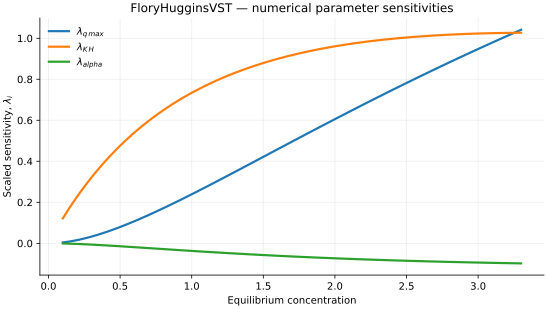

..
   ============================================================================
   Name        : FloryHugginsVST.rst
   Authors     : Joao Flavio Vasconcellos
   Version     : 2.0.0
   Description : Scientific equation, numerical domain and reproducible figures.

   Copyright   : Copyright (C) 2026 Joao Flavio Vasconcellos
   Licence     : MIT License (see LICENSE.txt)
   SPDX-License-Identifier: MIT
   ============================================================================

FloryHugginsVST isotherm
========================

Original publication and scope
------------------------------

Vacancy solution theory (VST) treats adsorption equilibrium using an adsorbed phase containing adsorbate molecules and hypothetical vacancies. Suwanayuen and Danner established this approach for gas adsorption. Cochran, Kabel and Danner subsequently introduced the Flory–Huggins activity-coefficient formulation (FH-VST), with three adjustable quantities: a Henry-law constant, a limiting adsorption capacity and a gas–solid interaction parameter.

The principal references are:

* Suwanayuen, S. and Danner, R. P. (1980), *A Gas Adsorption Isotherm Equation Based on Vacancy Solution Theory*, *AIChE Journal*, **26** (1), 68–76. DOI: `10.1002/aic.690260112 <https://doi.org/10.1002/aic.690260112>`_.
* Cochran, T. W., Kabel, R. L. and Danner, R. P. (1985), *Vacancy Solution Theory of Adsorption Using Flory-Huggins Activity Coefficient Equations*, *AIChE Journal*, **31** (2), 268–277. DOI: `10.1002/aic.690310214 <https://doi.org/10.1002/aic.690310214>`_.
* Cochran, T. W., Kabel, R. L. and Danner, R. P. (1985), *The Vacancy Solution Model of Adsorption—Improvements and Recommendations*, *AIChE Journal*, **31** (12), 2075–2081. DOI: `10.1002/aic.690311217 <https://doi.org/10.1002/aic.690311217>`_.

An application to pure and binary adsorption of carbon dioxide, methane and nitrogen on ZSM-5 is reported in *Adsorption of Carbon Dioxide, Methane and Nitrogen: Pure and Binary Mixture Adsorption for ZSM-5 with SiO2/Al2O3 Ratio of 280*, *Separation and Purification Technology*, **33** (2), 199–210 (2003), DOI: `10.1016/S1383-5866(02)00078-3 <https://doi.org/10.1016/S1383-5866(02)00078-3>`_. That study compares FH-VST with other adsorption models; it does not introduce FH-VST.

The original FH-VST formulation uses gas pressure as its driving variable. The C++ class evaluates the corresponding implicit three-parameter expression using the supplied concentration argument. A physical application must use dimensionally consistent units and must not assume that gas pressure and solution concentration are interchangeable without an appropriate thermodynamic relationship. This model is distinct from the surface-coverage FloryHuggins class.

Mathematical formulation
------------------------

.. math::

   x=\frac{q_{\max}}{K_H}\frac{\theta}{1-\theta}\exp\left(\frac{\alpha^2\theta}{1+\alpha\theta}\right)

The 3 adjustable parameters are: ``q_max``, ``K_H``, ``alpha``.
The independent variable is ``concentration``.

Positive q_max, K_H and alpha. The implicit forward relation is monotone for alpha>0; bisection returns the unique theta in (0,1).

FH-VST is not equivalent to the coverage-only FloryHuggins model; the activity coefficient is part of vacancy solution theory.

The implementation requires the following admissible parameter and input domain:

.. math::

   q_{\mathrm{max}}>0,\quad K_{\mathrm{H}}>0,\quad \alpha>0,\quad C_e\geq0.

C++20 usage
-----------

.. code-block:: cpp

   #include <isotherm/isotherm.hpp>

   const isotherm::models::FloryHugginsVST model{4.2, 1.3, 0.35};
   const isotherm::Real uptake = isotherm::evaluate(model, 0.5);   // 0.55538254
   const isotherm::Real slope = isotherm::derivative(model, 0.5);  // 0.95166432

.. raw:: html

   

     <a class="isotherm-source-action" href="../../../source-browser/src/isotherm/models/ThreeParameters/FloryHugginsVST.hpp.html">Implementation</a>
     <a class="isotherm-source-action" href="../../../source-browser/IsothermTest/ThreeParameters/FloryHugginsVST/test_flory_huggins_v_s_t.cpp.html">Tests</a>
     <a class="isotherm-source-action" href="../../../source-browser/Examples/ThreeParameters/FloryHugginsVST/main.cpp.html">Example</a>
   

Flory–Huggins VST isotherm plot
-------------------------------

   Flory–Huggins VST uptake for :math:`q_{\max}=4.2`, :math:`K_H=1.3`, :math:`\alpha=0.35`.

Concentration derivative
------------------------

   Concentration derivative of Flory–Huggins VST uptake for :math:`q_{\max}=4.2`,
   :math:`K_H=1.3`, :math:`\alpha=0.35`.

Numerical sensitivity
---------------------

For each coefficient :math:`k_i`, the numerical scaled sensitivity is

.. math::

   \lambda_i(C_e)=k_i\frac{\partial q_e}{\partial k_i}.

Numerical values are obtained by perturbing individual parameters and evaluating new instances of the C++ model. The accompanying C++20 example performs this procedure.

   Scaled sensitivities :math:`\lambda_{q_{\max}}`, :math:`\lambda_{K_H}`,
   :math:`\lambda_{\alpha}` versus equilibrium concentration.

Validation and limitations
--------------------------

.. math::

   q_{\mathrm{max}}>0,\quad K_{\mathrm{H}}>0,\quad \alpha>0,\quad C_e\geq0.
