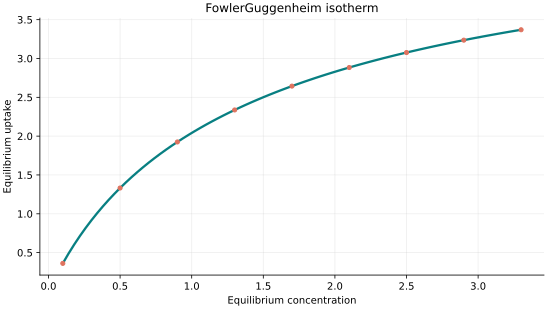
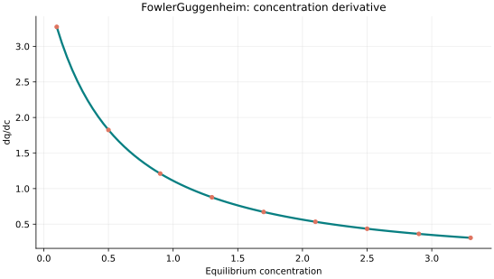
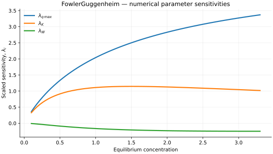

..
   ==============================================================================
   Name        : FowlerGuggenheim.rst
   Authors     : Joao Flavio Vasconcellos
   Version     : 2.0.0
   Description : Model equation, validity, code example and reproducible figures.

   Copyright   : Copyright (C) 2026 Joao Flavio Vasconcellos
   Licence     : MIT License (see LICENSE.txt)
   SPDX-License-Identifier: MIT
   ==============================================================================

Fowler–Guggenheim isotherm
==========================

Original publication and scope
------------------------------

The Fowler–Guggenheim model extends the Langmuir description of a monolayer
by allowing interactions between neighbouring adsorbed molecules. Its
statistical-mechanical background is presented by Fowler and Guggenheim
(1939), particularly in the discussion of surface layers. Fowler's earlier
1935 paper derived the non-interacting Langmuir isotherm from statistical
mechanics and is a theoretical precursor, rather than the source of the
lateral-interaction term.

* Fowler, R. H. (1935), *A Statistical Derivation of Langmuir's Adsorption
  Isotherm*, *Mathematical Proceedings of the Cambridge Philosophical
  Society*, **31** (2), 260–264. DOI:
  `10.1017/S0305004100013359 <https://doi.org/10.1017/S0305004100013359>`_.
* Fowler, R. H., and Guggenheim, E. A. (1939), *Statistical Thermodynamics*,
  Cambridge University Press, discussion of surface layers, pp. 421–451.
* Barbero, G., Evangelista, L. R., and Lelidis, I. (2021), *Effective
  adsorption energy and generalization of the Frumkin-Fowler-Guggenheim
  isotherm*, *Journal of Molecular Liquids*, **327**, 114795. DOI:
  `10.1016/j.molliq.2020.114795 <https://doi.org/10.1016/j.molliq.2020.114795>`_.
* Khunpetch, P., Majee, A., Ruixuan, H., and Podgornik, R. (2023),
  *Curvature effects in interfacial acidity of amphiphilic vesicles*,
  *Physical Review E*, **108**, 024402. DOI:
  `10.1103/PhysRevE.108.024402 <https://doi.org/10.1103/PhysRevE.108.024402>`_.

The later studies concern generalised lateral-interaction models and charge
regulation, respectively; they do not independently validate the precise
parameter convention used here. The C++ implementation employs an implicit
coverage equation with interaction parameter :math:`W\geq0` and a temperature
input in kelvin, as specified below. The sign and normalisation of interaction
parameters must be checked before comparing fitted coefficients across
published formulations.

Mathematical formulation
------------------------

.. math::

   Kc_e=\frac{\theta}{1-\theta}\exp\left(\frac{W\theta}{RT}\right),\qquad q_e=q_{\max}\theta

The three adjustable parameters are ``q_max`` (capacity), ``K`` (affinity)
and ``W`` (interaction energy). Capacity and affinity must be strictly positive;
interaction energy must be non-negative. All values must be finite. Equilibrium
concentration must be non-negative, while the absolute temperature is a separate,
strictly positive input **always in kelvin (K)**. By default, the gas
constant is 8.31446261815324 J mol⁻¹ K⁻¹, so the interaction energy uses
joules per mole. The constructor can select kJ/(mol K) or L atm/(mol K)
provided that the interaction energy is expressed in the corresponding units.

A bracketed, monotonic log-activity solver determines the surface coverage
:math:`0\leq\theta<1`; derivatives use implicit differentiation, rather
than numerical differentiation of iterates.

The implementation requires the following admissible parameter and input domain:

.. math::

   q_{\mathrm{max}}>0,\quad K>0,\quad W\geq0,\quad C_e\geq0,\quad T>0\ \mathrm{K}.

The temperature input :math:`T` **must always be supplied in kelvin (K)**. The interaction energy and selected value of :math:`R` must use compatible units.

C++20 usage
-----------

.. code-block:: cpp

   #include <isotherm/isotherm.hpp>

   const isotherm::models::FowlerGuggenheim model{5, 0.8, 900};
   const isotherm::Real temperature_k = 298.15;                                   // Always kelvin.
   const isotherm::Real uptake = isotherm::evaluate(model, 0.8, temperature_k);   // 1.7982749
   const isotherm::Real slope = isotherm::derivative(model, 0.8, temperature_k);  // 1.3283299

   // Equivalent energy representation: W=0.9 kJ/mol.
   const isotherm::models::FowlerGuggenheim model_kj{
       5, 0.8, 0.9, isotherm::gas_constant_unit::kilojoule_per_mole_kelvin};

.. raw:: html

   

     <a class="isotherm-source-action" href="../../../source-browser/src/isotherm/models/ThreeParameters/FowlerGuggenheim.hpp.html">Implementation</a>
     <a class="isotherm-source-action" href="../../../source-browser/IsothermTest/ThreeParameters/FowlerGuggenheim/test_fowler_guggenheim.cpp.html">Tests</a>
     <a class="isotherm-source-action" href="../../../source-browser/Examples/ThreeParameters/FowlerGuggenheim/main.cpp.html">Example</a>
   

Fowler–Guggenheim isotherm plot
-------------------------------

   Fowler–Guggenheim uptake for :math:`q_{\max}=5`, :math:`K=0.8`, :math:`W=900` at
   :math:`T=298.15\,\mathrm{K}`.

Concentration derivative
------------------------

   Concentration derivative of Fowler–Guggenheim uptake for :math:`q_{\max}=5`,
   :math:`K=0.8`, :math:`W=900` at :math:`T=298.15\,\mathrm{K}`.

Numerical sensitivity
---------------------

For each coefficient :math:`k_i`, the numerical scaled sensitivity is

.. math::

   \lambda_i(C_e;T)=k_i\frac{\partial q_e}{\partial k_i}.

Numerical values are obtained by perturbing individual parameters and evaluating new instances of the C++ model. The accompanying C++20 example performs this procedure.

   Scaled sensitivities :math:`\lambda_{q_{\max}}`, :math:`\lambda_{K}`, :math:`\lambda_{W}`
   versus equilibrium concentration at :math:`T=298.15\,\mathrm{K}`.

Validation and limitations
--------------------------

.. math::

   q_{\mathrm{max}}>0,\quad K>0,\quad W\geq0,\quad C_e\geq0,\quad T>0\ \mathrm{K}.
