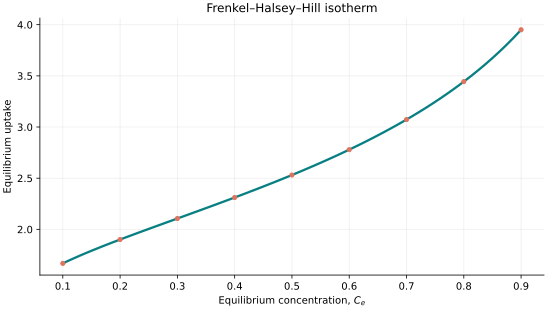
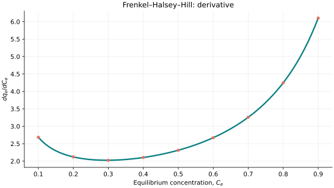
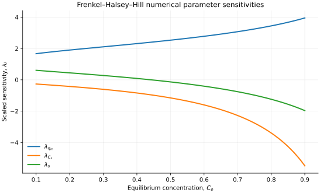

..
   ============================================================================
   Name        : FrenkelHalseyHill.rst
   Authors     : Joao Flavio Vasconcellos
   Version     : 2.0.0
   Description : Concentration-based FHH convention, C++20 examples and figures.

   Copyright   : Copyright (C) 2026 Joao Flavio Vasconcellos
   Licence     : MIT License (see LICENSE.txt)
   SPDX-License-Identifier: MIT
   ============================================================================

Frenkel–Halsey–Hill isotherm
============================

Original publication and scope
------------------------------

The Frenkel–Halsey–Hill (FHH) theory describes multilayer physical
adsorption in terms of an adsorption potential that changes with film
thickness. Its classical formulation commonly uses relative vapour
pressure. The Isotherm++ class implements the **concentration-based
three-parameter convention** specified below; this should not be
interpreted as a universal thermodynamic substitution of liquid-phase
concentration for relative vapour pressure.

The historical and subsequent sources include:

* Frenkel, J. (1946), *Kinetic Theory of Liquids*, Oxford University
  Press. A theoretical precursor, not the source of this exact C++
  parametrisation.
* Halsey, G. (1948), *Physical Adsorption on Non-Uniform Surfaces*,
  *The Journal of Chemical Physics*, **16** (10), 931–937.
  `DOI: 10.1063/1.1746689 <https://doi.org/10.1063/1.1746689>`_.
* Hill, T. L. (1952), a contribution in *Advances in Catalysis*, volume 4,
  Academic Press. Specific chapter metadata have not been independently
  verified for this documentation.
* Pierce, C. (1960), *The Frenkel–Halsey–Hill Adsorption Isotherm and
  Capillary Condensation*, *The Journal of Physical Chemistry*, **64**,
  1184–1187.
  `DOI: 10.1021/j100838a018 <https://doi.org/10.1021/j100838a018>`_.
* Pfeifer, P., Obert, M., and Cole, M. W. (1989), *Fractal BET and FHH
  Theories of Adsorption: A Comparative Study*, *Proceedings of the Royal
  Society of London A*, **423**, 169–188.
  `DOI: 10.1098/rspa.1989.0049 <https://doi.org/10.1098/rspa.1989.0049>`_.
* *A Review on the Adsorption Isotherms and Design Calculations for the
  Optimization of Adsorbent Mass and Contact Time* (2023), *ACS Omega*.
  `DOI: 10.1021/acsomega.2c08155 <https://doi.org/10.1021/acsomega.2c08155>`_.
  This review presents the concentration-based FHH relation with an
  additional coefficient :math:`k`.
* Chu, K. H., and co-authors (2023), *The Halsey Isotherm for Water
  Contaminant Adsorption Is Fake*, *Separation and Purification
  Technology*, **313**, 123500.
  `DOI: 10.1016/j.seppur.2023.123500 <https://doi.org/10.1016/j.seppur.2023.123500>`_.
  This paper cautions against uncritical use of certain concentration-based
  equations marketed as Halsey models. It does not establish the physical
  validity of every concentration-form FHH parametrisation.

Mathematical formulation
------------------------

The equation implemented by the C++20 class is

.. math::

   q_e(C_e)=q_m\left[\ln\left(\frac{C_s}{C_e}\right)\right]^{-1/s}.

The parameters are :math:`q_m>0` (uptake scaling coefficient),
:math:`C_s>0` (reference saturation concentration), and :math:`s>0`
(dimensionless exponent). The independent variable is equilibrium
concentration :math:`C_e`, expressed in the **same units** as :math:`C_s`.
Temperature is not a separate input to this implementation.

The admissible mathematical domain is

.. math::

   q_m>0,\quad C_s>0,\quad s>0,\quad 0<C_e<C_s.

A commonly reported concentration-based FHH relation includes an
additional coefficient :math:`k`:

.. math::

   -\ln(C_e/C_s)=\frac{k}{(q_e/q_0)^s},
   \qquad k>0.

Solving for uptake gives

.. math::

   q_e=q_0\,k^{1/s}\left[\ln(C_s/C_e)\right]^{-1/s}.

The implemented three-parameter form absorbs :math:`k^{1/s}` into
:math:`q_m=q_0 k^{1/s}`. Consequently, the stored :math:`q_m` is an
**effective scale coefficient** and should not be presented as an
independently measured monolayer capacity without additional evidence.
This convention is not the rational-power Fritz–Schlünder V model.

The analytical concentration derivative is

.. math::

   \frac{dq_e}{dC_e}
   =\frac{q_e(C_e)}{s C_e\ln(C_s/C_e)} > 0.

For this parametrisation, uptake tends to zero as :math:`C_e\to0^+`
and diverges as :math:`C_e\to C_s^-`. It has no finite saturation
capacity at the upper boundary. Although :math:`C_s` can be stored as a
fitted coefficient, any physical interpretation as a saturation
concentration requires appropriate independent experimental evidence.

The parameters are not affected by the amplitude redundancy of the
previous :math:`(q_m,A,B)` pressure-based implementation, because
:math:`C_s` appears *inside* the logarithm. This does not guarantee
practical identifiability from a limited or noisy dataset.

C++20 usage
-----------

.. code-block:: cpp

   #include <isotherm/isotherm.hpp>

   // q_m = 2.4, C_s = 1.2, s = 2.5; C_e has the units of C_s.
   const isotherm::models::FrenkelHalseyHill model{2.4, 1.2, 2.5};
   const isotherm::Real uptake = isotherm::evaluate(model, 0.5);   // 2.5311331095
   const isotherm::Real slope = isotherm::derivative(model, 0.5);  // 2.3129398015

.. raw:: html

   

     <a class="isotherm-source-action" href="../../../source-browser/src/isotherm/models/ThreeParameters/FrenkelHalseyHill.hpp.html">Implementation</a>
     <a class="isotherm-source-action" href="../../../source-browser/IsothermTest/ThreeParameters/FrenkelHalseyHill/test_frenkel_halsey_hill.cpp.html">Tests</a>
     <a class="isotherm-source-action" href="../../../source-browser/Examples/ThreeParameters/FrenkelHalseyHill/main.cpp.html">Example</a>
   

Frenkel–Halsey–Hill isotherm plot
---------------------------------

   Uptake versus :math:`C_e` for :math:`q_m=2.4`, :math:`C_s=1.2`,
   and :math:`s=2.5`.

Concentration derivative
------------------------

   Analytical derivative with respect to :math:`C_e` for the same parameters.

Numerical sensitivity
---------------------

For each coefficient :math:`k_i`, the numerical scaled sensitivity is

.. math::

   \lambda_i(C_e)=k_i\frac{\partial q_e}{\partial k_i}.

Numerical values are obtained by perturbing individual parameters and evaluating new instances of the C++ model. The accompanying C++20 example performs this procedure.

   Scaled sensitivities :math:`\lambda_{q_m}`, :math:`\lambda_{C_s}`, :math:`\lambda_{s}`
   versus equilibrium concentration.

Validation and limitations
--------------------------

.. math::

   q_m>0,\quad C_s>0,\quad s>0,\quad 0<C_e<C_s.
