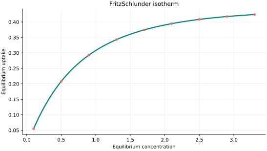
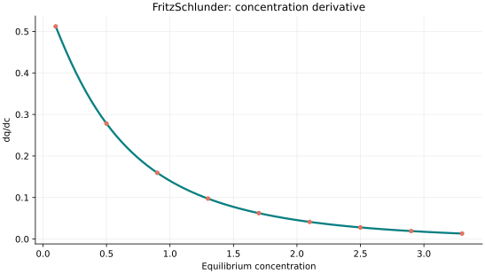
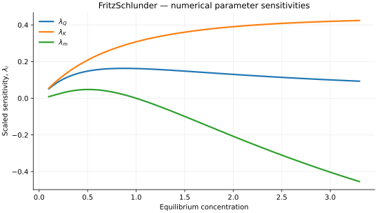

..
   ==============================================================================
   Name        : FritzSchlunder.rst
   Authors     : Joao Flavio Vasconcellos
   Version     : 2.0.0
   Description : Model equation, validity, code example and reproducible figures.

   Copyright   : Copyright (C) 2026 Joao Flavio Vasconcellos
   Licence     : MIT License (see LICENSE)
   SPDX-License-Identifier: MIT
   ==============================================================================

Fritz–Schlunder isotherm
========================

Original publication and scope
------------------------------

Fritz–Schlunder models are empirical rational expressions with adjustable
powers that provide flexibility for representing adsorption-equilibrium data.
Their bibliographical foundation is the work of Fritz and Schlünder (1974) on
simultaneous adsorption of organic solutes from dilute aqueous solutions onto
activated carbon. That paper establishes the model lineage; the specific
three-parameter equation implemented below must be identified from its
mathematical expression rather than inferred from the model name alone.

* Fritz, W., and Schlünder, E.-U. (1974), *Simultaneous adsorption equilibria
  of organic solutes in dilute aqueous solutions on activated carbon*,
  *Chemical Engineering Science*, **29** (5), 1279–1282. DOI:
  `10.1016/0009-2509(74)80128-4 <https://doi.org/10.1016/0009-2509(74)80128-4>`_.
* Kumar, K. V., Monteiro de Castro, M. C., Martinez-Escandell, M.,
  Molina-Sabio, M., and Rodriguez-Reinoso, F. (2010), *Adsorption on
  Heterogeneous Surfaces: Site Energy Distribution Functions from
  Fritz–Schlüender Isotherms*, *ChemPhysChem*, **11** (12), 2555–2560. DOI:
  `10.1002/cphc.201000307 <https://doi.org/10.1002/cphc.201000307>`_.
* Shukor, M. Y., and Sha'arani, S. A. W. (2023), *Adsorption of Sodium
  Dodecyl Sulfate onto Activated Coconut Shell-Based Adsorbent: Isothermal
  Remodelling*, *Journal of Environmental Microbiology and Toxicology*,
  **11** (1), 52–61. DOI:
  `10.54987/jemat.v11i1.884 <https://doi.org/10.54987/jemat.v11i1.884>`_.

The 2010 study examines distributions of adsorption-site energies associated
with Fritz–Schlüender representations. The 2023 comparison includes a
three-parameter variant, without establishing that it is preferable for other
adsorbates or materials. The implemented form is also algebraically related
to Redlich–Peterson-type rational equations; that relationship should not be
interpreted as proof of a distinct adsorption mechanism.

Mathematical formulation
------------------------

.. math::

   q_e=\frac{QKc_e}{1+Qc_e^m}

The three adjustable parameters are ``Q``, ``K`` and ``m``.
All must be strictly positive and finite. The model accepts finite,
non-negative equilibrium concentrations, while the derivative requires
strictly positive concentration.

An analytical concentration derivative is implemented and checked against an
independently calculated centred difference.

The implementation requires the following admissible parameter and input domain:

.. math::

   Q>0,\quad K>0,\quad m>0,\quad C_e\geq0.

C++20 usage
-----------

.. code-block:: cpp

   #include <isotherm/isotherm.hpp>

   const isotherm::models::FritzSchlunder model{0.9, 0.65, 1.15};
   const isotherm::Real uptake = isotherm::evaluate(model, 0.8);   // 0.2758947
   const isotherm::Real slope = isotherm::derivative(model, 0.8);  // 0.18207201

.. raw:: html

   

     <a class="isotherm-source-action" href="../../../source-browser/include/isotherm/models/ThreeParameters/FritzSchlunder.hpp.html">Implementation</a>
     <a class="isotherm-source-action" href="../../../source-browser/IsothermTest/ThreeParameters/FritzSchlunder/test_fritz_schlunder.cpp.html">Tests</a>
     <a class="isotherm-source-action" href="../../../source-browser/Examples/ThreeParameters/FritzSchlunder/main.cpp.html">Example</a>
   

Fritz–Schlunder isotherm plot
-----------------------------

   Fritz–Schlunder uptake for :math:`Q=0.9`, :math:`K=0.65`, :math:`m=1.15`.

Concentration derivative
------------------------

   Concentration derivative of Fritz–Schlunder uptake for :math:`Q=0.9`, :math:`K=0.65`,
   :math:`m=1.15`.

Numerical sensitivity
---------------------

For each coefficient :math:`k_i`, the numerical scaled sensitivity is

.. math::

   \lambda_i(C_e)=k_i\frac{\partial q_e}{\partial k_i}.

Numerical values are obtained by perturbing individual parameters and evaluating new instances of the C++ model. The accompanying C++20 example performs this procedure.

   Scaled sensitivities :math:`\lambda_{Q}`, :math:`\lambda_{K}`, :math:`\lambda_{m}` versus
   equilibrium concentration.

Validation and limitations
--------------------------

.. math::

   Q>0,\quad K>0,\quad m>0,\quad C_e\geq0.
