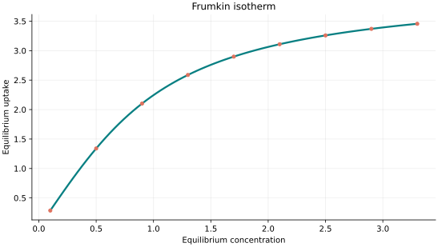
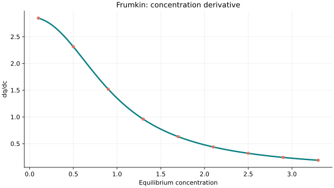
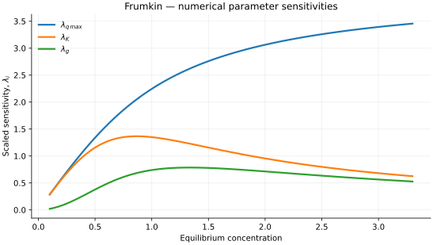

..
   ============================================================================
   Name        : Frumkin.rst
   Authors     : Joao Flavio Vasconcellos
   Version     : 2.0.0
   Description : Scientific equation, numerical domain and reproducible figures.

   Copyright   : Copyright (C) 2026 Joao Flavio Vasconcellos
   Licence     : MIT License (see LICENSE.txt)
   SPDX-License-Identifier: MIT
   ============================================================================

Frumkin isotherm
================

Original publication and scope
------------------------------

Frumkin's adsorption treatment accounts for lateral interactions between
adsorbed molecules in a surface layer. The historical starting point is
Frumkin's 1925 work on fatty-acid films and the equation of state of the
surface layer. A second paper published in the same volume addresses
adsorption and partitioning; it provides related background rather than an
independent derivation of the precise parameter convention implemented here.

* Frumkin, A. (1925), *Die Kapillarkurve der höheren Fettsäuren und die
  Zustandsgleichung der Oberflächenschicht*, *Zeitschrift für Physikalische
  Chemie*, **116U** (1), 466–484. DOI:
  `10.1515/zpch-1925-11629 <https://doi.org/10.1515/zpch-1925-11629>`_.
* Frumkin, A. (1925), *Einige Bemerkungen zur Theorie der Adsorption und
  Verteilung*, *Zeitschrift für Physikalische Chemie*, **116U** (1), 501–503.
  DOI: `10.1515/zpch-1925-11632 <https://doi.org/10.1515/zpch-1925-11632>`_.
* Mousavi, N. S., Javadi, A., Kovalchuk, V. I., Aksenenko, E. V., Loglio, G.,
  Vollhardt, D., Schneck, E., and Miller, R. (2025), *Frumkin's adsorption
  model – a successful approach for understanding surfactant adsorption
  layers*, *Zeitschrift für Physikalische Chemie*, **239** (10), 1705–1724.
  DOI: `10.1515/zpch-2025-0017
  <https://doi.org/10.1515/zpch-2025-0017>`_.

The 2025 study concerns adsorption at liquid interfaces and illustrates the
continuing use of the lateral-interaction description. The C++ model uses an
implicit surface-coverage relation and a dimensionless interaction coefficient
``g``; coefficients from other sign or scaling conventions should not be
compared without conversion.

Mathematical formulation
------------------------

.. math::

   Kx=\frac{\theta}{1-\theta}\exp(-g\theta),\quad q=q_{\max}\theta

The 3 adjustable parameters are: ``q_max``, ``K``, ``g``.
The independent variable is ``concentration``.

Positive q_max,K. Dimensionless g in [0,4); this subcritical range guarantees strictly increasing inverse and a unique equilibrium branch.

g >= 4 may permit multiple occupancy branches and is excluded rather than silently choosing one.

The implementation requires the following admissible parameter and input domain:

.. math::

   q_{\mathrm{max}}>0,\quad K>0,\quad g>0,\quad g<4,\quad C_e\geq0.

C++20 usage
-----------

.. code-block:: cpp

   #include <isotherm/isotherm.hpp>

   const isotherm::models::Frumkin model{4.1, 0.7, 1};
   const isotherm::Real uptake = isotherm::evaluate(model, 0.5);   // 1.3395007
   const isotherm::Real slope = isotherm::derivative(model, 0.5);  // 2.3124122

.. raw:: html

   

     <a class="isotherm-source-action" href="../../../source-browser/src/isotherm/models/ThreeParameters/Frumkin.hpp.html">Implementation</a>
     <a class="isotherm-source-action" href="../../../source-browser/IsothermTest/ThreeParameters/Frumkin/test_frumkin.cpp.html">Tests</a>
     <a class="isotherm-source-action" href="../../../source-browser/Examples/ThreeParameters/Frumkin/main.cpp.html">Example</a>
   

Frumkin isotherm plot
---------------------

   Frumkin uptake for :math:`q_{\max}=4.1`, :math:`K=0.7`, :math:`g=1`.

Concentration derivative
------------------------

   Concentration derivative of Frumkin uptake for :math:`q_{\max}=4.1`, :math:`K=0.7`,
   :math:`g=1`.

Numerical sensitivity
---------------------

For each coefficient :math:`k_i`, the numerical scaled sensitivity is

.. math::

   \lambda_i(C_e)=k_i\frac{\partial q_e}{\partial k_i}.

Numerical values are obtained by perturbing individual parameters and evaluating new instances of the C++ model. The accompanying C++20 example performs this procedure.

   Scaled sensitivities :math:`\lambda_{q_{\max}}`, :math:`\lambda_{K}`, :math:`\lambda_{g}`
   versus equilibrium concentration.

Validation and limitations
--------------------------

.. math::

   q_{\mathrm{max}}>0,\quad K>0,\quad g>0,\quad g<4,\quad C_e\geq0.
