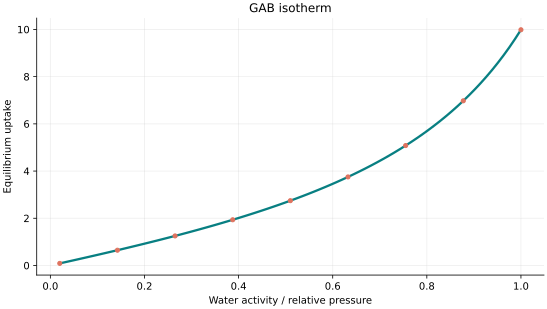
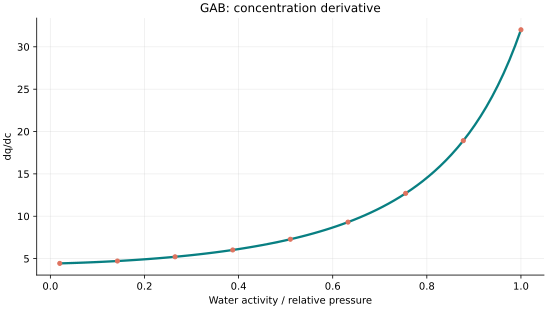
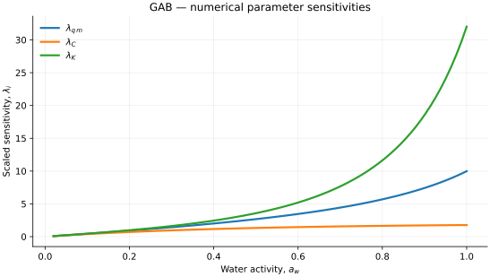

..
   ============================================================================
   Name        : GAB.rst
   Authors     : Joao Flavio Vasconcellos
   Version     : 2.0.0
   Description : Scientific equation, numerical domain and reproducible figures.

   Copyright   : Copyright (C) 2026 Joao Flavio Vasconcellos
   Licence     : MIT License (see LICENSE.txt)
   SPDX-License-Identifier: MIT
   ============================================================================

GAB isotherm
============

Original publication and scope
------------------------------

The Guggenheim–Anderson–de Boer (GAB) isotherm extends the BET
multilayer description by introducing an additional factor for the sorption
behaviour of layers beyond the first. The name recognises related independent
developments by Anderson (1946), de Boer (1953), and Guggenheim (1966). It is
widely used for equilibrium water-sorption isotherms in foods and other
hygroscopic materials.

* Anderson, R. B. (1946), *Modifications of the Brunauer, Emmett and Teller
  Equation*, *Journal of the American Chemical Society*, **68** (4), 686–691.
  DOI: `10.1021/ja01208a049 <https://doi.org/10.1021/ja01208a049>`_.
* de Boer, J. H. (1953), *The Dynamical Character of Adsorption*, Clarendon
  Press, Oxford.
* Guggenheim, E. A. (1966), *Applications of Statistical Mechanics*,
  Clarendon Press, Oxford.
* Roos, Y. H. (2024), *Water sorption modeling and monolayer of biological
  and food materials*, *LWT*, **201**, 116271. DOI:
  `10.1016/j.lwt.2024.116271
  <https://doi.org/10.1016/j.lwt.2024.116271>`_.

The 2024 review discusses the interpretation of GAB parameters, including the
estimated monolayer moisture content, and cautions that a physically distinct
monolayer is not necessarily established by a good fit to complex biological
materials. In the implementation below, the independent variable is water
activity :math:`a_w`, a dimensionless quantity defined as the equilibrium
water-vapour partial pressure divided by its saturation pressure at the same
temperature. The coefficient ``C`` is a GAB parameter, not a concentration.

Mathematical formulation
------------------------

.. math::

   q=\frac{q_m C K x}{(1-Kx)(1-Kx+C Kx)}

The 3 adjustable parameters are: ``q_m``, ``C``, ``K``.
The independent variable is ``water activity or relative pressure``.

0 <= x <= 1 water activity; 0 < K < 1 and C >= 1. These constraints ensure the implemented branch has no pole on [0,1] and is monotonic.

Parameters and uptake units are specific to moisture sorption, not directly exchangeable with gas adsorption concentration models.

The implementation requires the following admissible parameter and input domain:

.. math::

   q_{\mathrm{m}}>0,\quad C>0,\quad K>0,\quad C\geq 1,\quad K<1,\quad 0\leq a_w\leq1.

C++20 usage
-----------

.. code-block:: cpp

   #include <isotherm/isotherm.hpp>

   const isotherm::models::GAB model{3.4, 1.8, 0.72};
   const isotherm::Real uptake = isotherm::evaluate(model, 0.5);   // 2.6727484
   const isotherm::Real slope = isotherm::derivative(model, 0.5);  // 7.1570725

.. raw:: html

   

     <a class="isotherm-source-action" href="../../../source-browser/include/isotherm/models/ThreeParameters/GAB.hpp.html">Implementation</a>
     <a class="isotherm-source-action" href="../../../source-browser/IsothermTest/ThreeParameters/GAB/test_g_a_b.cpp.html">Tests</a>
     <a class="isotherm-source-action" href="../../../source-browser/Examples/ThreeParameters/GAB/main.cpp.html">Example</a>
   

GAB isotherm plot
-----------------

   GAB equilibrium moisture for :math:`q_m=3.4`, :math:`C=1.8`, :math:`K=0.72`.

Concentration derivative
------------------------

   Activity derivative of GAB equilibrium moisture for :math:`q_m=3.4`, :math:`C=1.8`,
   :math:`K=0.72`.

Numerical sensitivity
---------------------

For each coefficient :math:`k_i`, the numerical scaled sensitivity is

.. math::

   \lambda_i(x)=k_i\frac{\partial q_e}{\partial k_i}.

Numerical values are obtained by perturbing individual parameters and evaluating new instances of the C++ model. The accompanying C++20 example performs this procedure.

   Scaled sensitivities :math:`\lambda_{q_m}`, :math:`\lambda_{C}`, :math:`\lambda_{K}`
   versus water activity.

Validation and limitations
--------------------------

.. math::

   q_{\mathrm{m}}>0,\quad C>0,\quad K>0,\quad C\geq 1,\quad K<1,\quad 0\leq a_w\leq1.
