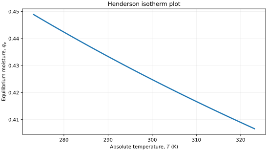
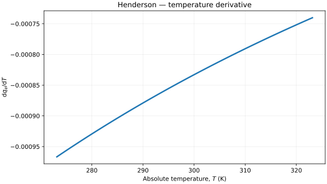
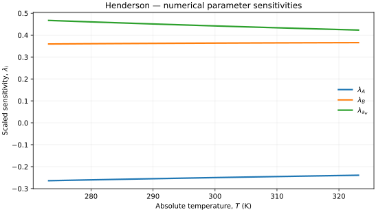

..
   ==============================================================================
   Name        : Henderson.rst
   Authors     : Joao Flavio Vasconcellos
   Version     : 2.0.0
   Description : Three-input temperature-section formulation and compiled numerical sensitivity.

   Copyright   : Copyright (C) 2026 Joao Flavio Vasconcellos
   Licence     : MIT License (see LICENSE)
   SPDX-License-Identifier: MIT
   ==============================================================================

Henderson isotherm
==================

Original publication and scope
------------------------------

Henderson, S. M. (1952), *A basic concept of equilibrium moisture*,
*Agricultural Engineering*, **33** (1), 29–32. This is the primary
publication of the Henderson moisture-sorption relation, as recorded in
the `FAO bibliography <https://www.fao.org/4/X5057S/x5057S07.htm>`_
and the `CiNii catalogue
<https://cir.nii.ac.jp/crid/1571417125188378112>`_. No DOI has been
verified for this article.

The original Henderson relation describes the equilibrium moisture content
of hygroscopic materials, particularly agricultural products, as a function
of water activity and temperature. It has **two empirical material
coefficients**. Water activity is the dimensionless vapour-pressure ratio
:math:`a_w=p_w/p_w^{\mathrm{sat}}` at the same temperature. The
formulation used here requires absolute temperature in kelvin.

Later studies have compared the original relation with temperature-dependent
modifications and other moisture-sorption models. Barrozo, Bego and Oliveira
(2008), *Equilibrium moisture of kale seed (Brassica oleracea var. acephala):
an alternative method for choice of the best model*, *International Journal
of Food Science and Technology*, **43** (10), 1844–1849,
`DOI 10.1111/j.1365-2621.2008.01728.x
<https://doi.org/10.1111/j.1365-2621.2008.01728.x>`_, discuss how
model selection and parameter behaviour depend on the moisture data.
Iji, Inyang and Etuk (2025), *American Journal of Food Science and
Technology*, **13** (2), 27–37,
`DOI 10.12691/ajfst-13-2-2
<https://doi.org/10.12691/ajfst-13-2-2>`_, review empirical
moisture-sorption models and their range-dependent applicability.
These references do not establish that the Henderson equation is the
best-fitting model for every material or water-activity interval.

Mathematical formulation
------------------------

.. math::

   1-a_w=\exp(-ATq_e^B),\qquad
   q_e(T;A,B,a_w)=\left(\frac{-\ln(1-a_w)}{AT}\right)^{1/B}.

The mathematical domain is

.. math::

   A>0,\quad B>0,\quad 0\le a_w<1,\quad T>0\ \mathrm{K}.

Here :math:`a_w` is the dimensionless water activity, and
:math:`T` **must always be provided in kelvin (K)**. For consistent units,
:math:`A` has units inverse to the product of temperature and equilibrium
moisture content raised to the power :math:`B`. The derivative produced by this class
is :math:`\mathrm{d}q_e/\mathrm{d}T` at fixed :math:`A`, :math:`B` and
:math:`a_w`, not a concentration derivative.

C++20 usage
-----------

.. code-block:: cpp

   #include <isotherm/isotherm.hpp>

   const isotherm::models::Henderson model{0.015, 1.7, 0.65};                 // A, B, a_w
   const isotherm::Real temperature_k = 298.15;                               // Kelvin
   const isotherm::Real moisture = isotherm::evaluate(model, temperature_k);  // 0.42634249
   const isotherm::Real slope = isotherm::derivative(model, temperature_k);   // -0.00084115277

.. raw:: html

   

     <a class="isotherm-source-action" href="../../../source-browser/include/isotherm/models/ThreeParameters/Henderson.hpp.html">Implementation</a>
     <a class="isotherm-source-action" href="../../../source-browser/IsothermTest/ThreeParameters/Henderson/test_henderson.cpp.html">Tests</a>
     <a class="isotherm-source-action" href="../../../source-browser/Examples/ThreeParameters/Henderson/main.cpp.html">Example</a>
   

Henderson isotherm plot
-----------------------

   Henderson equilibrium moisture for :math:`A=0.015`, :math:`B=1.7`, :math:`a_w=0.65`.

Temperature derivative
----------------------

   Temperature derivative of Henderson equilibrium moisture for :math:`A=0.015`,
   :math:`B=1.7`, :math:`a_w=0.65`.

Numerical sensitivity
---------------------

For the three constructor parameters :math:`k_i\in\{A,B,a_w\}`,
scaled numerical sensitivity is

.. math::

   \lambda_i(T)=k_i\frac{\partial q_e(T)}{\partial k_i}.

Numerical values are obtained by perturbing individual parameters and evaluating new instances of the C++ model. The accompanying C++20 example performs this procedure.

   Scaled sensitivities :math:`\lambda_{A}`, :math:`\lambda_{B}`, :math:`\lambda_{a_w}`
   versus absolute temperature.

Validation and limitations
--------------------------

.. math::

   A>0,\quad B>0,\quad 0\le a_w<1,\quad T>0\ \mathrm{K}.
