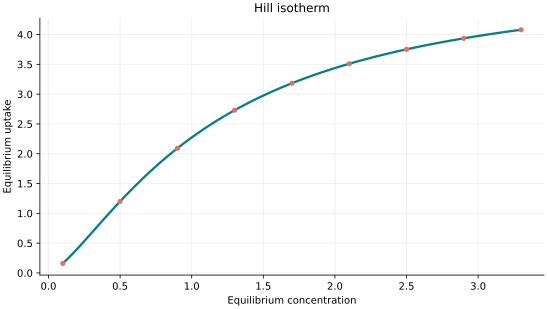
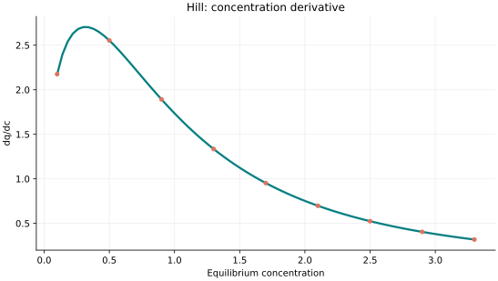
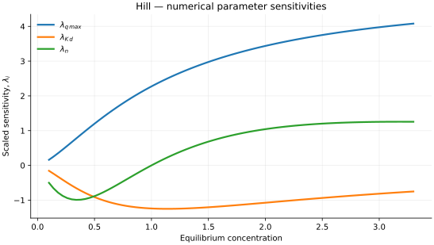

..
   ==============================================================================
   Name        : Hill.rst
   Authors     : Joao Flavio Vasconcellos
   Version     : 2.0.0
   Description : Model equation, validity, code example and reproducible figures.

   Copyright   : Copyright (C) 2026 Joao Flavio Vasconcellos
   Licence     : MIT License (see LICENSE.txt)
   SPDX-License-Identifier: MIT
   ==============================================================================

Hill isotherm
=============

Original publication and scope
------------------------------

The familiar Hill-type saturation law originates in A. V. Hill's
1910 analysis of cooperative oxygen binding by haemoglobin, not in a
1946 paper on gas adsorption. The relevant communication,
*The possible effects of the aggregation of the molecules of haemoglobin
on its dissociation curves*, appeared in *The Journal of Physiology*,
**40** (supplement), iv–vii, within the
`1910 Physiological Society proceedings
<https://doi.org/10.1113/jphysiol.1910.sp001386>`_. The linked DOI
identifies the proceedings containing the communication.

A different researcher, T. L. Hill, published *Statistical Mechanics of
Multimolecular Adsorption. II. Localized and Mobile Adsorption and
Absorption*, *The Journal of Chemical Physics*, **14** (7), 441–453
(1946), `DOI 10.1063/1.1724166
<https://doi.org/10.1063/1.1724166>`_. This is a foundational
statistical-mechanical study of adsorption, but it is not the origin of
the 1910 Hill binding equation.

As a contemporary adsorption application, Li et al. (2024),
*A novel magnetic Ti-MOF/chitosan composite for efficient adsorption
of Pb(II) from aqueous solutions: Synthesis and investigation*,
*International Journal of Biological Macromolecules*, **258**, 129170,
`DOI 10.1016/j.ijbiomac.2023.129170
<https://doi.org/10.1016/j.ijbiomac.2023.129170>`_, fitted the Hill
model to equilibrium data and reported a model-derived capacity of
944.9 mg/g. Such a fit does not, by itself, establish molecular-scale
cooperative interactions. The implemented :math:`n` is an empirical
exponent whose interpretation depends on independent physical evidence.

Mathematical formulation
------------------------

.. math::

   q_e=\frac{q_{\max}c_e^n}{K_d+c_e^n}

The three adjustable parameters are ``q_max``, ``K_d`` and ``n``.
All must be strictly positive and finite. The model accepts finite,
non-negative equilibrium concentrations, while the derivative requires
strictly positive concentration.

An analytical concentration derivative is implemented and checked against an
independently calculated centred difference.

The implementation requires the following admissible parameter and input domain:

.. math::

   q_{\mathrm{max}}>0,\quad K_{\mathrm{d}}>0,\quad n>0,\quad C_e\geq0.

C++20 usage
-----------

.. code-block:: cpp

   #include <isotherm/isotherm.hpp>

   const isotherm::models::Hill model{5, 1.2, 1.4};
   const isotherm::Real uptake = isotherm::evaluate(model, 0.8);   // 1.8939085
   const isotherm::Real slope = isotherm::derivative(model, 0.8);  // 2.0589286

.. raw:: html

   

     <a class="isotherm-source-action" href="../../../source-browser/src/isotherm/models/ThreeParameters/Hill.hpp.html">Implementation</a>
     <a class="isotherm-source-action" href="../../../source-browser/IsothermTest/ThreeParameters/Hill/test_hill.cpp.html">Tests</a>
     <a class="isotherm-source-action" href="../../../source-browser/Examples/ThreeParameters/Hill/main.cpp.html">Example</a>
   

Hill isotherm plot
------------------

   Hill uptake for :math:`q_{\max}=5`, :math:`K_d=1.2`, :math:`n=1.4`.

Concentration derivative
------------------------

   Concentration derivative of Hill uptake for :math:`q_{\max}=5`, :math:`K_d=1.2`,
   :math:`n=1.4`.

Numerical sensitivity
---------------------

For each coefficient :math:`k_i`, the numerical scaled sensitivity is

.. math::

   \lambda_i(C_e)=k_i\frac{\partial q_e}{\partial k_i}.

Numerical values are obtained by perturbing individual parameters and evaluating new instances of the C++ model. The accompanying C++20 example performs this procedure.

   Scaled sensitivities :math:`\lambda_{q_{\max}}`, :math:`\lambda_{K_d}`,
   :math:`\lambda_{n}` versus equilibrium concentration.

Validation and limitations
--------------------------

.. math::

   q_{\mathrm{max}}>0,\quad K_{\mathrm{d}}>0,\quad n>0,\quad C_e\geq0.
