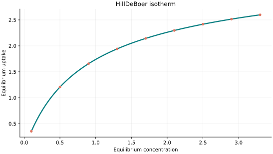
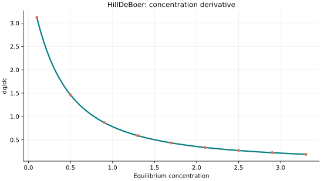
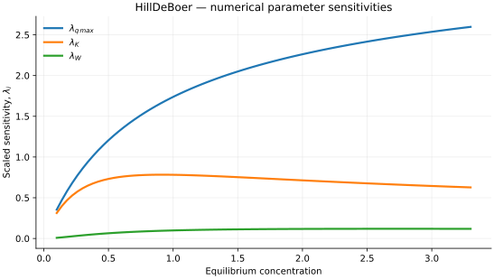

..
   ==============================================================================
   Name        : HillDeBoer.rst
   Authors     : Joao Flavio Vasconcellos
   Version     : 2.0.0
   Description : Model equation, validity, code example and reproducible figures.

   Copyright   : Copyright (C) 2026 Joao Flavio Vasconcellos
   Licence     : MIT License (see LICENSE.txt)
   SPDX-License-Identifier: MIT
   ==============================================================================

Hill–de Boer isotherm
=====================

Original publication and scope
------------------------------

The Hill–de Boer isotherm describes an adsorbed phase with
molecular mobility and lateral interactions. Its theoretical antecedent
is T. L. Hill (1946), *Statistical Mechanics of Multimolecular
Adsorption. II. Localized and Mobile Adsorption and Absorption*,
*The Journal of Chemical Physics*, **14** (7), 441–453,
`DOI 10.1063/1.1724166
<https://doi.org/10.1063/1.1724166>`_. Hill considered a mobile
adsorbed first layer through a two-dimensional equation of state.
J. H. de Boer subsequently provided a wider treatment in
*The Dynamical Character of Adsorption* (Clarendon Press, Oxford,
1953; `bibliographic record
<https://books.google.com/books?id=ZhJRAAAAMAAJ>`_).

A recent comparison by Chu, Hashim, Tran and Bollinger (2023),
*S-shaped adsorption isotherms modeled by the Frumkin–Fowler–Guggenheim
and Hill–de Boer equations*, *Monatshefte für Chemie*, **154**,
1127–1135, `DOI 10.1007/s00706-023-03116-w
<https://doi.org/10.1007/s00706-023-03116-w>`_, found that similar
curve-fitting performance can conceal substantial differences in
estimated saturation capacities. De Smedt et al. (2025) also applied
the Hill–de Boer equation to CO2 adsorption by pelletised activated
carbon in *Biomass and Bioenergy*, **107699**,
`DOI 10.1016/j.biombioe.2025.107699
<https://doi.org/10.1016/j.biombioe.2025.107699>`_. These studies
illustrate applications of the model without constituting validation
of every fitted parameter as an independently measurable physical
quantity.

Mathematical formulation
------------------------

.. math::

   Kc_e=\frac{\theta}{1-\theta}\exp\left(\frac{\theta}{1-\theta}-\frac{W\theta}{RT}\right),\qquad q_e=q_{\max}\theta

The three adjustable parameters are ``q_max`` (capacity), ``K`` (affinity)
and ``W`` (interaction energy). Capacity and affinity must be strictly positive;
interaction energy must be non-negative. All values must be finite. Equilibrium
concentration must be non-negative, while the absolute temperature is a separate,
strictly positive input **always in kelvin (K)**. By default, the gas
constant is 8.31446261815324 J mol⁻¹ K⁻¹, so the interaction energy uses
joules per mole. The constructor can select kJ/(mol K) or L atm/(mol K)
provided that the interaction energy is expressed in the corresponding units.

A bracketed, monotonic log-activity solver determines the surface coverage
:math:`0\leq\theta<1`; derivatives use implicit differentiation, rather
than numerical differentiation of iterates.

The accepted branch requires :math:`W/(RT)\leq 4`, a conservative sufficient
condition for a unique root. The library deliberately rejects stronger
interaction branches rather than selecting one equilibrium root arbitrarily.

The implementation requires the following admissible parameter and input domain:

.. math::

   q_{\mathrm{max}}>0,\quad K>0,\quad W\geq0,\quad W/(RT)\leq 4,\quad C_e\geq0,\quad T>0\ \mathrm{K}.

The temperature input :math:`T` **must always be supplied in kelvin (K)**. The interaction energy and selected value of :math:`R` must use compatible units.

C++20 usage
-----------

.. code-block:: cpp

   #include <isotherm/isotherm.hpp>

   const isotherm::models::HillDeBoer model{5, 0.8, 900};
   const isotherm::Real temperature_k = 298.15;                                   // Always kelvin.
   const isotherm::Real uptake = isotherm::evaluate(model, 0.8, temperature_k);   // 1.5633426
   const isotherm::Real slope = isotherm::derivative(model, 0.8, temperature_k);  // 0.97551664

   // Equivalent energy representation: W=0.9 kJ/mol.
   const isotherm::models::HillDeBoer model_kj{
       5, 0.8, 0.9, isotherm::gas_constant_unit::kilojoule_per_mole_kelvin};

.. raw:: html

   

     <a class="isotherm-source-action" href="../../../source-browser/src/isotherm/models/ThreeParameters/HillDeBoer.hpp.html">Implementation</a>
     <a class="isotherm-source-action" href="../../../source-browser/IsothermTest/ThreeParameters/HillDeBoer/test_hill_de_boer.cpp.html">Tests</a>
     <a class="isotherm-source-action" href="../../../source-browser/Examples/ThreeParameters/HillDeBoer/main.cpp.html">Example</a>
   

Hill–de Boer isotherm plot
--------------------------

   Hill–de Boer uptake for :math:`q_{\max}=5`, :math:`K=0.8`, :math:`W=900` at
   :math:`T=298.15\,\mathrm{K}`.

Concentration derivative
------------------------

   Concentration derivative of Hill–de Boer uptake for :math:`q_{\max}=5`, :math:`K=0.8`,
   :math:`W=900` at :math:`T=298.15\,\mathrm{K}`.

Numerical sensitivity
---------------------

For each coefficient :math:`k_i`, the numerical scaled sensitivity is

.. math::

   \lambda_i(C_e;T)=k_i\frac{\partial q_e}{\partial k_i}.

Numerical values are obtained by perturbing individual parameters and evaluating new instances of the C++ model. The accompanying C++20 example performs this procedure.

   Scaled sensitivities :math:`\lambda_{q_{\max}}`, :math:`\lambda_{K}`, :math:`\lambda_{W}`
   versus equilibrium concentration at :math:`T=298.15\,\mathrm{K}`.

Validation and limitations
--------------------------

.. math::

   q_{\mathrm{max}}>0,\quad K>0,\quad W\geq0,\quad W/(RT)\leq 4,\quad C_e\geq0,\quad T>0\ \mathrm{K}.
