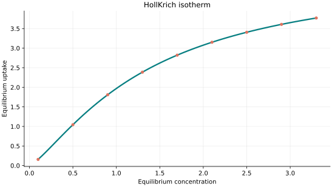
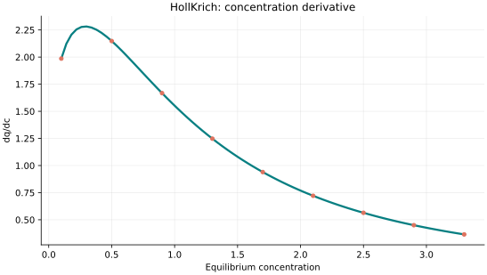
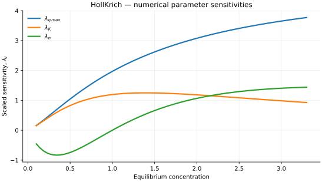

..
   ==============================================================================
   Name        : HollKrich.rst
   Authors     : Joao Flavio Vasconcellos
   Version     : 2.0.0
   Description : Model equation, validity, code example and reproducible figures.

   Copyright   : Copyright (C) 2026 Joao Flavio Vasconcellos
   Licence     : MIT License (see LICENSE)
   SPDX-License-Identifier: MIT
   ==============================================================================

Holl–Krich isotherm
===================

Original publication and scope
------------------------------

Holl–Krich is described in the adsorption literature as a three-parameter,
Langmuir-type relation with a concentration exponent. An example is Aniagor
and Menkiti (2020), who include the model in a comparative study of Cu(II)
and Pb(II) adsorption on activated carbon.

Aniagor, C. O., and Menkiti, M. C. (2020), *Relational description of an
adsorption system based on isotherm, adsorption density, adsorption potential,
hopping number and surface coverage*, *Sigma Journal of Engineering and
Natural Sciences*, **38** (3), 1073–1098.
`Full text <https://dergipark.org.tr/en/download/article-file/2017159>`_.

The equation used here is algebraically identical to the
Langmuir–Freundlich form with parameters :math:`q_{\max}`, :math:`K` and
:math:`n` and is also equivalent to a reparametrised Sips isotherm. In
particular, :math:`n=1` gives the Langmuir equation. These names therefore
do not denote distinct mathematical response functions in this parametrisation.
A single, verifiable primary publication establishing the *Holl–Krich* name
and its priority could not be established from the available sources; the
2020 publication is cited as a documented use, not as the origin.

Mathematical formulation
------------------------

.. math::

   q_e=\frac{q_{\max} Kc_e^n}{1+Kc_e^n}

The three adjustable parameters are ``q_max``, ``K`` and ``n``.
All must be strictly positive and finite. The model accepts finite,
non-negative equilibrium concentrations, while the derivative requires
strictly positive concentration.

An analytical concentration derivative is implemented and checked against an
independently calculated centred difference.

The implementation requires the following admissible parameter and input domain:

.. math::

   q_{\mathrm{max}}>0,\quad K>0,\quad n>0,\quad C_e\geq0.

C++20 usage
-----------

.. code-block:: cpp

   #include <isotherm/isotherm.hpp>

   const isotherm::models::HollKrich model{5, 0.65, 1.3};
   const isotherm::Real uptake = isotherm::evaluate(model, 0.8);   // 1.6360077
   const isotherm::Real slope = isotherm::derivative(model, 0.8);  // 1.7886431

.. raw:: html

   

     <a class="isotherm-source-action" href="../../../source-browser/include/isotherm/models/ThreeParameters/HollKrich.hpp.html">Implementation</a>
     <a class="isotherm-source-action" href="../../../source-browser/IsothermTest/ThreeParameters/HollKrich/test_holl_krich.cpp.html">Tests</a>
     <a class="isotherm-source-action" href="../../../source-browser/Examples/ThreeParameters/HollKrich/main.cpp.html">Example</a>
   

HollKrich isotherm plot
-----------------------

   Holl–Krich uptake for :math:`q_{\max}=5`, :math:`K=0.65`, :math:`n=1.3`.

Concentration derivative
------------------------

   Concentration derivative of Holl–Krich uptake for :math:`q_{\max}=5`, :math:`K=0.65`,
   :math:`n=1.3`.

Numerical sensitivity
---------------------

For each coefficient :math:`k_i`, the numerical scaled sensitivity is

.. math::

   \lambda_i(C_e)=k_i\frac{\partial q_e}{\partial k_i}.

Numerical values are obtained by perturbing individual parameters and evaluating new instances of the C++ model. The accompanying C++20 example performs this procedure.

   Scaled sensitivities :math:`\lambda_{q_{\max}}`, :math:`\lambda_{K}`, :math:`\lambda_{n}`
   versus equilibrium concentration.

Validation and limitations
--------------------------

.. math::

   q_{\mathrm{max}}>0,\quad K>0,\quad n>0,\quad C_e\geq0.
