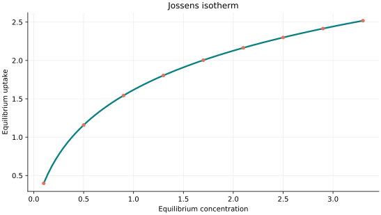
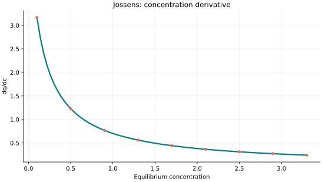
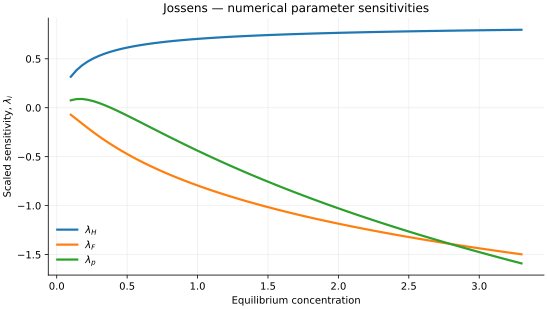

..
   ==============================================================================
   Name        : Jossens.rst
   Authors     : Joao Flavio Vasconcellos
   Version     : 2.0.0
   Description : Model equation, validity, code example and reproducible figures.

   Copyright   : Copyright (C) 2026 Joao Flavio Vasconcellos
   Licence     : MIT License (see LICENSE)
   SPDX-License-Identifier: MIT
   ==============================================================================

Jossens isotherm
================

Original publication and scope
------------------------------

Jossens, L., Prausnitz, J. M., Fritz, W., Schlünder, E. U., and
Myers, A. L. (1978), *Thermodynamics of multi-solute adsorption from dilute
aqueous solutions*, *Chemical Engineering Science*, **33** (8), 1097–1106.
`DOI: 10.1016/0009-2509(78)85015-5
<https://doi.org/10.1016/0009-2509(78)85015-5>`_. The paper
introduces an adsorption relation in its treatment of adsorption from
dilute solutions.

Chong, B. Y. K., Hashim, M. A., and Chu, K. H. (2024), *The Jossens
isotherm: A critical look at water contaminant adsorption modeling*,
*Separation Science and Technology*, **59** (10–14), 1147–1157.
`DOI: 10.1080/01496395.2024.2368236
<https://doi.org/10.1080/01496395.2024.2368236>`_. The authors distinguish
the original, loading-implicit Jossens relation from the Redlich–Peterson
isotherm and discuss parameter identification.

**Scientific identification issue:** the current C++ ``Jossens`` class uses
:math:`q_e=AC_e/(1+BC_e^n)`, which is the Redlich–Peterson functional form,
not the original loading-implicit Jossens equation. A commonly reported
form of the latter is :math:`C_e=(q_e/H)\exp(Fq_e^p)`. The 1978 publication
must therefore not be taken as establishing the equation currently
implemented in this class. The mathematical formulation and numerical
results below describe the present C++ implementation; correcting the model
identity requires a separate code and test review.

Mathematical formulation
------------------------

.. math::

   q_e=\frac{Ac_e}{1+Bc_e^n}

The three adjustable parameters are ``A``, ``B`` and ``n``.
All must be strictly positive and finite. The model accepts finite,
non-negative equilibrium concentrations, while the derivative requires
strictly positive concentration.

An analytical concentration derivative is implemented and checked against an
independently calculated centred difference.

The implementation requires the following admissible parameter and input domain:

.. math::

   A>0,\quad B>0,\quad n>0,\quad C_e\geq0.

C++20 usage
-----------

.. code-block:: cpp

   #include <isotherm/isotherm.hpp>

   const isotherm::models::Jossens model{5, 0.65, 1.15};
   const isotherm::Real uptake = isotherm::evaluate(model, 0.8);   // 2.6615514
   const isotherm::Real slope = isotherm::derivative(model, 0.8);  // 2.0467198

.. raw:: html

   

     <a class="isotherm-source-action" href="../../../source-browser/include/isotherm/models/ThreeParameters/Jossens.hpp.html">Implementation</a>
     <a class="isotherm-source-action" href="../../../source-browser/IsothermTest/ThreeParameters/Jossens/test_jossens.cpp.html">Tests</a>
     <a class="isotherm-source-action" href="../../../source-browser/Examples/ThreeParameters/Jossens/main.cpp.html">Example</a>
   

Jossens isotherm plot
---------------------

   Jossens uptake for :math:`A=5`, :math:`B=0.65`, :math:`n=1.15`.

Concentration derivative
------------------------

   Concentration derivative of Jossens uptake for :math:`A=5`, :math:`B=0.65`,
   :math:`n=1.15`.

Numerical sensitivity
---------------------

For each coefficient :math:`k_i`, the numerical scaled sensitivity is

.. math::

   \lambda_i(C_e)=k_i\frac{\partial q_e}{\partial k_i}.

Numerical values are obtained by perturbing individual parameters and evaluating new instances of the C++ model. The accompanying C++20 example performs this procedure.

   Scaled sensitivities :math:`\lambda_{A}`, :math:`\lambda_{B}`, :math:`\lambda_{n}` versus
   equilibrium concentration.

Validation and limitations
--------------------------

.. math::

   A>0,\quad B>0,\quad n>0,\quad C_e\geq0.
