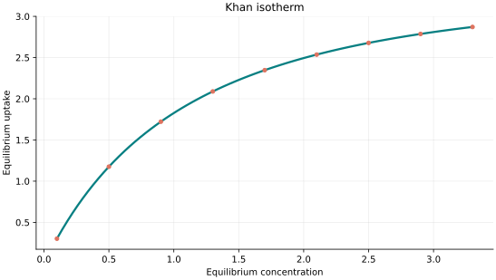
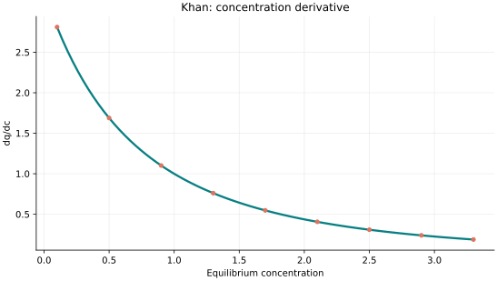
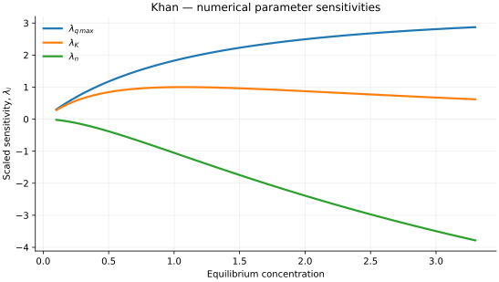

..
   ==============================================================================
   Name        : Khan.rst
   Authors     : Joao Flavio Vasconcellos
   Version     : 2.0.0
   Description : Model equation, validity, code example and reproducible figures.

   Copyright   : Copyright (C) 2026 Joao Flavio Vasconcellos
   Licence     : MIT License (see LICENSE.txt)
   SPDX-License-Identifier: MIT
   ==============================================================================

Khan isotherm
=============

Original publication and scope
------------------------------

Khan, A. R., Al-Waheab, I. R., and Al-Haddad, A. (1996),
*A generalized equation for adsorption isotherms for multi-component
organic pollutants in dilute aqueous solution*, *Environmental Technology*,
**17** (1), 13–23.
`DOI: 10.1080/09593331708616356
<https://doi.org/10.1080/09593331708616356>`_. The authors proposed a
generalised equilibrium relation for organic pollutants adsorbed from dilute
aqueous solutions, including multi-solute systems.

The single-component form implemented here is
:math:`q_e=q_{\max}KC_e/(1+KC_e)^n`. It reduces to the Langmuir form
when :math:`n=1`; at high concentration its response is proportional to
:math:`C_e^{1-n}`. Consequently, :math:`n>1` produces a decreasing
high-concentration branch rather than a finite, positive saturation plateau.
The cited multi-component study provides the historical context, whereas
the equations and parameter restrictions below specify the particular
single-component C++ model.

Mathematical formulation
------------------------

.. math::

   q_e=\frac{q_{\max}Kc_e}{(1+Kc_e)^n}

The three adjustable parameters are ``q_max``, ``K`` and ``n``.
All must be strictly positive and finite. The model accepts finite,
non-negative equilibrium concentrations, while the derivative requires
strictly positive concentration.

An analytical concentration derivative is implemented and checked against an
independently calculated centred difference.

The implementation requires the following admissible parameter and input domain:

.. math::

   q_{\mathrm{max}}>0,\quad K>0,\quad n>0,\quad C_e\geq0.

C++20 usage
-----------

.. code-block:: cpp

   #include <isotherm/isotherm.hpp>

   const isotherm::models::Khan model{5, 0.65, 1.15};
   const isotherm::Real uptake = isotherm::evaluate(model, 0.8);   // 1.6063982
   const isotherm::Real slope = isotherm::derivative(model, 0.8);  // 1.2180092

.. raw:: html

   

     <a class="isotherm-source-action" href="../../../source-browser/src/isotherm/models/ThreeParameters/Khan.hpp.html">Implementation</a>
     <a class="isotherm-source-action" href="../../../source-browser/IsothermTest/ThreeParameters/Khan/test_khan.cpp.html">Tests</a>
     <a class="isotherm-source-action" href="../../../source-browser/Examples/ThreeParameters/Khan/main.cpp.html">Example</a>
   

Khan isotherm plot
------------------

   Khan uptake for :math:`q_{\max}=5`, :math:`K=0.65`, :math:`n=1.15`.

Concentration derivative
------------------------

   Concentration derivative of Khan uptake for :math:`q_{\max}=5`, :math:`K=0.65`,
   :math:`n=1.15`.

Numerical sensitivity
---------------------

For each coefficient :math:`k_i`, the numerical scaled sensitivity is

.. math::

   \lambda_i(C_e)=k_i\frac{\partial q_e}{\partial k_i}.

Numerical values are obtained by perturbing individual parameters and evaluating new instances of the C++ model. The accompanying C++20 example performs this procedure.

   Scaled sensitivities :math:`\lambda_{q_{\max}}`, :math:`\lambda_{K}`, :math:`\lambda_{n}`
   versus equilibrium concentration.

Validation and limitations
--------------------------

.. math::

   q_{\mathrm{max}}>0,\quad K>0,\quad n>0,\quad C_e\geq0.
