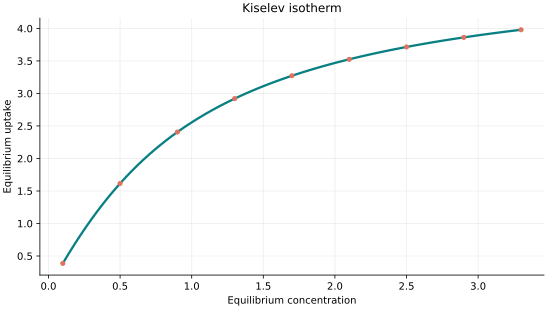
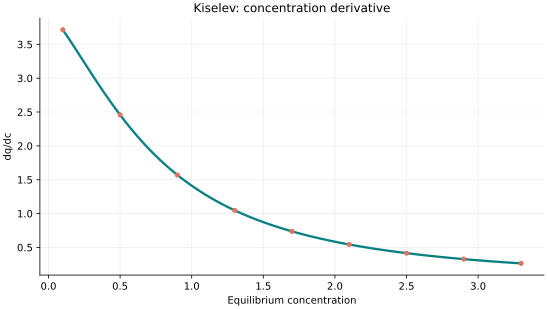
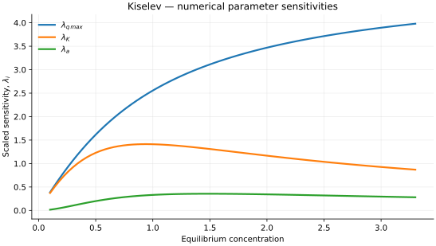

..
   ==============================================================================
   Name        : Kiselev.rst
   Authors     : Joao Flavio Vasconcellos
   Version     : 2.0.0
   Description : Model equation, validity, code example and reproducible figures.

   Copyright   : Copyright (C) 2026 Joao Flavio Vasconcellos
   Licence     : MIT License (see LICENSE)
   SPDX-License-Identifier: MIT
   ==============================================================================

Kiselev isotherm
================

Original publication and scope
------------------------------

The Kiselev isotherm describes localised adsorption with an additional
association term representing interactions between adsorbed molecules. The
occupancy :math:`\theta` in the implemented relation is converted to uptake
through :math:`q_e=q_{\max}\theta`; the parameter convention is specified in
the next section.

Kiselev, A. V. (1957), *Adsorption of vapours when complexes of adsorbate
molecules are formed on the surface*, *Doklady Akademii Nauk SSSR*, **117** (6),
1023–1026. `Primary bibliographic record <https://www.mathnet.ru/eng/dan22632>`_.
This earlier paper is directly identifiable in the journal archive.

Kiselev, A. V. (1958), *Vapor adsorption in the formation of adsorbate molecule
complexes on the surface*, *Kolloidnyi Zhurnal*, **20**, 338–348. This citation
is reproduced in subsequent adsorption literature, but an original-journal
record and a DOI have not been independently confirmed here.

Chu, K. H. (2021), *The Kiselev isotherm for adsorption at the liquid–solid
interface: Solving the mystery of negative equilibrium constants*, *Journal of
Molecular Liquids*, **343**, 117674. `DOI: 10.1016/j.molliq.2021.117674 <https://doi.org/10.1016/j.molliq.2021.117674>`_. Chu distinguishes
sigmoidal (type V) uptake from type I data and explains why fitting the latter
with an association-based model may produce negative estimates of the
association coefficient. This is a warning about model selection, not a
claim that every admissible parameter set produces a type V curve.

Mathematical formulation
------------------------

.. math::

   Kc_e=\frac{\theta}{(1+a\theta)(1-\theta)},\qquad q_e=q_{\max}\theta

The three adjustable parameters are ``q_max``, ``K`` and ``a``.
All must be positive and finite. Equilibrium concentration must be non-negative.
The unique admissible coverage is determined by a bracketed log-activity solver;
the analytical derivative follows from implicit differentiation.

The implementation requires the following admissible parameter and input domain:

.. math::

   q_{\mathrm{max}}>0,\quad K>0,\quad a>0,\quad C_e\geq0.

C++20 usage
-----------

.. code-block:: cpp

   #include <isotherm/isotherm.hpp>

   const isotherm::models::Kiselev model{5, 0.8, 0.6};
   const isotherm::Real uptake = isotherm::evaluate(model, 0.8);   // 2.2407551
   const isotherm::Real slope = isotherm::derivative(model, 0.8);  // 1.750393

.. raw:: html

   

     <a class="isotherm-source-action" href="../../../source-browser/include/isotherm/models/ThreeParameters/Kiselev.hpp.html">Implementation</a>
     <a class="isotherm-source-action" href="../../../source-browser/IsothermTest/ThreeParameters/Kiselev/test_kiselev.cpp.html">Tests</a>
     <a class="isotherm-source-action" href="../../../source-browser/Examples/ThreeParameters/Kiselev/main.cpp.html">Example</a>
   

Kiselev isotherm plot
---------------------

   Kiselev uptake for :math:`q_{\max}=5`, :math:`K=0.8`, :math:`a=0.6`.

Concentration derivative
------------------------

   Concentration derivative of Kiselev uptake for :math:`q_{\max}=5`, :math:`K=0.8`,
   :math:`a=0.6`.

Numerical sensitivity
---------------------

For each coefficient :math:`k_i`, the numerical scaled sensitivity is

.. math::

   \lambda_i(C_e)=k_i\frac{\partial q_e}{\partial k_i}.

Numerical values are obtained by perturbing individual parameters and evaluating new instances of the C++ model. The accompanying C++20 example performs this procedure.

   Scaled sensitivities :math:`\lambda_{q_{\max}}`, :math:`\lambda_{K}`, :math:`\lambda_{a}`
   versus equilibrium concentration.

Validation and limitations
--------------------------

.. math::

   q_{\mathrm{max}}>0,\quad K>0,\quad a>0,\quad C_e\geq0.
