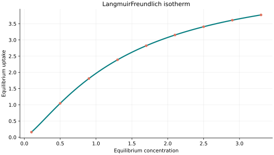
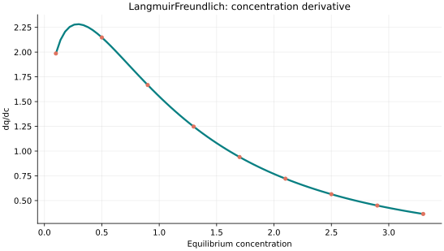
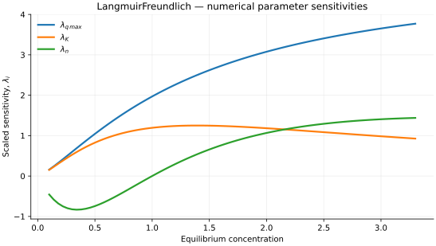

..
   ==============================================================================
   Name        : LangmuirFreundlich.rst
   Authors     : Joao Flavio Vasconcellos
   Version     : 2.0.0
   Description : Model equation, validity, code example and reproducible figures.

   Copyright   : Copyright (C) 2026 Joao Flavio Vasconcellos
   Licence     : MIT License (see LICENSE)
   SPDX-License-Identifier: MIT
   ==============================================================================

Langmuir–Freundlich isotherm
============================

Original publication and scope
------------------------------

The Langmuir–Freundlich isotherm combines a power-law dependence at low
concentration with finite saturation at high concentration. Its response
family is also widely called the Sips isotherm, although the affinity and
exponent may be parameterised differently in the literature. The equation
implemented here uses :math:`q_{\max}`, :math:`K` and :math:`n`.

Sips, R. (1948), *On the Structure of a Catalyst Surface*, *The Journal of
Chemical Physics*, **16** (5), 490–495.
`DOI: 10.1063/1.1746922 <https://doi.org/10.1063/1.1746922>`_.
Sips studied the distribution of adsorption-site energies and introduced a
form with Freundlich-like low-pressure behaviour and saturation at high
pressure.

Sips, R. (1950), *On the Structure of a Catalyst Surface. II*, *The Journal
of Chemical Physics*, **18** (8), 1024–1026.
`DOI: 10.1063/1.1747848 <https://doi.org/10.1063/1.1747848>`_.
This follow-up revises the earlier statistical treatment.

Jeppu, G. P., and Clement, T. P. (2012), *A modified Langmuir–Freundlich
isotherm model for simulating pH-dependent adsorption effects*, *Journal of
Contaminant Hydrology*, **129–130**, 46–53.
`DOI: 10.1016/j.jconhyd.2011.12.001 <https://doi.org/10.1016/j.jconhyd.2011.12.001>`_.
This is a pH-dependent extension, not the three-parameter equation
implemented here.

Chu, K. H., Debord, J., Harel, M., and Bollinger, J.-C. (2022),
*Mirror, Mirror on the Wall, Which Is the Fairest of Them All? Comparing the
Hill, Sips, Koble–Corrigan, and Liu Adsorption Isotherms*, *Industrial &
Engineering Chemistry Research*, **61** (19), 6781–6790.
`DOI: 10.1021/acs.iecr.2c00507 <https://doi.org/10.1021/acs.iecr.2c00507>`_.
This comparison establishes that several named three-parameter isotherms
belong to the same mathematical response family.

Mathematical formulation
------------------------

.. math::

   q_e=\frac{q_{\max}Kc_e^n}{1+Kc_e^n}

The three adjustable parameters are ``q_max``, ``K`` and ``n``.
All must be strictly positive and finite. The model accepts finite,
non-negative equilibrium concentrations, while the derivative requires
strictly positive concentration.

An analytical concentration derivative is implemented and checked against an
independently calculated centred difference.

The implementation requires the following admissible parameter and input domain:

.. math::

   q_{\mathrm{max}}>0,\quad K>0,\quad n>0,\quad C_e\geq0.

C++20 usage
-----------

.. code-block:: cpp

   #include <isotherm/isotherm.hpp>

   const isotherm::models::LangmuirFreundlich model{5, 0.65, 1.3};
   const isotherm::Real uptake = isotherm::evaluate(model, 0.8);   // 1.6360077
   const isotherm::Real slope = isotherm::derivative(model, 0.8);  // 1.7886431

.. raw:: html

   

     <a class="isotherm-source-action" href="../../../source-browser/include/isotherm/models/ThreeParameters/LangmuirFreundlich.hpp.html">Implementation</a>
     <a class="isotherm-source-action" href="../../../source-browser/IsothermTest/ThreeParameters/LangmuirFreundlich/test_langmuir_freundlich.cpp.html">Tests</a>
     <a class="isotherm-source-action" href="../../../source-browser/Examples/ThreeParameters/LangmuirFreundlich/main.cpp.html">Example</a>
   

Langmuir–Freundlich isotherm plot
---------------------------------

   Langmuir–Freundlich uptake for :math:`q_{\max}=5`, :math:`K=0.65`, :math:`n=1.3`.

Concentration derivative
------------------------

   Concentration derivative of Langmuir–Freundlich uptake for :math:`q_{\max}=5`,
   :math:`K=0.65`, :math:`n=1.3`.

Numerical sensitivity
---------------------

For each coefficient :math:`k_i`, the numerical scaled sensitivity is

.. math::

   \lambda_i(C_e)=k_i\frac{\partial q_e}{\partial k_i}.

Numerical values are obtained by perturbing individual parameters and evaluating new instances of the C++ model. The accompanying C++20 example performs this procedure.

   Scaled sensitivities :math:`\lambda_{q_{\max}}`, :math:`\lambda_{K}`, :math:`\lambda_{n}`
   versus equilibrium concentration.

Validation and limitations
--------------------------

.. math::

   q_{\mathrm{max}}>0,\quad K>0,\quad n>0,\quad C_e\geq0.
