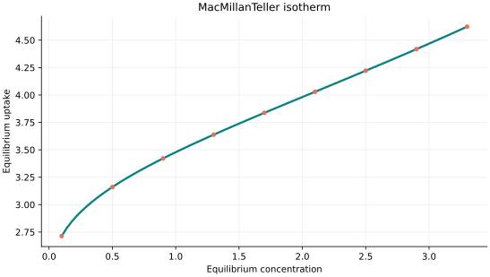
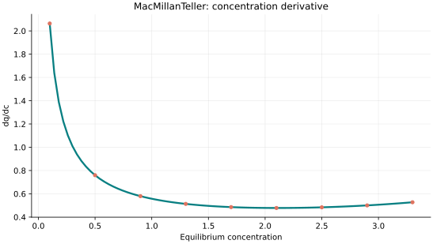
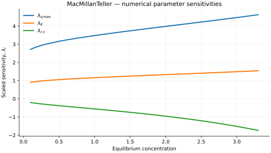

..
   ==============================================================================
   Name        : MacMillanTeller.rst
   Authors     : Joao Flavio Vasconcellos
   Version     : 2.0.0
   Description : Model equation, validity, code example and reproducible figures.

   Copyright   : Copyright (C) 2026 Joao Flavio Vasconcellos
   Licence     : MIT License (see LICENSE.txt)
   SPDX-License-Identifier: MIT
   ==============================================================================

MacMillan–Teller isotherm
=========================

Original publication and scope
------------------------------

The multilayer-adsorption treatment associated with this model was developed
by W. G. **McMillan** and E. Teller in `The Assumptions of the B.E.T.
Theory (1951) <https://doi.org/10.1021/j150484a003>`_ (*Journal of Physical
Chemistry*, **55**, 17–20) and `The Role of Surface Tension in Multilayer Gas
Adsorption (1951) <https://doi.org/10.1063/1.1747984>`_ (*Journal of Chemical
Physics*, **19**, 25–32). The authors' surname is **McMillan**, whereas the
C++ model identifier is ``MacMillanTeller``.

The `review by Foo and Hameed (2010)
<https://doi.org/10.1016/j.cej.2009.09.013>`_ (*Chemical Engineering Journal*,
**156**, 2–10) and the `review by Benjelloun et al. (2021)
<https://doi.org/10.1016/j.arabjc.2021.103031>`_ (*Arabian Journal of
Chemistry*) discuss adsorption-isotherm variants in aqueous systems.
The 2021 review reports the concentration-based expression with exponent
:math:`1/3`, which is the form implemented by the Isotherm++ model below.
The original 1951 publications concern multilayer gas adsorption;
the concentration-based expression is cited here from the later review.

Mathematical formulation
------------------------

.. math::

   q_e=q_{\max}\left[\frac{K}{\ln(c_s/c_e)}\right]^{1/3}

The three adjustable parameters are ``q_max``, ``K`` and ``c_s``.
All must be strictly positive and finite. The model accepts finite,
non-negative equilibrium concentrations, while the derivative requires
strictly positive concentration.

An analytical concentration derivative is implemented and checked against an
independently calculated centred difference.

The concentration must remain strictly below the saturation concentration
:math:`c_s`; the model diverges as that boundary is approached.

The implementation requires the following admissible parameter and input domain:

.. math::

   q_{\mathrm{max}}>0,\quad K>0,\quad c_{\mathrm{s}}>0,\quad 0\leq C_e<c_s.

C++20 usage
-----------

.. code-block:: cpp

   #include <isotherm/isotherm.hpp>

   const isotherm::models::MacMillanTeller model{5, 0.7, 8};
   const isotherm::Real uptake = isotherm::evaluate(model, 0.8);   // 3.36199803
   const isotherm::Real slope = isotherm::derivative(model, 0.8);  // 0.60837383

.. raw:: html

   

     <a class="isotherm-source-action" href="../../../source-browser/src/isotherm/models/ThreeParameters/MacMillanTeller.hpp.html">Implementation</a>
     <a class="isotherm-source-action" href="../../../source-browser/IsothermTest/ThreeParameters/MacMillanTeller/test_mac_millan_teller.cpp.html">Tests</a>
     <a class="isotherm-source-action" href="../../../source-browser/Examples/ThreeParameters/MacMillanTeller/main.cpp.html">Example</a>
   

MacMillan–Teller isotherm plot
------------------------------

   MacMillan–Teller uptake for :math:`q_{\max}=5`, :math:`K=0.7`, :math:`c_s=8`.

Concentration derivative
------------------------

   Concentration derivative of MacMillan–Teller uptake for :math:`q_{\max}=5`,
   :math:`K=0.7`, :math:`c_s=8`.

Numerical sensitivity
---------------------

For each coefficient :math:`k_i`, the numerical scaled sensitivity is

.. math::

   \lambda_i(C_e)=k_i\frac{\partial q_e}{\partial k_i}.

Numerical values are obtained by perturbing individual parameters and evaluating new instances of the C++ model. The accompanying C++20 example performs this procedure.

   Scaled sensitivities :math:`\lambda_{q_{\max}}`, :math:`\lambda_{K}`,
   :math:`\lambda_{c_s}` versus equilibrium concentration.

Validation and limitations
--------------------------

.. math::

   q_{\mathrm{max}}>0,\quad K>0,\quad c_{\mathrm{s}}>0,\quad 0\leq C_e<c_s.
