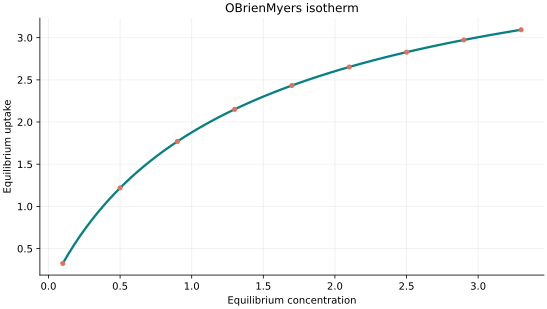
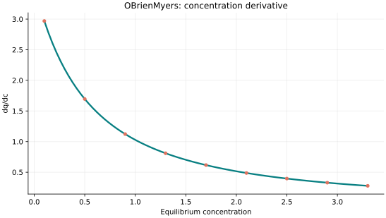
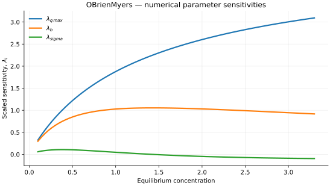

..
   ============================================================================
   Name        : OBrienMyers.rst
   Authors     : Joao Flavio Vasconcellos
   Version     : 2.0.0
   Description : Scientific equation, numerical domain and reproducible figures.

   Copyright   : Copyright (C) 2026 Joao Flavio Vasconcellos
   Licence     : MIT License (see LICENSE)
   SPDX-License-Identifier: MIT
   ============================================================================

OBrienMyers isotherm
====================

Original publication and scope
------------------------------

The `original O'Brien and Myers (1984) article
<https://doi.org/10.1039/F19848001467>`_, *Physical adsorption of gases on
heterogeneous surfaces. Series expansion of isotherms using central moments
of the adsorption energy distribution* (*Journal of the Chemical Society,
Faraday Transactions 1*, **80**, 1467–1477), derives an approximation to the
adsorption integral equation in terms of central moments of an adsorption
energy distribution. The authors compare the truncated expansion with
numerical integration for a Langmuir local isotherm and a normal energy
distribution, and report failure of convergence for very broad distributions.

A subsequent explicit presentation of the two-term form used here is given
in `RUPTURA: simulation code for breakthrough, ideal adsorption solution
theory computations, and fitting of isotherm models (2023)
<https://doi.org/10.1080/08927022.2023.2202757>`_, Eq. (20).
The width parameter :math:`\sigma` appears through :math:`\sigma^2` in this
convention. The approximation is a truncated heterogeneous-surface model,
not a general exact integral for arbitrary energy distributions.

Mathematical formulation
------------------------

.. math::

   q=q_{\max}\left[\frac{bx}{1+bx}+\sigma^2\frac{bx(1-bx)}{2(1+bx)^3}\right]

The 3 adjustable parameters are: ``q_max``, ``b``, ``sigma``.
The independent variable is ``concentration``.

All parameters strictly positive and 0<sigma<1 in this implementation; sigma is a width measure, and the truncation is not justified for arbitrarily broad energy distributions.

The width term is the square of sigma, not an independently fitted sigma-squared parameter.

The implementation requires the following admissible parameter and input domain:

.. math::

   q_{\mathrm{max}}>0,\quad b>0,\quad \sigma>0,\quad \sigma<1,\quad C_e\geq0.

C++20 usage
-----------

.. code-block:: cpp

   #include <isotherm/isotherm.hpp>

   const isotherm::models::OBrienMyers model{4.5, 0.7, 0.5};
   const isotherm::Real uptake = isotherm::evaluate(model, 0.5);   // 1.2186786
   const isotherm::Real slope = isotherm::derivative(model, 0.5);  // 1.6954987

.. raw:: html

   

     <a class="isotherm-source-action" href="../../../source-browser/include/isotherm/models/ThreeParameters/OBrienMyers.hpp.html">Implementation</a>
     <a class="isotherm-source-action" href="../../../source-browser/IsothermTest/ThreeParameters/OBrienMyers/test_o_brien_myers.cpp.html">Tests</a>
     <a class="isotherm-source-action" href="../../../source-browser/Examples/ThreeParameters/OBrienMyers/main.cpp.html">Example</a>
   

O’Brien–Myers isotherm plot
---------------------------

   O'Brien–Myers uptake for :math:`q_{\max}=4.5`, :math:`b=0.7`, :math:`\sigma=0.5`.

Concentration derivative
------------------------

   Concentration derivative of O'Brien–Myers uptake for :math:`q_{\max}=4.5`, :math:`b=0.7`,
   :math:`\sigma=0.5`.

Numerical sensitivity
---------------------

For each coefficient :math:`k_i`, the numerical scaled sensitivity is

.. math::

   \lambda_i(C_e)=k_i\frac{\partial q_e}{\partial k_i}.

Numerical values are obtained by perturbing individual parameters and evaluating new instances of the C++ model. The accompanying C++20 example performs this procedure.

   Scaled sensitivities :math:`\lambda_{q_{\max}}`, :math:`\lambda_{b}`,
   :math:`\lambda_{\sigma}` versus equilibrium concentration.

Validation and limitations
--------------------------

.. math::

   q_{\mathrm{max}}>0,\quad b>0,\quad \sigma>0,\quad \sigma<1,\quad C_e\geq0.
