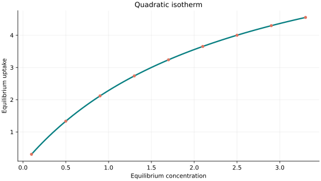
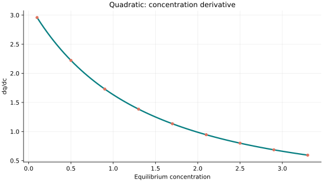
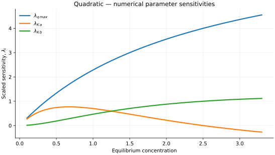

..
   ============================================================================
   Name        : Quadratic.rst
   Authors     : Joao Flavio Vasconcellos
   Version     : 2.0.0
   Description : Scientific equation, numerical domain and reproducible figures.

   Copyright   : Copyright (C) 2026 Joao Flavio Vasconcellos
   Licence     : MIT License (see LICENSE.txt)
   SPDX-License-Identifier: MIT
   ============================================================================

Quadratic isotherm
==================

Original publication and scope
------------------------------

The three-parameter quadratic site-interaction expression used here is
explicitly documented by `pyGAPS, Quadratic isotherm
<https://pygaps.readthedocs.io/en/develop/reference/fitting.html>`_, which
cites T. L. Hill's *An Introduction to Statistical Thermodynamics* as a
statistical-mechanical reference. The quadratic denominator and the factor
of two multiplying the :math:`K_b` term represent a particular
site-interaction convention; the expression need not describe every model
called a ``quadratic isotherm``.

`Xia, Nagrath and Cramer (2003)
<https://doi.org/10.1016/S0021-9673(02)02047-2>`_, *Modeling of adsorption in
hydrophobic interaction chromatography systems using a preferential
interaction quadratic isotherm* (*Journal of Chromatography A*, **989**,
47–54), introduced a **preferential-interaction quadratic** model coupling
salt-dependent interactions to nonlinear adsorption. It is an important
related chromatographic application, but it should **not** be identified as
the original derivation of the specific three-parameter equation below.
A unique original research article for that precise parametrisation has not
been established.

Mathematical formulation
------------------------

.. math::

   q=q_{\max}\frac{x(K_a+2K_b x)}{1+K_a x+K_b x^2}

The 3 adjustable parameters are: ``q_max``, ``K_a``, ``K_b``.
The independent variable is ``concentration``.

All three parameters positive, concentration non-negative. Saturating limit is 2*q_max; the q_max parameter is a site-scale factor, not the total limiting uptake.

The factor 2 in the quadratic numerator means q_max is not the limiting capacity.

The implementation requires the following admissible parameter and input domain:

.. math::

   q_{\mathrm{max}}>0,\quad K_{\mathrm{a}}>0,\quad K_{\mathrm{b}}>0,\quad C_e\geq0.

C++20 usage
-----------

.. code-block:: cpp

   #include <isotherm/isotherm.hpp>

   const isotherm::models::Quadratic model{4, 0.8, 0.16};
   const isotherm::Real uptake = isotherm::evaluate(model, 0.5);   // 1.3333333
   const isotherm::Real slope = isotherm::derivative(model, 0.5);  // 2.2222222

.. raw:: html

   

     <a class="isotherm-source-action" href="../../../source-browser/src/isotherm/models/ThreeParameters/Quadratic.hpp.html">Implementation</a>
     <a class="isotherm-source-action" href="../../../source-browser/IsothermTest/ThreeParameters/Quadratic/test_quadratic.cpp.html">Tests</a>
     <a class="isotherm-source-action" href="../../../source-browser/Examples/ThreeParameters/Quadratic/main.cpp.html">Example</a>
   

Quadratic isotherm plot
-----------------------

   Quadratic uptake for :math:`q_{\max}=4`, :math:`K_a=0.8`, :math:`K_b=0.16`.

Concentration derivative
------------------------

   Concentration derivative of Quadratic uptake for :math:`q_{\max}=4`, :math:`K_a=0.8`,
   :math:`K_b=0.16`.

Numerical sensitivity
---------------------

For each coefficient :math:`k_i`, the numerical scaled sensitivity is

.. math::

   \lambda_i(C_e)=k_i\frac{\partial q_e}{\partial k_i}.

Numerical values are obtained by perturbing individual parameters and evaluating new instances of the C++ model. The accompanying C++20 example performs this procedure.

   Scaled sensitivities :math:`\lambda_{q_{\max}}`, :math:`\lambda_{K_a}`,
   :math:`\lambda_{K_b}` versus equilibrium concentration.

Validation and limitations
--------------------------

.. math::

   q_{\mathrm{max}}>0,\quad K_{\mathrm{a}}>0,\quad K_{\mathrm{b}}>0,\quad C_e\geq0.
