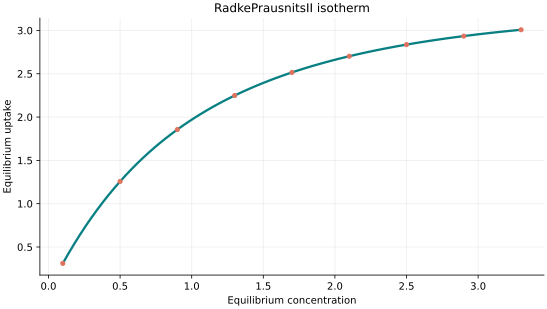
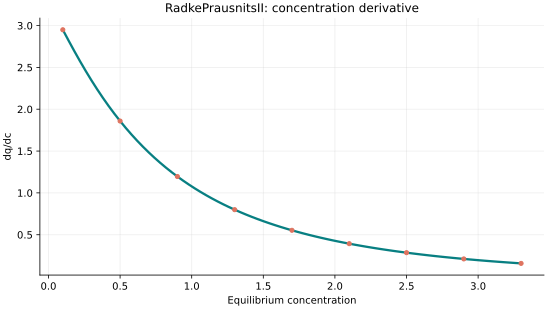
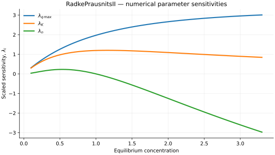

..
   ==============================================================================
   Name        : RadkePrausnitsII.rst
   Authors     : Joao Flavio Vasconcellos
   Version     : 2.0.0
   Description : Model equation, validity, code example and reproducible figures.

   Copyright   : Copyright (C) 2026 Joao Flavio Vasconcellos
   Licence     : MIT License (see LICENSE)
   SPDX-License-Identifier: MIT
   ==============================================================================

Radke–Prausnitz II isotherm
===========================

Original publication and scope
------------------------------

The original adsorption study is Radke and Prausnitz (1972),
*Adsorption of Organic Solutes from Dilute Aqueous Solution of Activated
Carbon*, *Industrial & Engineering Chemistry Fundamentals*, **11** (4),
445–451 (`DOI <https://doi.org/10.1021/i160044a003>`_). It concerns
the equilibrium adsorption of organic solutes from dilute aqueous
solutions onto activated carbon. The three expressions labelled I, II
and III in this catalogue are specific mathematical parametrisations;
their common historical attribution does not establish that they are
interchangeable.

Tran, Bollinger, Salvestrini, Chu and Juang (2023), *Critical Review and
Discussion of the Nonlinear Form of Radke–Prausnitz Model in Adsorption
Solid–Liquid Phases*, *Journal of Environmental Engineering*, **149** (3),
03122006 (`DOI: 10.1061/JOEEDU.EEENG-7074
<https://doi.org/10.1061/JOEEDU.EEENG-7074>`_), examine the nonlinear
expression, parameter dimensions and correct attribution to Radke and
Prausnitz (1972). In particular, their analysis specifies the admissible
exponent range for the correctly parametrised Radke–Prausnitz expression.

Tran, Bollinger, Lima and Juang (2023), *How to avoid mistakes in treating
adsorption isotherm data (liquid and solid phases): Some comments about
correctly using Radke-Prausnitz nonlinear model and Langmuir equilibrium
constant*, *Journal of Environmental Management*, **325** (Part A), 116475
(`DOI: 10.1016/j.jenvman.2022.116475
<https://doi.org/10.1016/j.jenvman.2022.116475>`_), identify incorrect
nonlinear forms and errors in the dimensional interpretation of adsorption
equilibrium constants.

The implemented form II is :math:`q_e=q_{\max}KC_e/(1+KC_e^n)`.
It has a Henry-law limit at low concentration; :math:`n=1` reduces to
Langmuir, whereas :math:`0<n<1` produces a Freundlich-type asymptote
proportional to :math:`C_e^{1-n}`. For :math:`n>1` the response ultimately
decreases with increasing concentration. If :math:`C_e` carries physical
units, dimensional consistency requires :math:`[K]=[C_e]^{-n}` and
:math:`[q_{\max}]=[q_e][C_e]^{n-1}`; consequently, ``q_max`` is not a
saturation-capacity parameter for arbitrary :math:`n`. This expression
is not interchangeable with form I under unchanged parameters.

Mathematical formulation
------------------------

.. math::

   q_e=\frac{q_{\max}Kc_e}{1+Kc_e^n}

The three adjustable parameters are ``q_max``, ``K`` and ``n``.
All must be strictly positive and finite. The model accepts finite,
non-negative equilibrium concentrations, while the derivative requires
strictly positive concentration.

An analytical concentration derivative is implemented and checked against an
independently calculated centred difference.

The implementation requires the following admissible parameter and input domain:

.. math::

   q_{\mathrm{max}}>0,\quad K>0,\quad n>0,\quad C_e\geq0.

C++20 usage
-----------

.. code-block:: cpp

   #include <isotherm/isotherm.hpp>

   const isotherm::models::RadkePrausnitsII model{5, 0.65, 1.15};
   const isotherm::Real uptake = isotherm::evaluate(model, 0.8);   // 1.7300084
   const isotherm::Real slope = isotherm::derivative(model, 0.8);  // 1.3303679

.. raw:: html

   

     <a class="isotherm-source-action" href="../../../source-browser/include/isotherm/models/ThreeParameters/RadkePrausnitsII.hpp.html">Implementation</a>
     <a class="isotherm-source-action" href="../../../source-browser/IsothermTest/ThreeParameters/RadkePrausnitsII/test_radke_prausnits_i_i.cpp.html">Tests</a>
     <a class="isotherm-source-action" href="../../../source-browser/Examples/ThreeParameters/RadkePrausnitsII/main.cpp.html">Example</a>
   

RadkePrausnitsII isotherm plot
------------------------------

   Radke–Prausnitz II uptake for :math:`q_{\max}=5`, :math:`K=0.65`, :math:`n=1.15`.

Concentration derivative
------------------------

   Concentration derivative of Radke–Prausnitz II uptake for :math:`q_{\max}=5`,
   :math:`K=0.65`, :math:`n=1.15`.

Numerical sensitivity
---------------------

For each coefficient :math:`k_i`, the numerical scaled sensitivity is

.. math::

   \lambda_i(C_e)=k_i\frac{\partial q_e}{\partial k_i}.

Numerical values are obtained by perturbing individual parameters and evaluating new instances of the C++ model. The accompanying C++20 example performs this procedure.

   Scaled sensitivities :math:`\lambda_{q_{\max}}`, :math:`\lambda_{K}`, :math:`\lambda_{n}`
   versus equilibrium concentration.

Validation and limitations
--------------------------

.. math::

   q_{\mathrm{max}}>0,\quad K>0,\quad n>0,\quad C_e\geq0.
