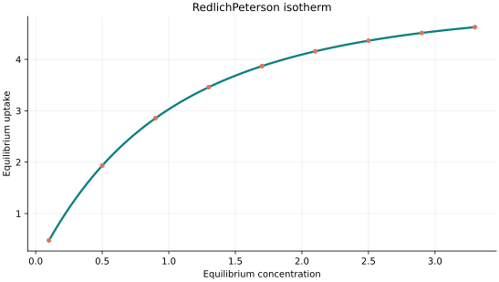
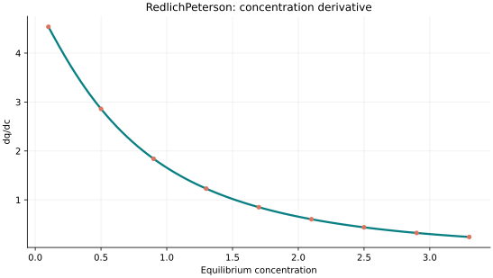
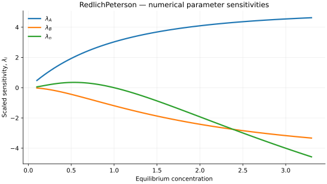

..
   ==============================================================================
   Name        : RedlichPeterson.rst
   Authors     : Joao Flavio Vasconcellos
   Version     : 2.0.0
   Description : Model equation, validity, code example and reproducible figures.

   Copyright   : Copyright (C) 2026 Joao Flavio Vasconcellos
   Licence     : MIT License (see LICENSE.txt)
   SPDX-License-Identifier: MIT
   ==============================================================================

Redlich–Peterson isotherm
=========================

Original publication and scope
------------------------------

Redlich–Peterson equation. Earlier versions of this catalogue also exposed this functional form under the name ``Jossens``; that class now implements the original loading-implicit Jossens relation and is no longer equivalent to Redlich–Peterson.

The equation and parameter convention are specified below; the model name
alone does not establish equivalence with every published formulation.
For broader context see the `2022 adsorption-model review <https://doi.org/10.1016/j.scitotenv.2021.151334>`_.

Mathematical formulation
------------------------

.. math::

   q_e=\frac{Ac_e}{1+Bc_e^n}

The three adjustable parameters are ``A``, ``B`` and ``n``.
All must be strictly positive and finite. The model accepts finite,
non-negative equilibrium concentrations, while the derivative requires
strictly positive concentration.

An analytical concentration derivative is implemented and checked against an
independently calculated centred difference.

The implementation requires the following admissible parameter and input domain:

.. math::

   A>0,\quad B>0,\quad n>0,\quad C_e\geq0.

C++20 usage
-----------

.. code-block:: cpp

   #include <isotherm/isotherm.hpp>

   const isotherm::models::RedlichPeterson model{5, 0.65, 1.15};
   const isotherm::Real uptake = isotherm::evaluate(model, 0.8);   // 2.6615514
   const isotherm::Real slope = isotherm::derivative(model, 0.8);  // 2.0467198

.. raw:: html

   

     <a class="isotherm-source-action" href="../../../source-browser/src/isotherm/models/ThreeParameters/RedlichPeterson.hpp.html">Implementation</a>
     <a class="isotherm-source-action" href="../../../source-browser/IsothermTest/ThreeParameters/RedlichPeterson/test_redlich_peterson.cpp.html">Tests</a>
     <a class="isotherm-source-action" href="../../../source-browser/Examples/ThreeParameters/RedlichPeterson/main.cpp.html">Example</a>
   

Redlich–Peterson isotherm plot
------------------------------

   Redlich–Peterson uptake for :math:`A=5`, :math:`B=0.65`, :math:`n=1.15`.

Concentration derivative
------------------------

   Concentration derivative of Redlich–Peterson uptake for :math:`A=5`, :math:`B=0.65`,
   :math:`n=1.15`.

Numerical sensitivity
---------------------

For each coefficient :math:`k_i`, the numerical scaled sensitivity is

.. math::

   \lambda_i(C_e)=k_i\frac{\partial q_e}{\partial k_i}.

Numerical values are obtained by perturbing individual parameters and evaluating new instances of the C++ model. The accompanying C++20 example performs this procedure.

   Scaled sensitivities :math:`\lambda_{A}`, :math:`\lambda_{B}`, :math:`\lambda_{n}` versus
   equilibrium concentration.

Validation and limitations
--------------------------

.. math::

   A>0,\quad B>0,\quad n>0,\quad C_e\geq0.
