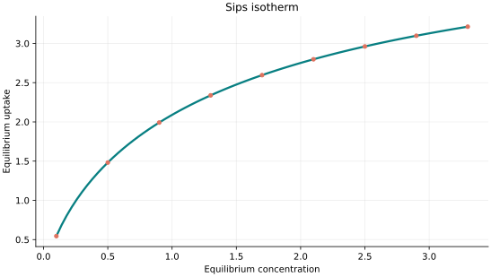
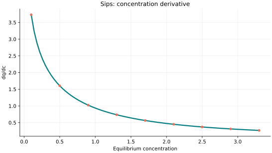
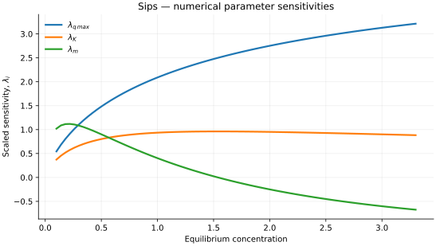

..
   ==============================================================================
   Name        : Sips.rst
   Authors     : Joao Flavio Vasconcellos
   Version     : 2.0.0
   Description : Model equation, validity, code example and reproducible figures.

   Copyright   : Copyright (C) 2026 Joao Flavio Vasconcellos
   Licence     : MIT License (see LICENSE)
   SPDX-License-Identifier: MIT
   ==============================================================================

Sips isotherm
=============

Original publication and scope
------------------------------

Sips derived a saturating adsorption relation for heterogeneous surfaces,
with a low-pressure limit resembling Freundlich behaviour. The class uses
:math:`q_{\max}`, :math:`K` and :math:`m`, with the concentration-dependent
term :math:`(KC_e)^{1/m}`. It is algebraically equivalent to the
Langmuir–Freundlich form in this catalogue after setting the latter's
exponent to :math:`n=1/m` and its affinity coefficient to
:math:`K_{\mathrm{LF}}=K^{1/m}`.

Sips, R. (1948), *On the Structure of a Catalyst Surface*, *The Journal of
Chemical Physics*, **16** (5), 490–495.
`DOI: 10.1063/1.1746922 <https://doi.org/10.1063/1.1746922>`_.

Sips, R. (1950), *On the Structure of a Catalyst Surface. II*, *The Journal
of Chemical Physics*, **18** (8), 1024–1026.
`DOI: 10.1063/1.1747848 <https://doi.org/10.1063/1.1747848>`_.
The 1950 paper revisits the statistical basis of the earlier treatment.

Chu, K. H., Debord, J., Harel, M., and Bollinger, J.-C. (2022), *Mirror,
Mirror on the Wall, Which Is the Fairest of Them All? Comparing the Hill,
Sips, Koble–Corrigan, and Liu Adsorption Isotherms*, *Industrial & Engineering
Chemistry Research*, **61** (19), 6781–6790.
`DOI: 10.1021/acs.iecr.2c00507 <https://doi.org/10.1021/acs.iecr.2c00507>`_.
This analysis distinguishes differences in parameter definitions from
genuinely different mathematical behaviour.

Mathematical formulation
------------------------

.. math::

   q_e=\frac{q_{\max}(Kc_e)^{1/m}}{1+(Kc_e)^{1/m}}

The three adjustable parameters are ``q_max``, ``K`` and ``m``.
All must be strictly positive and finite. The model accepts finite,
non-negative equilibrium concentrations, while the derivative requires
strictly positive concentration.

An analytical concentration derivative is implemented and checked against an
independently calculated centred difference.

The implementation requires the following admissible parameter and input domain:

.. math::

   q_{\mathrm{max}}>0,\quad K>0,\quad m>0,\quad C_e\geq0.

C++20 usage
-----------

.. code-block:: cpp

   #include <isotherm/isotherm.hpp>

   const isotherm::models::Sips model{5, 0.65, 1.3};
   const isotherm::Real uptake = isotherm::evaluate(model, 0.8);   // 1.8841557
   const isotherm::Real slope = isotherm::derivative(model, 0.8);  // 1.1289876

.. raw:: html

   

     <a class="isotherm-source-action" href="../../../source-browser/include/isotherm/models/ThreeParameters/Sips.hpp.html">Implementation</a>
     <a class="isotherm-source-action" href="../../../source-browser/IsothermTest/ThreeParameters/Sips/test_sips.cpp.html">Tests</a>
     <a class="isotherm-source-action" href="../../../source-browser/Examples/ThreeParameters/Sips/main.cpp.html">Example</a>
   

Sips isotherm plot
------------------

   Sips uptake for :math:`q_{\max}=5`, :math:`K=0.65`, :math:`m=1.3`.

Concentration derivative
------------------------

   Concentration derivative of Sips uptake for :math:`q_{\max}=5`, :math:`K=0.65`,
   :math:`m=1.3`.

Numerical sensitivity
---------------------

For each coefficient :math:`k_i`, the numerical scaled sensitivity is

.. math::

   \lambda_i(C_e)=k_i\frac{\partial q_e}{\partial k_i}.

Numerical values are obtained by perturbing individual parameters and evaluating new instances of the C++ model. The accompanying C++20 example performs this procedure.

   Scaled sensitivities :math:`\lambda_{q_{\max}}`, :math:`\lambda_{K}`, :math:`\lambda_{m}`
   versus equilibrium concentration.

Validation and limitations
--------------------------

.. math::

   q_{\mathrm{max}}>0,\quad K>0,\quad m>0,\quad C_e\geq0.
