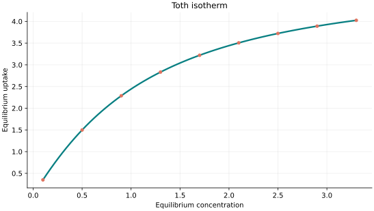
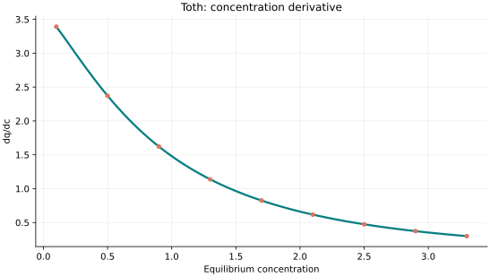
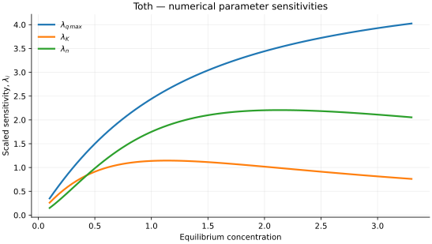

..
   ==============================================================================
   Name        : Toth.rst
   Authors     : Joao Flavio Vasconcellos
   Version     : 2.0.0
   Description : Model equation, validity, code example and reproducible figures.

   Copyright   : Copyright (C) 2026 Joao Flavio Vasconcellos
   Licence     : MIT License (see LICENSE.txt)
   SPDX-License-Identifier: MIT
   ==============================================================================

Toth isotherm
=============

Original publication and scope
------------------------------

Tóth introduced an empirical three-parameter adsorption relation for
heterogeneous solid–gas interfaces. The model retains a finite saturation
capacity while providing a more flexible representation of the approach to
saturation than the Langmuir equation. The exponent describes the shape of
the isotherm; its fitted value should not, by itself, be taken as a unique
measurement of the microscopic distribution of adsorption sites.

Tóth, J. (1971), *State Equations of the Solid-Gas Interface Layers*,
*Acta Chimica Academiae Scientiarum Hungaricae*, **69** (3), 311–328.
`Digitised original journal volume (PDF) <https://real-j.mtak.hu/3721/1/ActaChimica_069.pdf>`_;
`journal archive record <https://real-j.mtak.hu/3721/>`_;
`bibliographic record <https://cir.nii.ac.jp/crid/1573387449959730304?lang=en>`_.
The archive provides the complete volume rather than a separate article file.
No DOI has been verified for the original publication.

Kumar, K. V., Gadipelli, S., Howard, C. A., Kwapinski, W., and Brett,
D. J. L. (2021), *Probing adsorbent heterogeneity using Toth isotherms*,
*Journal of Materials Chemistry A*, **9**, 944–962.
`DOI: 10.1039/D0TA08150G <https://doi.org/10.1039/D0TA08150G>`_.
The authors investigate the interpretation of adsorbent heterogeneity
through Tóth-model parameters and affinity distributions.

Bbumba, S., Karume, I., Nsamba, H. K., Kigozi, M., and Kato, M. (2024),
*An Insight into Isotherm Models in Physical Characterization of Adsorption
Studies*, *European Journal of Applied Sciences*, **12** (2), 115–134.
`DOI: 10.14738/aivp.122.16738 <https://doi.org/10.14738/aivp.122.16738>`_.
This review discusses the Tóth equation alongside other two- and
three-parameter models and compares fitting and error-assessment methods.

Musa, M. A., Chowdhury, S., Biswas, S., Alam, S. M. N., Parvin, S., and
Sattar, M. A. (2024), *Removal of aqueous methylene blue dye over
Vallisneria Natans biosorbent using artificial neural network and statistical
response surface methodology analysis*, *Journal of Molecular Liquids*,
**393**, 123624.
`DOI: 10.1016/j.molliq.2023.123624 <https://doi.org/10.1016/j.molliq.2023.123624>`_.
The Tóth model was reported as the best-fitting isotherm in that study,
with a reported capacity of 63.07 mg g\ :sup:`-1`.

Zarei, S., Raanaei, H., Mohammad-Hosseini, V., and Kamali, S. (2025),
*Efficient removal of zinc ion pollution by carbon-based magnetic alloy:
Experimental, theoretical modeling and DFT studies*,
*Inorganic Chemistry Communications*, **172**, 113735.
`DOI: 10.1016/j.inoche.2024.113735 <https://doi.org/10.1016/j.inoche.2024.113735>`_.
The study compared ten adsorption isotherms for Zn(II) on a graphite–iron
alloy and reported the best fit with Tóth, including a fitted maximum
capacity of 729.7 mg g\ :sup:`-1`.

Zuhara, S., and McKay, G. (2025), *Single and binary pollutant adsorption
of strontium and barium on waste-derived activated carbons: Modelling,
regeneration and mechanistic insights*, *Environmental Technology &
Innovation*, **39**, 104220.
`DOI: 10.1016/j.eti.2025.104220 <https://doi.org/10.1016/j.eti.2025.104220>`_.
Tóth fitted the single-solute equilibrium data best in this study,
whereas a Langmuir formulation was preferred for the binary systems.

Grossmann, Q., Saenz-Cavazos, P. A., Ferru, N., Williams, D. R., and
Mazzotti, M. (2025), *Measuring and Modeling Water and Carbon Dioxide
Adsorption on Amine Functionalized Alumina under Direct Air Capture
Conditions*, *Industrial & Engineering Chemistry Research*, **64** (13),
7165–7175.
`DOI: 10.1021/acs.iecr.4c04581 <https://doi.org/10.1021/acs.iecr.4c04581>`_.
The authors use a temperature-dependent Tóth relation for dry CO\ :sub:`2`
adsorption and develop a separate collaborative, dual-site extension for
humid conditions, named CATSO. Neither extension is implemented by this
three-parameter class.

These publications illustrate applications and extensions, not evidence
that the Tóth equation is universally the most suitable model. Applicability
must be assessed for each adsorbate–adsorbent system and experimental range.

Mathematical formulation
------------------------

.. math::

   q_e=\frac{q_{\max}c_e}{(1/K+c_e^n)^{1/n}}

This is the parameter convention implemented in Isotherm++. It is
algebraically equivalent to the frequently used affinity-based form:

.. math::

   q_e=\frac{q_{\max}bC_e}{[1+(bC_e)^n]^{1/n}},\qquad b=K^{1/n}.

Accordingly, when concentration is dimensional, :math:`K` has units of
:math:`[C_e]^{-n}`, whereas :math:`b` has units of :math:`[C_e]^{-1}`.
The parameter :math:`K` must not be substituted numerically for the
coefficient :math:`b` without this transformation. For :math:`n=1`,
the equation reduces to the Langmuir isotherm. Its limiting behaviour is

.. math::

   q_e\sim q_{\max}K^{1/n}C_e\quad(C_e\to 0^+),\qquad
   \lim_{C_e\to\infty}q_e=q_{\max}.

The three adjustable parameters are ``q_max``, ``K`` and ``n``.
All must be strictly positive and finite. The model accepts finite,
non-negative equilibrium concentrations, while the derivative requires
strictly positive concentration.

An analytical concentration derivative is implemented and checked against an
independently calculated centred difference.

The implementation requires the following admissible parameter and input domain:

.. math::

   q_{\mathrm{max}}>0,\quad K>0,\quad n>0,\quad C_e\geq0.

C++20 usage
-----------

.. code-block:: cpp

   #include <isotherm/isotherm.hpp>

   const isotherm::models::Toth model{5, 0.65, 1.3};
   const isotherm::Real uptake = isotherm::evaluate(model, 0.8);   // 2.1171471
   const isotherm::Real slope = isotherm::derivative(model, 0.8);  // 1.7805166

.. raw:: html

   

     <a class="isotherm-source-action" href="../../../source-browser/include/isotherm/models/ThreeParameters/Toth.hpp.html">Implementation</a>
     <a class="isotherm-source-action" href="../../../source-browser/IsothermTest/ThreeParameters/Toth/test_toth.cpp.html">Tests</a>
     <a class="isotherm-source-action" href="../../../source-browser/Examples/ThreeParameters/Toth/main.cpp.html">Example</a>
   

Toth isotherm plot
------------------

   Toth uptake for :math:`q_{\max}=5`, :math:`K=0.65`, :math:`n=1.3`.

Concentration derivative
------------------------

   Concentration derivative of Toth uptake for :math:`q_{\max}=5`, :math:`K=0.65`,
   :math:`n=1.3`.

Numerical sensitivity
---------------------

For each coefficient :math:`k_i`, the numerical scaled sensitivity is

.. math::

   \lambda_i(C_e)=k_i\frac{\partial q_e}{\partial k_i}.

Numerical values are obtained by perturbing individual parameters and evaluating new instances of the C++ model. The accompanying C++20 example performs this procedure.

   Scaled sensitivities :math:`\lambda_{q_{\max}}`, :math:`\lambda_{K}`, :math:`\lambda_{n}`
   versus equilibrium concentration.

Validation and limitations
--------------------------

.. math::

   q_{\mathrm{max}}>0,\quad K>0,\quad n>0,\quad C_e\geq0.
