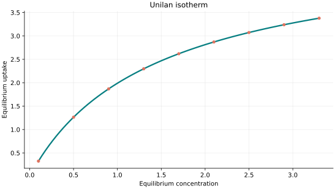
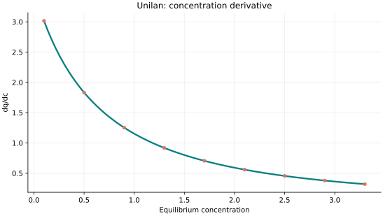
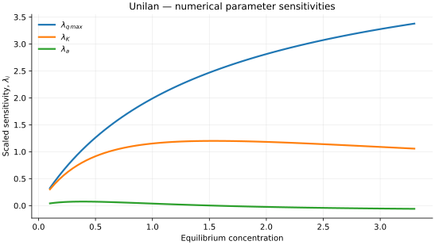

..
   ==============================================================================
   Name        : Unilan.rst
   Authors     : Joao Flavio Vasconcellos
   Version     : 2.0.0
   Description : Model equation, validity, code example and reproducible figures.

   Copyright   : Copyright (C) 2026 Joao Flavio Vasconcellos
   Licence     : MIT License (see LICENSE.txt)
   SPDX-License-Identifier: MIT
   ==============================================================================

Unilan isotherm
===============

Original publication and scope
------------------------------

The UNILAN (uniform-energy-distribution/Langmuir) equation represents
energetic heterogeneity by averaging local Langmuir responses over a
uniform distribution of adsorption energies. The resulting relation has
three fitted coefficients, including a dimensionless heterogeneity spread.
It is an equilibrium correlation; a fitted spread does not, by itself,
establish a unique microscopic surface-energy distribution.

Valenzuela, D. P., and Myers, A. L. (1989), *Adsorption Equilibrium Data
Handbook*, Prentice Hall, Englewood Cliffs, New Jersey.
`Bibliographic record <https://search.worldcat.org/title/Adsorption-equilibrium-data-handbook/oclc/1485058109>`_.
This handbook compiles adsorption-equilibrium data and UNILAN model
applications. It is a standard reference for the equation, but should
not automatically be described as its first derivation.

Tóth, J. (1997), *Some Consequences of the Application of Incorrect
Gas/Solid Adsorption Isotherm Equations*, *Journal of Colloid and
Interface Science*, **185** (1), 228–235.
`DOI: 10.1006/jcis.1996.4562 <https://doi.org/10.1006/jcis.1996.4562>`_.
This critical discussion distinguishes useful equilibrium fitting from
thermodynamically valid interpretation of heterogeneous-gas models,
including the forms of UNILAN presented in the handbook.

Gürkan, E. H., Ilyas, B., and Tibet, Y. (2023), *Adsorption performance of
heavy metal ions from aqueous solutions by a waste biomass based hydrogel:
comparison of isotherm and kinetic models*, *International Journal of
Environmental Analytical Chemistry*, **103** (6), 1343–1360.
`DOI: 10.1080/03067319.2021.1873314 <https://doi.org/10.1080/03067319.2021.1873314>`_.
UNILAN was one of the models compared for Cu(II) and Zn(II) adsorption
on rice-husk biochar, calcium alginate and their composites; the article
does not establish that UNILAN was universally the best-fitting model.

Sha'arani, S. A. W., Yasid, N. A., Halmi, M. I. E., Othman, A. R., and
Shukor, M. Y. (2023), *Adsorption of Sodium Dodecyl Sulfate onto Activated
Coconut Shell-Based Adsorbent: Isothermal Remodelling*, *Journal of
Environmental Microbiology and Toxicology*, **11** (1), 52–61.
`DOI: 10.54987/jemat.v11i1.884 <https://doi.org/10.54987/jemat.v11i1.884>`_.
The authors compared 19 nonlinear isotherm models; UNILAN ranked second
after Moreau under the error criteria considered.

Dan-Iya, B. I., Khayat, M. E., and Shukor, M. Y. (2023), *Isothermal
Modelling of the Adsorption of Crystal Violet onto Modified Charred Rice
Husk*, *Journal of Environmental Microbiology and Toxicology*, **11** (1),
1–9.
`DOI: 10.54987/jemat.v11i1.837 <https://doi.org/10.54987/jemat.v11i1.837>`_.
UNILAN was included in this model comparison, but the authors identified
Jovanovic as the best-fitting model for the data analysed.

Mathematical formulation
------------------------

.. math::

   q_e=\frac{q_{\max}}{2a}\ln\left[\frac{1+Kc_e\exp(a)}{1+Kc_e\exp(-a)}\right]

The coefficient :math:`q_{\max}` is the limiting uptake of the
heterogeneous Langmuir component, :math:`K` is the affinity coefficient
(with dimensions of inverse concentration), and :math:`a` is a
dimensionless half-width for the assumed uniform energy distribution.
As :math:`a\to0^+`, this equation reduces continuously to the
Langmuir relation:

.. math::

   \lim_{a\to0^+}q_e=\frac{q_{\max}KC_e}{1+KC_e}.

The current C++ constructor excludes the exact value :math:`a=0`;
this is an implementation restriction, not a failure of the
mathematical limit. With positive parameters, the uptake tends to
:math:`q_{\max}` as :math:`C_e\to\infty`.

The three adjustable parameters are ``q_max``, ``K`` and ``a``.
All must be strictly positive and finite. The model accepts finite,
non-negative equilibrium concentrations, while the derivative requires
strictly positive concentration.

An analytical concentration derivative is implemented and checked against an
independently calculated centred difference.

For numerical stability the implemented heterogeneity spread is restricted
to :math:`a\leq 50`, avoiding unsafe intermediate exponentials. This is an
explicit implementation restriction, not a physical upper bound.

The implementation requires the following admissible parameter and input domain:

.. math::

   q_{\mathrm{max}}>0,\quad K>0,\quad a>0,\quad a\leq 50,\quad C_e\geq0.

C++20 usage
-----------

.. code-block:: cpp

   #include <isotherm/isotherm.hpp>

   const isotherm::models::Unilan model{5, 0.65, 0.7};
   const isotherm::Real uptake = isotherm::evaluate(model, 0.8);   // 1.7383849
   const isotherm::Real slope = isotherm::derivative(model, 0.8);  // 1.3673534

.. raw:: html

   

     <a class="isotherm-source-action" href="../../../source-browser/include/isotherm/models/ThreeParameters/Unilan.hpp.html">Implementation</a>
     <a class="isotherm-source-action" href="../../../source-browser/IsothermTest/ThreeParameters/Unilan/test_unilan.cpp.html">Tests</a>
     <a class="isotherm-source-action" href="../../../source-browser/Examples/ThreeParameters/Unilan/main.cpp.html">Example</a>
   

Unilan isotherm plot
--------------------

   Unilan uptake for :math:`q_{\max}=5`, :math:`K=0.65`, :math:`a=0.7`.

Concentration derivative
------------------------

   Concentration derivative of Unilan uptake for :math:`q_{\max}=5`, :math:`K=0.65`,
   :math:`a=0.7`.

Numerical sensitivity
---------------------

For each coefficient :math:`k_i`, the numerical scaled sensitivity is

.. math::

   \lambda_i(C_e)=k_i\frac{\partial q_e}{\partial k_i}.

Numerical values are obtained by perturbing individual parameters and evaluating new instances of the C++ model. The accompanying C++20 example performs this procedure.

   Scaled sensitivities :math:`\lambda_{q_{\max}}`, :math:`\lambda_{K}`, :math:`\lambda_{a}`
   versus equilibrium concentration.

Validation and limitations
--------------------------

.. math::

   q_{\mathrm{max}}>0,\quad K>0,\quad a>0,\quad a\leq 50,\quad C_e\geq0.
