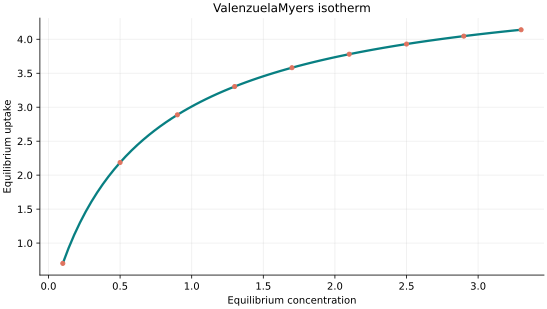
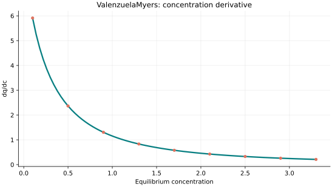
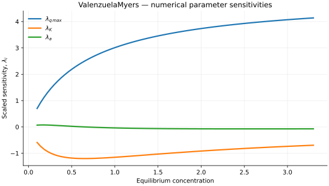

..
   ==============================================================================
   Name        : ValenzuelaMyers.rst
   Authors     : Joao Flavio Vasconcellos
   Version     : 2.0.0
   Description : Model equation, validity, code example and reproducible figures.

   Copyright   : Copyright (C) 2026 Joao Flavio Vasconcellos
   Licence     : MIT License (see LICENSE.txt)
   SPDX-License-Identifier: MIT
   ==============================================================================

Valenzuela–Myers isotherm
=========================

Original publication and scope
------------------------------

The name ``ValenzuelaMyers`` is retained as an Isotherm++ model
identifier. It must not be interpreted as the name of a separately
established adsorption equation. Valenzuela and Myers published a
widely used handbook compiling adsorption-equilibrium data and
heterogeneous-surface models, including UNILAN. The formula implemented
here is mathematically the UNILAN relation with a *reciprocal affinity*
parameter; it is not an additional independent adsorption model.

Valenzuela, D. P., and Myers, A. L. (1984), *Gas Adsorption Equilibria*,
*Separation and Purification Methods*, **13** (2), 153–183.
`DOI: 10.1080/03602548408058530 <https://doi.org/10.1080/03602548408058530>`_.
This earlier review provides context on gas-adsorption equilibrium and
separation processes; it does not establish a separate
``ValenzuelaMyers`` isotherm of the form used here.

Valenzuela, D. P., and Myers, A. L. (1989), *Adsorption Equilibrium Data
Handbook*, Prentice Hall, Englewood Cliffs, New Jersey.
`Bibliographic record <https://search.worldcat.org/title/Adsorption-equilibrium-data-handbook/oclc/1485058109>`_.
The handbook is the appropriate historical reference for UNILAN and
its use in gas-adsorption data correlation, not proof of a distinct
Valenzuela–Myers equation.

Tóth, J. (1997), *Some Consequences of the Application of Incorrect
Gas/Solid Adsorption Isotherm Equations*, *Journal of Colloid and
Interface Science*, **185** (1), 228–235.
`DOI: 10.1006/jcis.1996.4562 <https://doi.org/10.1006/jcis.1996.4562>`_.
This analysis cautions that good empirical fits of certain Tóth and
UNILAN formulations do not guarantee thermodynamic consistency.

For a three-parameter UNILAN implementation using the conventional
affinity parameter, see :doc:`Unilan`.

Mathematical formulation
------------------------

.. math::

   q_e=\frac{q_{\max}}{2a}\ln\left[\frac{K+c_e\exp(a)}{K+c_e\exp(-a)}\right]

The parameter :math:`K` in this class has the dimensions of
concentration and is *not* the affinity parameter :math:`K_{\mathrm{U}}`
stored by ``isotherm::models::Unilan``. Their conversion is

.. math::

   K_{\mathrm{U}}=\frac{1}{K_{\mathrm{VM}}},\qquad
   q_e^{\mathrm{VM}}(C_e;q_{\max},K_{\mathrm{VM}},a)
   =q_e^{\mathrm{UNILAN}}(C_e;q_{\max},1/K_{\mathrm{VM}},a).

Thus the two Isotherm++ classes describe the same family of curves
with different numerical meanings for ``K``. This is an algebraic
identity, not a new experimentally distinct isotherm. In the
homogeneous limit :math:`a\to0^+`, the expression becomes
:math:`q_{\max}C_e/(K+C_e)`. The constructor excludes :math:`a=0`.

The three adjustable parameters are ``q_max``, ``K`` and ``a``.
All must be strictly positive and finite. The model accepts finite,
non-negative equilibrium concentrations, while the derivative requires
strictly positive concentration.

An analytical concentration derivative is implemented and checked against an
independently calculated centred difference.

For numerical stability the implemented heterogeneity spread is restricted
to :math:`a\leq 50`, avoiding unsafe intermediate exponentials. This is an
explicit implementation restriction, not a physical upper bound.

The implementation requires the following admissible parameter and input domain:

.. math::

   q_{\mathrm{max}}>0,\quad K>0,\quad a>0,\quad a\leq 50,\quad C_e\geq0.

C++20 usage
-----------

.. code-block:: cpp

   #include <isotherm/isotherm.hpp>

   const isotherm::models::ValenzuelaMyers model{5, 0.65, 0.7};
   const isotherm::Real uptake = isotherm::evaluate(model, 0.8);   // 2.7486538
   const isotherm::Real slope = isotherm::derivative(model, 0.8);  // 1.4874073

.. raw:: html

   

     <a class="isotherm-source-action" href="../../../source-browser/include/isotherm/models/ThreeParameters/ValenzuelaMyers.hpp.html">Implementation</a>
     <a class="isotherm-source-action" href="../../../source-browser/IsothermTest/ThreeParameters/ValenzuelaMyers/test_valenzuela_myers.cpp.html">Tests</a>
     <a class="isotherm-source-action" href="../../../source-browser/Examples/ThreeParameters/ValenzuelaMyers/main.cpp.html">Example</a>
   

ValenzuelaMyers isotherm plot
-----------------------------

   Valenzuela–Myers uptake for :math:`q_{\max}=5`, :math:`K=0.65`, :math:`a=0.7`.

Concentration derivative
------------------------

   Concentration derivative of Valenzuela–Myers uptake for :math:`q_{\max}=5`,
   :math:`K=0.65`, :math:`a=0.7`.

Numerical sensitivity
---------------------

For each coefficient :math:`k_i`, the numerical scaled sensitivity is

.. math::

   \lambda_i(C_e)=k_i\frac{\partial q_e}{\partial k_i}.

Numerical values are obtained by perturbing individual parameters and evaluating new instances of the C++ model. The accompanying C++20 example performs this procedure.

   Scaled sensitivities :math:`\lambda_{q_{\max}}`, :math:`\lambda_{K}`, :math:`\lambda_{a}`
   versus equilibrium concentration.

Validation and limitations
--------------------------

.. math::

   q_{\mathrm{max}}>0,\quad K>0,\quad a>0,\quad a\leq 50,\quad C_e\geq0.
