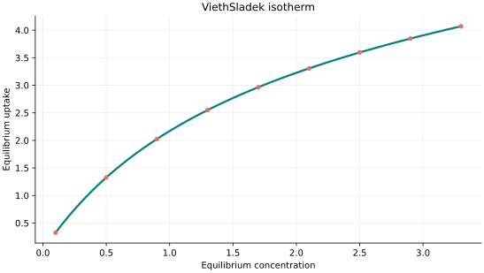
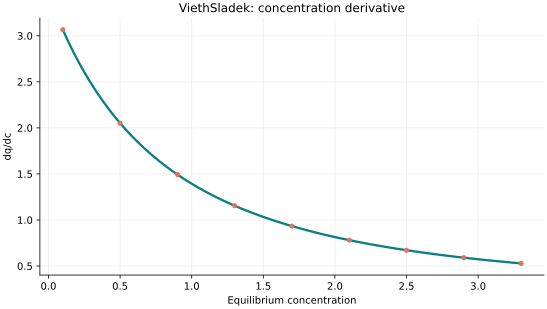
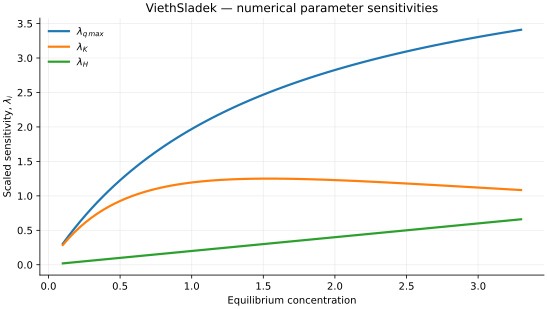

..
   ==============================================================================
   Name        : ViethSladek.rst
   Authors     : Joao Flavio Vasconcellos
   Version     : 2.0.0
   Description : Model equation, validity, code example and reproducible figures.

   Copyright   : Copyright (C) 2026 Joao Flavio Vasconcellos
   Licence     : MIT License (see LICENSE.txt)
   SPDX-License-Identifier: MIT
   ==============================================================================

Vieth–Sladek isotherm
=====================

Original publication and scope
------------------------------

Vieth and Sladek used a dual-mode equilibrium-sorption relation as
part of a model for transient gas transport through glassy polymers.
The equilibrium uptake combines a Henry-law dissolution term and a
finite-capacity Langmuir-type population associated with polymer
microvoids. The corresponding diffusion model requires additional
transport assumptions; the equilibrium equation alone does not
predict diffusion rates.

Vieth, W. R., and Sladek, K. J. (1965), *A model for diffusion in a
glassy polymer*, *Journal of Colloid Science*, **20** (9), 1014–1033.
`DOI: 10.1016/0095-8522(65)90071-1 <https://doi.org/10.1016/0095-8522(65)90071-1>`_.
The original study applies the equilibrium dual-mode description to
transient gas sorption in polymer films. The Langmuir-like fraction is
associated with immobilised molecules in polymer microvoids, while
molecules dissolved in the amorphous phase provide the mobile fraction
in the authors' transport interpretation.

Dan-Iya, B. I., Khayat, M. E., and Shukor, M. Y. (2023), *Isothermal
Modelling of the Adsorption of Crystal Violet onto Modified Charred Rice
Husk*, *Journal of Environmental Microbiology and Toxicology*, **11** (1),
1–9.
`DOI: 10.54987/jemat.v11i1.837 <https://doi.org/10.54987/jemat.v11i1.837>`_.
Vieth–Sladek was among the models used for nonlinear regression of
crystal-violet sorption data; Jovanovic gave the best fit in that
comparison.

Sha'arani, S. A. W., Yasid, N. A., Halmi, M. I. E., Othman, A. R., and
Shukor, M. Y. (2023), *Adsorption of Sodium Dodecyl Sulfate onto Activated
Coconut Shell-Based Adsorbent: Isothermal Remodelling*, *Journal of
Environmental Microbiology and Toxicology*, **11** (1), 52–61.
`DOI: 10.54987/jemat.v11i1.884 <https://doi.org/10.54987/jemat.v11i1.884>`_.
Vieth–Sladek was included in the comparison of 19 empirical models;
the best-ranked model was Moreau, rather than Vieth–Sladek.

Mathematical formulation
------------------------

.. math::

   q_e=Hc_e+\frac{q_{\max}Kc_e}{1+Kc_e}

Here :math:`H` is a Henry-law coefficient (uptake per concentration),
:math:`K` is the Langmuir affinity (inverse concentration), and
:math:`q_{\max}` is the capacity of the *saturable component only*.
The total uptake is not bounded by :math:`q_{\max}` when :math:`H>0`:

.. math::

   q_e\sim HC_e+q_{\max}\quad(C_e\to\infty).

The implemented derivative is :math:`H+q_{\max}K/(1+KC_e)^2`.
These parameters describe equilibrium sorption; diffusion coefficients
and transient transport mechanisms are not parameters of this class.

The three adjustable parameters are ``q_max``, ``K`` and ``H``.
All must be strictly positive and finite. The model accepts finite,
non-negative equilibrium concentrations, while the derivative requires
strictly positive concentration.

An analytical concentration derivative is implemented and checked against an
independently calculated centred difference.

The implementation requires the following admissible parameter and input domain:

.. math::

   q_{\mathrm{max}}>0,\quad K>0,\quad H>0,\quad C_e\geq0.

C++20 usage
-----------

.. code-block:: cpp

   #include <isotherm/isotherm.hpp>

   const isotherm::models::ViethSladek model{5, 0.65, 0.2};
   const isotherm::Real uptake = isotherm::evaluate(model, 0.8);   // 1.8705263
   const isotherm::Real slope = isotherm::derivative(model, 0.8);  // 1.6066828

.. raw:: html

   

     <a class="isotherm-source-action" href="../../../source-browser/include/isotherm/models/ThreeParameters/ViethSladek.hpp.html">Implementation</a>
     <a class="isotherm-source-action" href="../../../source-browser/IsothermTest/ThreeParameters/ViethSladek/test_vieth_sladek.cpp.html">Tests</a>
     <a class="isotherm-source-action" href="../../../source-browser/Examples/ThreeParameters/ViethSladek/main.cpp.html">Example</a>
   

Vieth–Sladek isotherm plot
--------------------------

   Vieth–Sladek uptake for :math:`q_{\max}=5`, :math:`K=0.65`, :math:`H=0.2`.

Concentration derivative
------------------------

   Concentration derivative of Vieth–Sladek uptake for :math:`q_{\max}=5`, :math:`K=0.65`,
   :math:`H=0.2`.

Numerical sensitivity
---------------------

For each coefficient :math:`k_i`, the numerical scaled sensitivity is

.. math::

   \lambda_i(C_e)=k_i\frac{\partial q_e}{\partial k_i}.

Numerical values are obtained by perturbing individual parameters and evaluating new instances of the C++ model. The accompanying C++20 example performs this procedure.

   Scaled sensitivities :math:`\lambda_{q_{\max}}`, :math:`\lambda_{K}`, :math:`\lambda_{H}`
   versus equilibrium concentration.

Validation and limitations
--------------------------

.. math::

   q_{\mathrm{max}}>0,\quad K>0,\quad H>0,\quad C_e\geq0.
