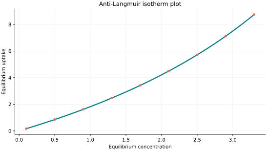
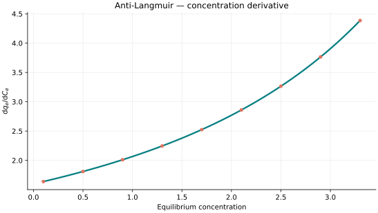
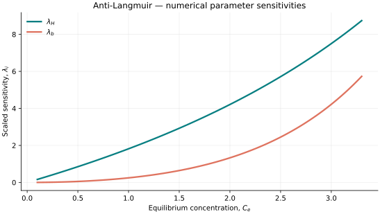

..
   ============================================================================
   Name        : AntiLangmuir.rst
   Authors     : Joao Flavio Vasconcellos
   Version     : 2.0.0
   Description : Scientific equation, numerical domain and reproducible figures.

   Copyright   : Copyright (C) 2026 Joao Flavio Vasconcellos
   Licence     : MIT License (see LICENSE)
   SPDX-License-Identifier: MIT
   ============================================================================

Anti-Langmuir isotherm
======================

Original publication and scope
------------------------------

The Anti-Langmuir isotherm is used to represent unfavourable adsorption
behaviour, with an uptake curve that is convex with respect to equilibrium
concentration. No single original publication is assigned to this model here.
For background on nonlinear single-component adsorption equilibria, see
Guiochon, Felinger, Shirazi and Katti, *Fundamentals of Preparative and
Nonlinear Chromatography*, 2nd ed., Academic Press (2006), Chapter 3.
`Publisher record <https://shop.elsevier.com/books/fundamentals-of-preparative-and-nonlinear-chromatography/guiochon/978-0-12-370537-2>`_.

Cavazzini *et al.*, *Adsorption equilibria of butyl- and amylbenzene on
monolithic silica-based columns*, *Journal of Chromatography A*, **957**
(2002), 111–126, reported experimentally measured upward-concave adsorption
isotherms fitted using the Anti-Langmuir model. DOI:
`10.1016/S0021-9673(02)00320-5 <https://doi.org/10.1016/S0021-9673(02)00320-5>`_.

For the extension to binary chromatography, see Mazzotti, *Local Equilibrium
Theory for the Binary Chromatography of Species Subject to a Generalized
Langmuir Isotherm*, *Industrial & Engineering Chemistry Research*, **45**
(2006), 5332–5350. DOI:
`10.1021/ie060297v <https://doi.org/10.1021/ie060297v>`_.
The implementation documented here is a single-component model, not the
binary generalisation.

Mathematical formulation
------------------------

.. math::

   q_e(C_e)=\frac{H C_e}{1-b C_e}.

The admissible parameter and input domain is

.. math::

   H>0,\quad b>0,\quad 0\leq C_e<\frac{1}{b}.

Here :math:`q_e` denotes equilibrium uptake and :math:`C_e` equilibrium
concentration. The coefficient :math:`H` has units of uptake divided by
concentration, while :math:`b` has units of reciprocal concentration.
The coefficient :math:`H` corresponds to :math:`a` in the alternative
notation :math:`q_e=a C_e/(1-b C_e)`.
The independent variable is concentration, not thermodynamic activity.
For this equation,

.. math::

   \frac{\mathrm{d}q_e}{\mathrm{d}C_e} =
   \frac{H}{(1-b C_e)^2}.

The admissible concentration range is :math:`0\leq C_e<1/b`.
The pole at :math:`C_e=1/b` is a mathematical limit of the model, not
physical saturation. The equation is convex for positive concentration.

C++20 usage
-----------

.. code-block:: cpp

   #include <isotherm/isotherm.hpp>

   const isotherm::models::AntiLangmuir model{1.6, 0.12};
   const isotherm::Real uptake = isotherm::evaluate(model, 0.5);   // 0.85106383
   const isotherm::Real slope = isotherm::derivative(model, 0.5);  // 1.8107741

.. raw:: html

   

     <a class="isotherm-source-action" href="../../../source-browser/include/isotherm/models/TwoParameters/AntiLangmuir.hpp.html">Implementation</a>
     <a class="isotherm-source-action" href="../../../source-browser/IsothermTest/TwoParameters/AntiLangmuir/test_anti_langmuir.cpp.html">Tests</a>
     <a class="isotherm-source-action" href="../../../source-browser/Examples/TwoParameters/AntiLangmuir/main.cpp.html">Example</a>
   

The source browser shows the C++ files with links to their original source.

Anti-Langmuir isotherm plot
---------------------------

   Anti-Langmuir uptake for :math:`H=1.6`, :math:`b=0.12`.

Concentration derivative
------------------------

   Concentration derivative of Anti-Langmuir uptake for :math:`H=1.6`, :math:`b=0.12`.

Numerical sensitivity
---------------------

For each fitted coefficient :math:`k_i`, define the scaled sensitivity

.. math::

   \lambda_i(C_e) = k_i\frac{\partial q_e}{\partial k_i}.

Numerical values are obtained by perturbing individual parameters and evaluating new instances of the C++ model. The accompanying C++20 example performs this procedure.

   Scaled sensitivities :math:`\lambda_{H}`, :math:`\lambda_{b}` versus equilibrium
   concentration.

Validation and limitations
--------------------------

.. math::

   H>0,\quad b>0,\quad 0\leq C_e<\frac{1}{b}.

.. raw:: html

   
