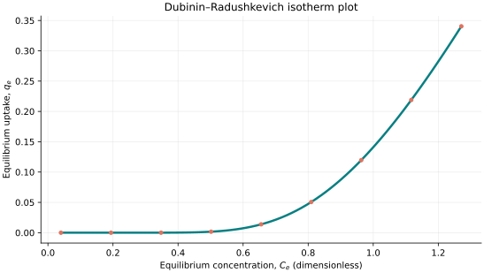
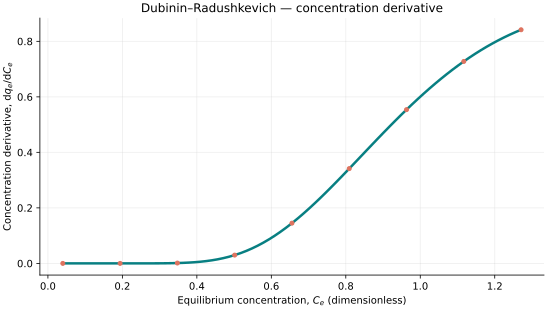
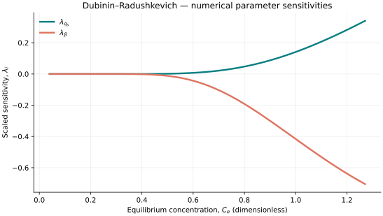

..
   ==============================================================================
   Name        : DubininRadushkevich.rst
   Authors     : Joao Flavio Vasconcellos
   Version     : 2.0.0
   Description : Dubinin–Radushkevich scientific formulation and C++20 usage.

   Copyright   : Copyright (C) 2026 Joao Flavio Vasconcellos
   Licence     : MIT License (see LICENSE.txt)
   SPDX-License-Identifier: MIT
   ==============================================================================

Dubinin–Radushkevich isotherm
=============================

Original publication and scope
------------------------------

Dubinin and Radushkevich, *Equation of the Characteristic Curve of Activated
Charcoal*, *Proceedings of the Academy of Sciences of the USSR*, **55**
(1947), 331–333. The bibliographic details are reproduced in a later
`review of cooperative sorption <https://pmc.ncbi.nlm.nih.gov/articles/PMC8413001/>`_.

For a subsequent theoretical treatment, see Dubinin, *The Potential Theory
of Adsorption of Gases and Vapors for Adsorbents with Energetically Nonuniform
Surfaces*, *Chemical Reviews*, **60** (1960), 235–241.
DOI: `10.1021/cr60204a006 <https://doi.org/10.1021/cr60204a006>`_.

The model describes adsorption in the adsorption-potential (pore-filling)
framework. This implementation follows a frequently used liquid-phase
concentration-based representation, rather than claiming to reproduce
all thermodynamic activity or vapour-pressure conventions of the original work.

Mathematical formulation
------------------------

.. math::

   q_e(C_e,T) = q_s\exp(-\beta\varepsilon^2),
   \qquad \varepsilon=RT\ln\!\left(1+\frac{1}{C_e}\right).

The admissible parameter and input domain is

.. math::

   q_s>0,\quad \beta>0,\quad C_e\geq0,\quad T>0\ \mathrm{K},\quad C_e\ \text{dimensionless}.

Here :math:`q_s` is a capacity parameter and :math:`\beta` is an inverse
energy-squared coefficient. The independent temperature :math:`T` **must always be in kelvin (K)**.
By default :math:`R=8.31446261815324` J mol⁻¹ K⁻¹, and
:math:`\varepsilon` is the Polanyi potential in J mol⁻¹.
Consequently, :math:`\beta` must be expressed in mol² J⁻² when these units
are used for :math:`R`. **The quantity supplied as** :math:`C_e` **must be
dimensionless** (for example, a physical concentration divided by a stated
reference concentration). Taking the logarithm of a dimensional concentration
is not mathematically valid.

For positive concentration, the analytical concentration derivative exposed
by the model is

.. math::

   \frac{\partial q_e}{\partial C_e}
   =\frac{2\beta RT\varepsilon}{C_e(1+C_e)}q_e.

At :math:`C_e=0`, the implementation uses the limits
:math:`q_e=0` and :math:`\partial q_e/\partial C_e=0`.
The algebraic linearisation of this equation is
:math:`\ln q_e=\ln q_s-\beta\varepsilon^2`, for :math:`q_e>0`.

C++20 usage
-----------

.. code-block:: cpp

   #include <isotherm/isotherm.hpp>

   const isotherm::models::DubininRadushkevich model{2.7, 0.000001};
   const isotherm::Real temperature = 298.15;
   const isotherm::Real uptake = isotherm::evaluate(model, 1.0, temperature);   // 0.1409653
   const isotherm::Real slope = isotherm::derivative(model, 1.0, temperature);  // 0.60044838

   // Equivalent energy units: beta must be converted together with R.
   const isotherm::models::DubininRadushkevich model_kj{
       2.7, 1.0, isotherm::gas_constant_unit::kilojoule_per_mole_kelvin};
   const isotherm::Real same_uptake =
       isotherm::evaluate(model_kj, 1.0, temperature);                          // 0.1409653

.. raw:: html

   

     <a class="isotherm-source-action" href="../../../source-browser/include/isotherm/models/TwoParameters/DubininRadushkevich.hpp.html">Implementation</a>
     <a class="isotherm-source-action" href="../../../source-browser/IsothermTest/TwoParameters/DubininRadushkevich/test_dubinin_radushkevich.cpp.html">Tests</a>
     <a class="isotherm-source-action" href="../../../source-browser/Examples/TwoParameters/DubininRadushkevich/main.cpp.html">Example</a>
   

The source browser shows the C++ files with links to their original source.

Dubinin–Radushkevich isotherm plot
----------------------------------

   Dubinin–Radushkevich uptake for :math:`q_s=2.7`, :math:`\beta=0.000001` at
   :math:`T=298.15\,\mathrm{K}`.

Concentration derivative
------------------------

   Concentration derivative of Dubinin–Radushkevich uptake for :math:`q_s=2.7`,
   :math:`\beta=0.000001` at :math:`T=298.15\,\mathrm{K}`.

Numerical sensitivity
---------------------

For each coefficient :math:`k_i`, the scaled sensitivity is defined by

.. math::

   \lambda_i(C_e)=k_i\frac{\partial q_e}{\partial k_i}.

Numerical values are obtained by perturbing individual parameters and evaluating new instances of the C++ model. The accompanying C++20 example performs this procedure.

   Scaled sensitivities :math:`\lambda_{q_s}`, :math:`\lambda_{\beta}` versus equilibrium
   concentration at :math:`T=298.15\,\mathrm{K}`.

Validation and limitations
--------------------------

.. math::

   q_s>0,\quad \beta>0,\quad C_e\geq0,\quad T>0\ \mathrm{K},\quad C_e\ \text{dimensionless}.

.. raw:: html

   
