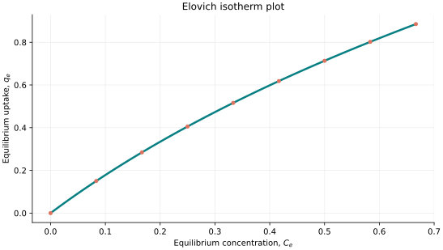
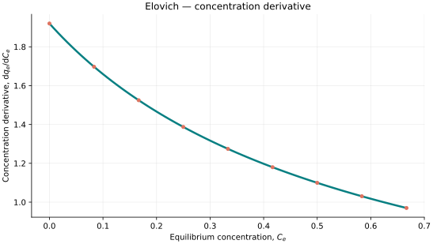
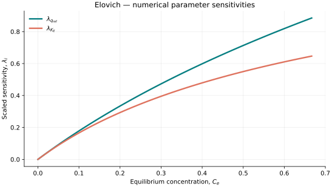

..
   ==============================================================================
   Name        : Elovich.rst
   Authors     : Joao Flavio Vasconcellos
   Version     : 2.0.0
   Description : Elovich scientific model, numerical sensitivities and C++20 usage.

   Copyright   : Copyright (C) 2026 Joao Flavio Vasconcellos
   Licence     : MIT License (see LICENSE)
   SPDX-License-Identifier: MIT
   ==============================================================================

Elovich isotherm
================

Original publication and scope
------------------------------

Elovich, S. Yu., and Larionov, O. G. (1962), *Theory of adsorption from
nonelectrolyte solutions on solid adsorbents, II. Experimental verification
of the equation for the adsorption isotherm from solutions*, *Bulletin
of the Academy of Sciences of the USSR, Division of Chemical Science*,
**11** (2), 198–203. DOI:
`10.1007/BF00908017 <https://doi.org/10.1007/BF00908017>`_.

Dusart, O., Bouabane, H., and Mazet, M. (1991), *Adsorption sur charbon actif
d'acides aminés dans l'eau : détermination de paramètres d'équilibre par
différentes équations*, *Journal de Chimie Physique*, **88**, 259–270.
DOI: `10.1051/jcp/1991880259 <https://doi.org/10.1051/jcp/1991880259>`_.
The 1991 study is identified in later literature as an early source for
an equation equivalent to the form commonly used in adsorption fitting.

For a detailed historical and mathematical assessment, see Debord, J.,
Harel, M., Bollinger, J.-C., and Chu, K. H. (2022), *The Elovich isotherm
equation: Back to the roots and new developments*, *Chemical Engineering
Science*, **262**, 118012.
DOI: `10.1016/j.ces.2022.118012 <https://doi.org/10.1016/j.ces.2022.118012>`_.

Mathematical formulation
------------------------

The single-component equilibrium relationship is implicit:

.. math::

   \theta\exp(\theta)=K_E C_e,\qquad q_e=q_{\mathrm{ref}}\theta.

The admissible parameter and variable domain is

.. math::

   q_{\mathrm{ref}}>0,\qquad K_E>0,\qquad
   0\leq C_e\leq\frac{\exp(1)}{K_E},\qquad 0\leq\theta\leq1.

The implementation solves for the non-negative coverage fraction
:math:`\theta` on the restricted interval :math:`0\leq\theta\leq1`,
using a bracketed numerical algorithm. The capacity scale
:math:`q_{\mathrm{ref}}` is an uptake parameter and :math:`K_E` has units
of inverse concentration. The concentration derivative evaluated by the
C++ implementation for :math:`C_e>0` is

.. math::

   \frac{\mathrm{d}q_e}{\mathrm{d}C_e} =
   \frac{q_e}{C_e(1+\theta)}.

At :math:`C_e=0`, its limiting slope is
:math:`\mathrm{d}q_e/\mathrm{d}C_e=q_{\mathrm{ref}}K_E`.

C++20 usage
-----------

.. code-block:: cpp

   #include <isotherm/isotherm.hpp>

   const isotherm::models::Elovich model{2.4, 0.8};
   const isotherm::Real uptake = isotherm::evaluate(model, 1.0);   // 1.1761629
   const isotherm::Real slope = isotherm::derivative(model, 1.0);  // 0.7893351

.. raw:: html

   

     <a class="isotherm-source-action" href="../../../source-browser/include/isotherm/models/TwoParameters/Elovich.hpp.html">Implementation</a>
     <a class="isotherm-source-action" href="../../../source-browser/IsothermTest/TwoParameters/Elovich/test_elovich.cpp.html">Tests</a>
     <a class="isotherm-source-action" href="../../../source-browser/Examples/TwoParameters/Elovich/main.cpp.html">Example</a>
   

Elovich isotherm plot
---------------------

   Elovich uptake for :math:`q_{\mathrm{ref}}=2.4`, :math:`K_E=0.8`.

Concentration derivative
------------------------

   Concentration derivative of Elovich uptake for :math:`q_{\mathrm{ref}}=2.4`,
   :math:`K_E=0.8`.

Numerical sensitivity
---------------------

For each coefficient :math:`k_i`, define the scaled parameter sensitivity

.. math::

   \lambda_i(C_e)=k_i\frac{\partial q_e}{\partial k_i}.

Numerical values are obtained by perturbing individual parameters and evaluating new instances of the C++ model. The accompanying C++20 example performs this procedure.

   Scaled sensitivities :math:`\lambda_{q_{\mathrm{ref}}}`, :math:`\lambda_{K_E}` versus
   equilibrium concentration.

Validation and limitations
--------------------------

.. math::

   q_{\mathrm{ref}}>0,\quad K_E>0,\quad 0\leq C_e\leq\frac{\exp(1)}{K_E},\quad 0\leq\theta\leq1.
