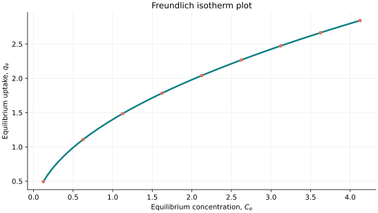
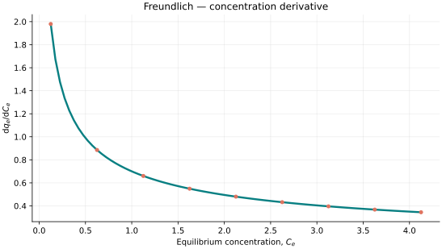
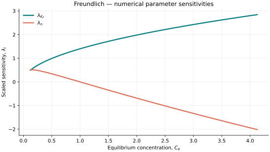

..
   ==============================================================================
   Name        : Freundlich.rst
   Authors     : Joao Flavio Vasconcellos
   Version     : 2.0.0
   Description : Freundlich scientific documentation and numerical parameter sensitivities.

   Copyright   : Copyright (C) 2026 Joao Flavio Vasconcellos
   Licence     : MIT License (see LICENSE.txt)
   SPDX-License-Identifier: MIT
   ==============================================================================

Freundlich isotherm
===================

Original publication and scope
------------------------------

Freundlich, H. (1907), *Über die Adsorption in Lösungen*, *Zeitschrift für Physikalische Chemie*, **57U** (1), 385–470. DOI: `10.1515/zpch-1907-5723 <https://doi.org/10.1515/zpch-1907-5723>`_. The publisher dates the journal article to 1907; a separate 1906 habilitation edition was published by Wilhelm Engelmann.

The Freundlich isotherm is an empirical power-law model used to describe adsorption on heterogeneous surfaces. It does not predict a finite saturation capacity. See also the `adsorption-isotherm review (2025) <https://doi.org/10.1007/s13201-025-02682-0>`_.

Mathematical formulation
------------------------

.. math::

   q_e=K_F C_e^{1/n}.

The admissible parameter and input domain is

.. math::

   K_F>0,\quad n>0,\quad C_e\geq0.

.. math::

   \left.\frac{\mathrm{d}q_e}{\mathrm{d}C_e}\right|_{C_e=0}\text{ is finite only when }0<n\leq1.

Here :math:`C_e` denotes equilibrium concentration.

The adjustable parameters are :math:`K_F`, :math:`n`.

C++20 usage
-----------

.. code-block:: cpp

   #include <isotherm/isotherm.hpp>

   const isotherm::models::Freundlich model{1.4, 2.0};
   const isotherm::Real uptake = isotherm::evaluate(model, 0.5);   // 0.98994949
   const isotherm::Real slope = isotherm::derivative(model, 0.5);  // 0.98994949

.. raw:: html

   

     <a class="isotherm-source-action" href="../../../source-browser/src/isotherm/models/TwoParameters/Freundlich.hpp.html">Implementation</a>
     <a class="isotherm-source-action" href="../../../source-browser/IsothermTest/TwoParameters/Freundlich/test_freundlich.cpp.html">Tests</a>
     <a class="isotherm-source-action" href="../../../source-browser/Examples/TwoParameters/Freundlich/main.cpp.html">Example</a>
   

Freundlich isotherm plot
------------------------

   Equilibrium uptake evaluated through the C++ model interface.

Concentration derivative
------------------------

   Derivative evaluated through the C++ model interface.

Numerical sensitivity
---------------------

For each parameter :math:`k_i`, the scaled parameter sensitivity is

.. math::

   \lambda_i(x)=k_i\frac{\partial q_e(x)}{\partial k_i}.

Numerical values are obtained by perturbing individual parameters and evaluating new instances of the C++ model. The accompanying C++20 example performs this procedure.

   Numerical scaled sensitivities versus equilibrium concentration.

Validation and limitations
--------------------------

.. math::

   K_F>0,\quad n>0,\quad C_e\geq0.

.. math::

   \left.\frac{\mathrm{d}q_e}{\mathrm{d}C_e}\right|_{C_e=0}\text{ is finite only when }0<n\leq1.
