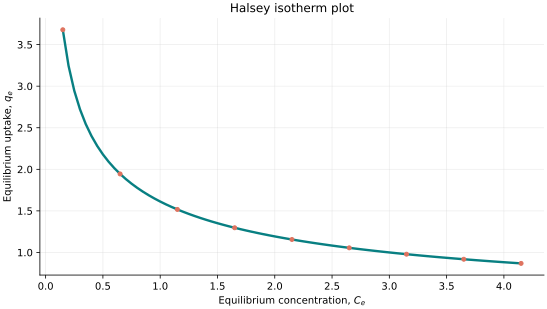
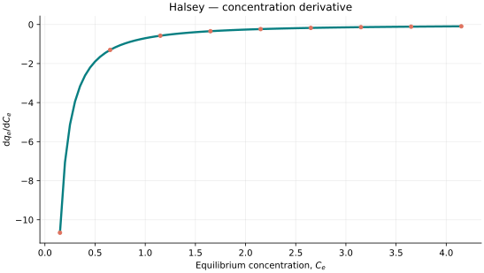
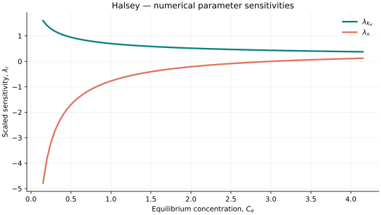

..
   ==============================================================================
   Name        : Halsey.rst
   Authors     : Joao Flavio Vasconcellos
   Version     : 2.0.0
   Description : Halsey scientific documentation and numerical parameter sensitivities.

   Copyright   : Copyright (C) 2026 Joao Flavio Vasconcellos
   Licence     : MIT License (see LICENSE.txt)
   SPDX-License-Identifier: MIT
   ==============================================================================

Halsey isotherm
===============

Original publication and scope
------------------------------

Halsey, G., and Taylor, H. S. (1947), *The Adsorption of Hydrogen on
Tungsten Powders*, *The Journal of Chemical Physics*, **15** (9), 624–630.
DOI: `10.1063/1.1746618 <https://doi.org/10.1063/1.1746618>`_.
This experimental study preceded Halsey's treatment of adsorption on
non-uniform surfaces.

Halsey, G. (1948), *Physical Adsorption on Non-Uniform Surfaces*,
*The Journal of Chemical Physics*, **16** (10), 931–937.
DOI: `10.1063/1.1746689 <https://doi.org/10.1063/1.1746689>`_.
The original multilayer relation is expressed through relative gas pressure
:math:`p/p_0` and surface coverage :math:`\theta`, in the form
:math:`\ln(p/p_0)=-a/\theta^r`. It is not a reciprocal-concentration law.

The related historical framework includes Frenkel, J., *Kinetic Theory of
Liquids* (Clarendon Press, 1946), and Hill, T. L. (1952), *Theory of Physical
Adsorption*, *Advances in Catalysis*, **4**, 211–258.
DOI: `10.1016/S0360-0564(08)60615-X <https://doi.org/10.1016/S0360-0564(08)60615-X>`_.
These works are commonly cited in connection with the
Frenkel–Halsey–Hill (FHH) treatment of multilayer adsorption.

Chu, K. H., Bashiri, H., Hashim, M. A., Abd Shukor, M. Y., and Bollinger,
J.-C. (2023), *The Halsey isotherm for water contaminant adsorption is fake*,
*Separation and Purification Technology*, **313**, 123500.
DOI: `10.1016/j.seppur.2023.123500 <https://doi.org/10.1016/j.seppur.2023.123500>`_.
The authors distinguish the original gas-adsorption isotherm from a
frequently used liquid-phase power-law form, which they show to be
mathematically equivalent to a reparameterised Freundlich relation.
Their terminology refers to that specific liquid-phase formulation;
it should not be treated as a replacement for comparing actual equations.

The C++ class documented here evaluates :math:`q_e=(K_H/C_e)^{1/n}`.
For positive :math:`K_H` and :math:`n`, this function decreases with
increasing :math:`C_e`, diverges as :math:`C_e\to0^+`, and tends to zero as
:math:`C_e\to\infty`. Its mathematical behaviour is therefore distinct from
the original Halsey multilayer relation, and the 1948 publication does not
establish the physical validity of this particular expression.

The implementation describes its concentration argument as dimensionless.
A reference concentration for converting a dimensional :math:`C_e` to this
input has not been established here. Its physical interpretation therefore
requires an explicit normalisation convention.

Mathematical formulation
------------------------

.. math::

   q_e=\left(\frac{K_H}{C_e}\right)^{1/n}.

The admissible parameter and input domain is

.. math::

   K_H>0,\quad n>0,\quad C_e>0.

Here :math:`C_e` is required by the C++ class to be positive and
dimensionless. No reference concentration has been specified for a
normalisation :math:`c^*=C_e/C_{\mathrm{ref}}`; hence physical
concentration data cannot be converted into model inputs without an
additional, explicit definition of :math:`C_{\mathrm{ref}}`.

The adjustable parameters are :math:`K_H`, :math:`n`.

C++20 usage
-----------

.. code-block:: cpp

   #include <isotherm/isotherm.hpp>

   const isotherm::models::Halsey model{3.0, 2.3};
   const isotherm::Real uptake = isotherm::evaluate(model, 0.5);   // 2.1793482
   const isotherm::Real slope = isotherm::derivative(model, 0.5);  // -1.8950854

.. raw:: html

   

     <a class="isotherm-source-action" href="../../../source-browser/src/isotherm/models/TwoParameters/Halsey.hpp.html">Implementation</a>
     <a class="isotherm-source-action" href="../../../source-browser/IsothermTest/TwoParameters/Halsey/test_halsey.cpp.html">Tests</a>
     <a class="isotherm-source-action" href="../../../source-browser/Examples/TwoParameters/Halsey/main.cpp.html">Example</a>
   

Halsey isotherm plot
--------------------

   Halsey uptake for :math:`K_H=3.0`, :math:`n=2.3`.

Concentration derivative
------------------------

   Concentration derivative of Halsey uptake for :math:`K_H=3.0`, :math:`n=2.3`.

Numerical sensitivity
---------------------

For each parameter :math:`k_i`, the scaled parameter sensitivity is

.. math::

   \lambda_i(x)=k_i\frac{\partial q_e(x)}{\partial k_i}.

Numerical values are obtained by perturbing individual parameters and evaluating new instances of the C++ model. The accompanying C++20 example performs this procedure.

   Scaled sensitivities :math:`\lambda_{K_H}`, :math:`\lambda_{n}` versus equilibrium
   concentration.

Validation and limitations
--------------------------

.. math::

   K_H>0,\quad n>0,\quad C_e>0.
