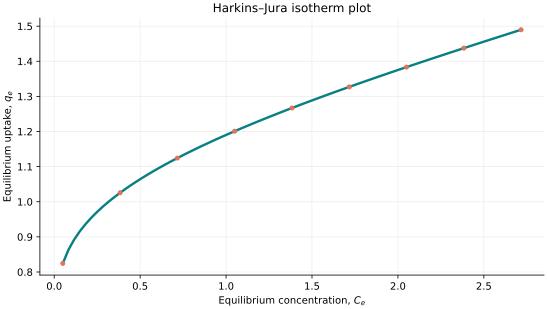
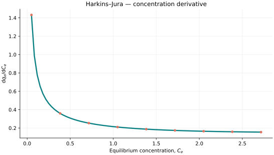
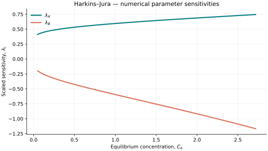

..
   ==============================================================================
   Name        : HarkinJura.rst
   Authors     : Joao Flavio Vasconcellos
   Version     : 2.0.0
   Description : HarkinJura scientific documentation and numerical parameter sensitivities.

   Copyright   : Copyright (C) 2026 Joao Flavio Vasconcellos
   Licence     : MIT License (see LICENSE.txt)
   SPDX-License-Identifier: MIT
   ==============================================================================

Harkins–Jura isotherm
=====================

Original publication and scope
------------------------------

Jura and Harkins (1943) introduced an adsorption isotherm for gas–solid
systems over a wide range of pressures. Subsequent work by Harkins and
Jura (1944) developed the connection between adsorbed films, changes
in surface free energy and the determination of solid surface area.
These publications establish the historical basis of the Harkins–Jura
isotherm.

The present model uses a two-parameter, base-10 logarithmic relation
expressed in terms of equilibrium concentration. This concentration-based
form should not be assumed to be identical to the original gas-pressure
formulation. Chu and Hashim (2023) critically examined the use of the
Harkins–Jura equation for aqueous-phase contaminant adsorption, including
the limitations of linearised fits. The C++ identifier for this model is
``HarkinJura``.

**Primary and related references**

* Jura, G., and Harkins, W. D. (1943). *A New Adsorption Isotherm Which Is
  Valid Over a Very Wide Range of Pressure*. *The Journal of Chemical
  Physics*, **11** (9), 430–431.
  DOI: `10.1063/1.1723870 <https://doi.org/10.1063/1.1723870>`_.

* Harkins, W. D., and Jura, G. (1944). *The Decrease (π) of Free Surface
  Energy (γ) as a Basis for the Development of Equations for Adsorption
  Isotherms; and the Existence of Two Condensed Phases in Films on Solids*.
  *The Journal of Chemical Physics*, **12** (3), 112–113.
  DOI: `10.1063/1.1723913 <https://doi.org/10.1063/1.1723913>`_.

* Harkins, W. D., and Jura, G. (1944). *Surfaces of Solids. XIII. A
  Vapor Adsorption Method for the Determination of the Area of a Solid
  without the Assumption of a Molecular Area, and the Areas Occupied by
  Nitrogen and Other Molecules on the Surface of a Solid*. *Journal of
  the American Chemical Society*, **66** (8), 1366–1373.
  DOI: `10.1021/ja01236a048 <https://doi.org/10.1021/ja01236a048>`_.

* Chu, K. H., and Hashim, M. A. (2023). *Modeling of aqueous phase
  adsorption: Is it time to bid adieu to the Harkins–Jura isotherm?*
  *Journal of Molecular Liquids*, **371**, 121122.
  DOI: `10.1016/j.molliq.2022.121122 <https://doi.org/10.1016/j.molliq.2022.121122>`_.

Mathematical formulation
------------------------

.. math::

   \frac{1}{q_e^2}=\frac{B-\log_{10}(C_e)}{A}.

The admissible parameter and input domain is

.. math::

   A>0,\quad B>0,\quad 0\leq C_e<10^B.

.. math::

   \text{The concentration derivative requires }C_e>0.

Here :math:`C_e` denotes equilibrium concentration.

The adjustable parameters are :math:`A`, :math:`B`.

C++20 usage
-----------

.. code-block:: cpp

   #include <isotherm/isotherm.hpp>

   const isotherm::models::HarkinJura model{1.7, 1.2};
   const isotherm::Real uptake = isotherm::evaluate(model, 0.5);   // 1.064216
   const isotherm::Real slope = isotherm::derivative(model, 0.5);  // 0.30791065

.. raw:: html

   

     <a class="isotherm-source-action" href="../../../source-browser/include/isotherm/models/TwoParameters/HarkinJura.hpp.html">Implementation</a>
     <a class="isotherm-source-action" href="../../../source-browser/IsothermTest/TwoParameters/HarkinJura/test_harkin_jura.cpp.html">Tests</a>
     <a class="isotherm-source-action" href="../../../source-browser/Examples/TwoParameters/HarkinJura/main.cpp.html">Example</a>
   

Harkins–Jura isotherm plot
--------------------------

   Harkins–Jura uptake for :math:`A=1.7`, :math:`B=1.2`.

Concentration derivative
------------------------

   Concentration derivative of Harkins–Jura uptake for :math:`A=1.7`, :math:`B=1.2`.

Numerical sensitivity
---------------------

For each parameter :math:`k_i`, the scaled parameter sensitivity is

.. math::

   \lambda_i(x)=k_i\frac{\partial q_e(x)}{\partial k_i}.

Numerical values are obtained by perturbing individual parameters and evaluating new instances of the C++ model. The accompanying C++20 example performs this procedure.

   Scaled sensitivities :math:`\lambda_{A}`, :math:`\lambda_{B}` versus equilibrium
   concentration.

Validation and limitations
--------------------------

.. math::

   A>0,\quad B>0,\quad 0\leq C_e<10^B.

.. math::

   \text{The concentration derivative requires }C_e>0.
