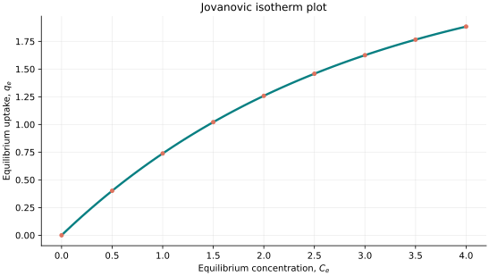
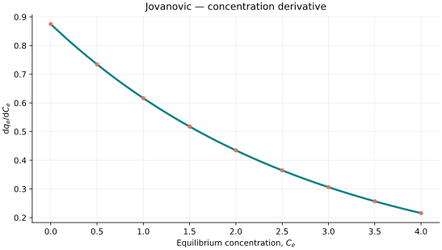
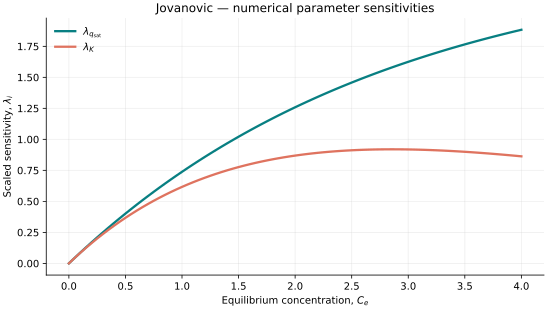

..
   ==============================================================================
   Name        : Jovanovic.rst
   Authors     : Joao Flavio Vasconcellos
   Version     : 2.0.0
   Description : Jovanovic scientific documentation and numerical parameter sensitivities.

   Copyright   : Copyright (C) 2026 Joao Flavio Vasconcellos
   Licence     : MIT License (see LICENSE)
   SPDX-License-Identifier: MIT
   ==============================================================================

Jovanovic isotherm
==================

Original publication and scope
------------------------------

Jovanović (1969) derived monolayer and multilayer isotherms for the
physical adsorption of gases. The monolayer model approaches a finite
saturation capacity through an exponential dependence on the gas-phase
pressure variable. The concentration-based expression used here adopts the
same saturating functional form, with :math:`C_e` as its independent variable.
Its application to adsorption from solutions is a model adaptation, rather
than a direct reproduction of the gas-phase experimental conditions.
Chu et al. (2023) distinguish this rising, saturating form from incorrect
exponential parametrisations found in the aqueous-adsorption literature.

The primary sources and subsequent developments are:

* Jovanović, D. S. (1969). *Physical adsorption of gases. I: Isotherms for
  monolayer and multilayer adsorption*. *Kolloid-Zeitschrift und Zeitschrift
  für Polymere*, **235**, 1203–1213.
  `DOI: 10.1007/BF01542530 <https://doi.org/10.1007/BF01542530>`_.

* Jovanović, D. S. (1969). *Physical adsorption of gases. II: Practical
  application of derived isotherms for monolayer and multilayer adsorption*.
  *Kolloid-Zeitschrift und Zeitschrift für Polymere*, **235**, 1214–1225.
  `DOI: 10.1007/BF01542531 <https://doi.org/10.1007/BF01542531>`_.

* Misra, D. N. (1973). *Jovanovich adsorption isotherm for heterogeneous
  surfaces*. *Journal of Colloid and Interface Science*, **43**, 85–88.
  `DOI: 10.1016/0021-9797(73)90350-0
  <https://doi.org/10.1016/0021-9797(73)90350-0>`_.

* Quiñones, I., and Guiochon, G. (1996). *Derivation and application of a
  Jovanovic–Freundlich isotherm model for single-component adsorption on
  heterogeneous surfaces*. *Journal of Colloid and Interface Science*,
  **183**, 57–67.
  `DOI: 10.1006/jcis.1996.0518 <https://doi.org/10.1006/jcis.1996.0518>`_.

* Chu, K. H., Hashim, M. A., Debord, J., Harel, M., Salvestrini, S., and
  Bollinger, J.-C. (2023). *The Jovanović adsorption isotherm in water
  contaminant research: Unmasking spurious versions and spotlighting the real
  thing*. *Chemical Engineering Science*, **281**, 119127.
  `DOI: 10.1016/j.ces.2023.119127
  <https://doi.org/10.1016/j.ces.2023.119127>`_.

Mathematical formulation
------------------------

.. math::

   q_e=q_{\mathrm{sat}}\left[1-\exp(-K C_e)\right].

The admissible parameter and input domain is

.. math::

   q_{\mathrm{sat}}>0,\quad K>0,\quad C_e\geq0.

Here :math:`C_e` denotes equilibrium concentration. The capacity
:math:`q_{\mathrm{sat}}` has the same units as :math:`q_e`, while
:math:`K` has the reciprocal units of :math:`C_e`. The model satisfies
:math:`q_e(0)=0` and approaches :math:`q_{\mathrm{sat}}` as
:math:`C_e\to\infty`.

The adjustable parameters are :math:`q_{\mathrm{sat}}` and :math:`K`.

C++20 usage
-----------

.. code-block:: cpp

   #include <isotherm/isotherm.hpp>

   const isotherm::models::Jovanovic model{2.5, 0.35};
   const isotherm::Real uptake = isotherm::evaluate(model, 0.5);   // 0.40135745
   const isotherm::Real slope = isotherm::derivative(model, 0.5);  // 0.73452489

.. raw:: html

   

     <a class="isotherm-source-action" href="../../../source-browser/include/isotherm/models/TwoParameters/Jovanovic.hpp.html">Implementation</a>
     <a class="isotherm-source-action" href="../../../source-browser/IsothermTest/TwoParameters/Jovanovic/test_jovanovic.cpp.html">Tests</a>
     <a class="isotherm-source-action" href="../../../source-browser/Examples/TwoParameters/Jovanovic/main.cpp.html">Example</a>
   

Jovanovic isotherm plot
-----------------------

   Jovanovic uptake for :math:`q_{\mathrm{sat}}=2.5`, :math:`K=0.35`.

Concentration derivative
------------------------

   Concentration derivative of Jovanovic uptake for :math:`q_{\mathrm{sat}}=2.5`,
   :math:`K=0.35`.

Numerical sensitivity
---------------------

For each parameter :math:`k_i`, the scaled parameter sensitivity is

.. math::

   \lambda_i(x)=k_i\frac{\partial q_e(x)}{\partial k_i}.

Numerical values are obtained by perturbing individual parameters and evaluating new instances of the C++ model. The accompanying C++20 example performs this procedure.

   Scaled sensitivities :math:`\lambda_{q_{\mathrm{sat}}}`, :math:`\lambda_{K}` versus
   equilibrium concentration.

Validation and limitations
--------------------------

.. math::

   q_{\mathrm{sat}}>0,\quad K>0,\quad C_e\geq0.
